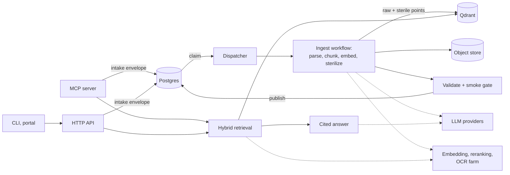

# vo-rag

[](https://github.com/Buckeyes22/vo-rag/actions/workflows/ci.yml)

**Ingests a library of books and long documents into a crash-safe, rights-aware hybrid index, then answers questions with cited, injection-defended synthesis.**



## Headline features

**Crash-safe ingestion with opt-in atomic publication.** A dispatcher process claims verified intake envelopes from Postgres with one `FOR UPDATE SKIP LOCKED` statement, heartbeats from its own thread every 60 s, and reclaims work stuck in `processing` for 15 minutes; deterministic IDs make a retry overwrite rather than duplicate. Every book runs register, parse, chunk and embed, optional sterilize, register-artifact, an eight-check validator and, when an LLM endpoint is configured, a self-retrieval smoke gate (without one it records `skipped`); both record their findings as warnings. Set `VORAG_INGEST_GENERATIONS=1` for generation mode: points stay invisible until one atomic switch makes them `active`, under a 15-minute lease, and a database constraint refuses to publish a book that failed validation or the smoke gate, leaving the previous version live. A per-source publication revision pointer, also opt-in, keeps readers on one consistent version. See [ingestion](docs/ingestion.md) and [reliability](docs/reliability.md).

**Rights-aware retrieval with three query modes.** When a run enables sterilization (`sterilize_enabled`, off by default and set in code with `BookRagConfig(sterilize_enabled=True)`; there is no environment variable or CLI flag), an LLM rewrites each passage into facts, equations and concepts and writes it to a second collection, `vo_rag_books_sterile_v1`, next to the raw one. The `internal` mode searches raw text. The `publication` and `partner` modes search only the sterile collection and filter to the `cleared` and `public_domain` license classes. `POST /api/v1/answer` fails closed: in `publication` and `partner` mode it returns 403 `answer_compliance_gate_not_configured` until you supply a compliance gate, and once you do it calls the gate on every request with the mode, the retrieved hits and the caller: a deny, an error or an invalid gate returns 403 (`answer_compliance_gate_denied`, `answer_compliance_gate_error`, `answer_compliance_gate_invalid`). See [rights and compliance](docs/rights-and-compliance.md) and [retrieval and answers](docs/retrieval-and-answers.md).

**A parsing and chunking engine built for real books.** A CPU-only preflight routes or rejects every file before ingest. The parser router detects the format and sends PDFs, EPUB, MOBI, Office and HTML documents to the right parser, with an OCR cache for scanned books. A corruption gate rejects garbled text, a page quality gate quarantines pages that have figures or tables but no extractable text, and a per-chunk OCR filter drops unreadable noise. A hierarchical chunker builds chunks that each carry their heading path, and filters remove contents pages and boilerplate. About 16% of the product code lives in these two packages, because this is where retrieval quality for long documents is won or lost. See [parsing and chunking](docs/parsing-and-chunking.md) and [OCR](docs/ocr.md).

## Example: publication mode fails closed

An answer request in `publication` mode on a deployment with no compliance gate configured, and its response:

```sh
curl -sS -X POST http://127.0.0.1:8000/api/v1/answer \
  -H "Content-Type: application/json" -H "X-API-Key: $VORAG_API_KEY" \
  -d '{"query": "How are passages stored?", "mode": "publication"}'
```

```json
{"detail": "answer_compliance_gate_not_configured"}
```

The same request in `internal` mode, with `"context_scope": "raw"` and the `local` answer profile, retrieves from the raw collection and sends it to a model you run yourself:

```sh
curl -sS -X POST http://127.0.0.1:8000/api/v1/answer \
  -H "Content-Type: application/json" -H "X-API-Key: $VORAG_API_KEY" \
  -d '{"query": "How are passages stored?", "mode": "internal", "context_scope": "raw", "profile": "local"}'
```

It needs `ANSWER_ALLOW_LOCAL=true` and an OpenAI-compatible llama.cpp server at `ANSWER_LOCAL_BASE_URL` (default `http://127.0.0.1:8080`) serving the model named in `ANSWER_LOCAL_MODEL`. Both have defaults in `config/settings.yaml`, and the request returns `answer`, `citations`, `sources` and `retrieval_results` (see [the API reference](docs/api.md)). Answers read the sterile collection by default (`context_scope` is `sterile` unless you set `raw`), and that collection stays empty until a run enables sterilization. The default `quality` profile calls a hosted provider and returns 503 `answer_generation_not_configured` until `answer.allow_hosted` is on; sending raw context to a hosted provider additionally needs `answer.allow_raw_hosted_egress`, or the request gets 403 `raw_context_hosted_egress_forbidden`. See [retrieval and answers](docs/retrieval-and-answers.md#profiles-and-hosted-gating).

## Quickstart: inspect and test locally

Requires Python 3.12 and uv. No GPU, database or cloud account is needed for this lane, which uses synthetic fixtures.

```sh
uv sync --locked --extra dev --extra llamaindex
cp .env.example .env
set -a; . ./.env; set +a
uv run vo-rag version
uv run vo-rag roster
uv run vo-rag preflight examples
make test
make eval-demo
```

`vo-rag preflight` checks every file in a directory without touching any service. For the bundled synthetic document it prints a report like this (example):

```json
{
  "ok": true,
  "schema_version": "2",
  "command": "preflight",
  "counts": {"route": {"text": 1}, "verdict": {"ok": 1}},
  "results": [{"path": "examples/synthetic-document.md", "kind": "text", "route": "text", "verdict": "ok", "reasons": []}]
}
```

`make test` runs the hermetic backend suite. `make eval-demo` runs the evaluation gate in replay mode on synthetic examples; its zero quality floors make it a wiring check, not a benchmark. To run the API, dispatcher and workers against your own Postgres, Qdrant and object store, follow the [setup guide](docs/setup.md) and [operations](docs/operations.md).

## Capability map

| Capability | Entry point | Page |
| --- | --- | --- |
| Crash-safe ingestion, dispatcher, opt-in generation lease | `vo-rag ingest`, `POST /api/v1/intake` | [ingestion](docs/ingestion.md) |
| Publication revisions, retries, leases, budgets | `vo-rag corpus-repair` | [reliability](docs/reliability.md) |
| Raw and sterile collections, query modes | `mode` on query and answer | [rights and compliance](docs/rights-and-compliance.md) |
| Parser routing, preflight, hierarchical chunking | `vo-rag preflight` | [parsing and chunking](docs/parsing-and-chunking.md) |
| OCR farm over ssh hosts and RunPod pods | `vo-rag corpus ocr-farm` | [OCR](docs/ocr.md) |
| Dense, sparse and BM25 retrieval with RRF fusion | `vo-rag query`, `POST /api/v1/query` | [retrieval and answers](docs/retrieval-and-answers.md) |
| Cited, injection-defended answers | `vo-rag answer`, `POST /api/v1/answer` | [retrieval and answers](docs/retrieval-and-answers.md) |
| Summary tree, RAPTOR, DSI and entity graph layers | `vo-rag build` | [advanced layers](docs/advanced-layers.md) |
| Evaluation and regression gate | `vo-rag eval-gate`, `make eval-demo` | [evaluation](docs/evaluation.md) |
| Auth, CSRF, SSRF guard, redaction | API middleware | [security](docs/security.md) |
| Metrics, audit tables, tracing | `/metrics`, `query_log` | [observability](docs/observability.md) |
| Corpus health, purge, duplicates, cost control | `vo-rag corpus` | [operations](docs/operations.md) |
| LlamaIndex adapters, video extraction | `vo-rag vce` | [integrations](docs/integrations.md) |

The full table of 31 capabilities, with what each one does, is in [capabilities](docs/capabilities.md). Storage layout is in the [data model](docs/data-model.md).

## Surfaces at a glance

| Surface | Size | Reference |
| --- | --- | --- |
| HTTP API (FastAPI) | 28 routes | [api](docs/api.md) |
| CLI (`vo-rag`) | 53 leaf commands | [cli](docs/cli.md) |
| MCP server (stdio or streamable HTTP) | 4 tools | [mcp](docs/mcp.md) |
| React portal | ten pages | [portal](docs/portal.md) |

All four call the same retrieval and ingestion services. Settings live in [`config/settings.yaml`](config/settings.yaml); see [configuration](docs/configuration.md).

## Status

One pipeline is active: `book_rag`. Nine are planned and listed by `vo-rag roster`: `code_rag`, `research_agent`, `idea_capture`, `article_extraction`, `structured_scrape`, `url_snapshot`, `repo_analysis`, `tool_evaluation` and `vce`. The `vce` pipeline has code and a CLI group but is not yet an active producer.

The hermetic suite collects about 5,000 tests in about 420 test files and needs no services. GPU parsing and embedding, hosted answers, the OCR farm, cloud workers and telemetry export each need their own service and configuration; [engineering decisions and limitations](docs/engineering.md) says which parts are contract-tested and which need a live deployment. Architecture is in [architecture](docs/architecture.md), and every page is indexed in [docs/README.md](docs/README.md).

## License and attribution

Licensed under [Apache-2.0](LICENSE); see [NOTICE](NOTICE). The bundled SCOWL dictionary retains its [copyright and licensing notice](src/vo_rag/pipelines/book_rag/data/SCOWL-COPYRIGHT.txt). Dependencies, separately acquired documents and model weights have their own terms.
