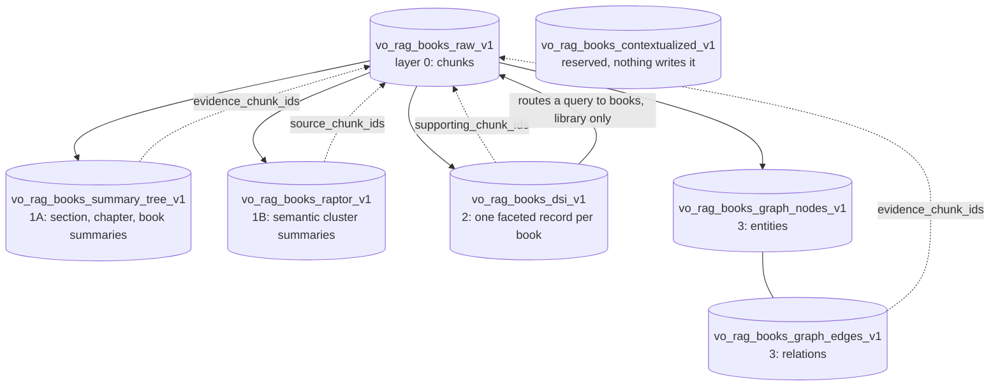

# Advanced layers

[README](../README.md) · [Architecture](architecture.md) · [Data model](data-model.md) · [Ingestion](ingestion.md) · [Retrieval and answers](retrieval-and-answers.md) · [Evaluation](evaluation.md)

Raw chunks answer questions about passages. Some questions are about a whole book ("what does this book cover?", "which book deals with this topic?") or about relations between ideas that sit far apart. Four optional layers sit on top of the raw chunks to help with those: a **summary tree**, a **RAPTOR** cluster tree, a **DSI** record per book and an **entity graph**. Each layer is built for one book at a time after ingest, stored in its own Qdrant collection, and paired with a decision procedure that says whether the layer earned a place in the stack.

Two facts frame everything below. First, none of the layers is built by default: the ingest workflow has an `advanced_understanding` step, but it does nothing unless a layer flag in `BookRagConfig` is on, and the shipped runner leaves them all off ([ingestion](ingestion.md#the-workflow)). You build layers afterwards with `vo-rag build`. Second, the default query does not read them: the default collections for every mode are the book collection plus the nine mode-agnostic ones ([retrieval and answers](retrieval-and-answers.md#collections-searched-per-mode)). The layers are built, stored and inspectable today, and each has a tested retrieval primitive, but `/api/v1/query` does not route through them.

## The layers at a glance



Every layer reads the raw collection and every node points back to the raw chunks that justify it. That provenance is a design rule, not decoration: a summary or a graph edge that cannot be traced to chunk ids is a claim nobody can check.

| Layer | Collection | A node is | Build command |
| --- | --- | --- | --- |
| Summary tree (1A) | `vo_rag_books_summary_tree_v1` | A summary of a section, a chapter or the whole book | `vo-rag build summary` |
| RAPTOR (1B) | `vo_rag_books_raptor_v1` | A summary of a semantic cluster of chunks, recursively | `vo-rag build raptor` |
| DSI (2) | `vo_rag_books_dsi_v1` | One faceted record per book | `vo-rag build dsi` |
| Entity graph (3) | `vo_rag_books_graph_nodes_v1`, `vo_rag_books_graph_edges_v1` | An entity, or a relation between two entities | `vo-rag build graph` |

### Summary tree

[`core/summary`](../src/vo_rag/core/summary) builds a tree of summaries: section summaries from groups of raw chunks, chapter summaries from section summaries, and one book summary at the top ([`builder.py`](../src/vo_rag/core/summary/builder.py)). Leaves are packed to between 3 and 12 chunks, and every upper tier aggregates at most 10 children, with extra tiers inserted until the top fits. That packing came from measurement: grouping leaves by their full section path produced an almost one-to-one explosion of single-chunk summaries, and grouping by chapter overflowed on a chapter with hundreds of chunks.

Each summary is written from two inputs: its children's summaries (the primary input) and a few evidence snippets chosen from the **raw** chunks underneath (the support, [`extract_support.py`](../src/vo_rag/core/summary/extract_support.py)). Evidence always comes from raw chunks, never from summary text that was itself generated, so an early mistake cannot compound up the tree. A node records the chunk ids it covers and the evidence it used, and its id is a hash of the sorted chunk ids and the prompt hash, so a retry or a rebuild with the same inputs produces the same ids and an edited prompt produces new ones.

Retrieval primitive: `layer1a_retrieve` and `search_summary_nodes` ([`layer1a_retrieval.py`](../src/vo_rag/core/summary/layer1a_retrieval.py)) search the summary nodes and expand a hit selectively into its source chunks ([`selective_expansion.py`](../src/vo_rag/core/summary/selective_expansion.py)).

### RAPTOR

[`core/raptor`](../src/vo_rag/core/raptor) builds a tree whose groups are semantic, not structural. It embeds the leaf chunks, reduces them with UMAP (5 dimensions, 15 neighbors), fits a Gaussian mixture and picks the number of clusters by BIC (up to 50 components, rejecting any candidate that leaves a cluster under 5 members), summarizes each cluster with an LLM, embeds the summaries and repeats on the summaries until a level has a single node or `max_tree_levels` (5) is reached ([`clustering.py`](../src/vo_rag/core/raptor/clustering.py), [`builder.py`](../src/vo_rag/core/raptor/builder.py)). When a level has no more items than UMAP has neighbors, the remaining items become one root cluster instead of failing in the reducer.

The random seeds for UMAP and the mixture are fixed (42) and recorded on every node, along with the selection criterion. This is what makes a RAPTOR build reproducible, and reproducibility is one of the checks its decision gate runs. Supporting evidence is again taken from raw chunks. A node's `source_chunk_ids` list every raw chunk beneath it. The level label saturates at `level_2`, so deeper passes reuse it.

RAPTOR nodes have persistence and expansion helpers ([`persistence.py`](../src/vo_rag/core/raptor/persistence.py)) but no query-time search path of their own. A library function in [`preflight.py`](../src/vo_rag/core/raptor/preflight.py) projects the token, time and dollar cost of a build against budget caps (defaults of 50 million input tokens, 5 million output tokens, 24 hours and $200) and returns `proceed`, `abort_over_budget` or `reduce_scope`; the build commands do not call it.

### DSI

DSI (document structure index, [`core/dsi`](../src/vo_rag/core/dsi)) condenses a book into one record that is cheap to search: title, author, a short abstract, technical domains, key components, prerequisite topics, a chapter outline and the ids of the representative chunks the model read. Five facets (key concepts, methods, equations or models, figure-heavy topics, synonyms and aliases) hold provenance-linked entries, each with the chunk ids and section paths that support it ([`schemas.py`](../src/vo_rag/core/dsi/schemas.py)).

Every provenance link is verified before the record is kept ([`validation.py`](../src/vo_rag/core/dsi/validation.py)). A cited chunk id must exist in the raw collection for that book, and a cited section path must be a real section of it. A record with violations is extracted again, up to two attempts, and after that it is marked for manual review and **not persisted**. The record id includes the model name and the prompt hash, so a prompt edit or a model swap makes a separate record instead of overwriting the first.

The point of DSI is query-time routing ([`routing.py`](../src/vo_rag/core/dsi/routing.py), [`router.py`](../src/vo_rag/core/dsi/router.py)). `DsiRouter` embeds the query, searches the DSI collection, turns each book's best score into a confidence with a softmax and calls `allocate_budgets` to divide a chunk budget between books. The top-k books (default 8) share the primary budget in proportion to confidence, at least one chunk each. When there are more books than `top_k`, every book also gets a small fallback allowance (5% of the budget by default, spread over the books outside the top-k and never under one chunk), so a book the router ranked low can still contribute and a bad routing decision cannot hide a book completely. `HybridRetriever.dsi_routed_search` then runs one filtered search per book with a budget.

A worked example computed with `allocate_budgets` (six books, `top_k=3`, the default budget of 20 chunks and the default 5% fallback share):

| Book | Confidence | Primary | Fallback | Total |
| --- | --- | --- | --- | --- |
| book-a | 0.553 | 9 | 1 | 10 |
| book-b | 0.225 | 4 | 1 | 5 |
| book-c | 0.166 | 2 | 1 | 3 |
| book-d | 0.025 | 0 | 1 | 1 |
| book-e | 0.020 | 0 | 1 | 1 |
| book-f | 0.011 | 0 | 1 | 1 |

The allowance is a floor, so the totals can exceed the nominal budget (21 against 20 here), and with hundreds of books every book still receives one chunk. The routing and budget functions are fully unit-tested but nothing in the query path calls them yet: they are kept verified, ready for a planner that chooses between retrieval paths, and the module says so.

### Entity graph

[`core/graph`](../src/vo_rag/core/graph) extracts entities and relations from a book's chunks in batches (6 chunks per call by default, 24 calls in flight) and stores them as points. A node has a type (`book`, `concept`, `method`, `equation`, `person` or `component`), a label, aliases and the chunk ids that mention it; an edge has a type (`mentions`, `authored_by`, `relates_to`, `used_by`, `part_of`, `is_a` or `introduces`), a direction, a weight and `evidence_chunk_ids` ([`schemas.py`](../src/vo_rag/core/graph/schemas.py)). Node and edge ids are hashes of type and label, or of the endpoints and edge type, so the same entity extracted from different books maps to the same id. Edges live in a dense-only collection.

Direction matters for `part_of`, `is_a` and `used_by` ("the pump is part of the circuit", not the reverse), and models get it wrong often enough that [`direction.py`](../src/vo_rag/core/graph/direction.py) orients those edges with deterministic rules and scores its own confidence. If the share of confidently oriented edges is under the threshold (0.85, `VORAG_GRAPH_DIRECTION_MIN_COVERAGE`), the build asks an LLM to re-orient the low-confidence ones (`VORAG_GRAPH_LOCAL_REORIENT`, on by default, uses the build's own client; `VORAG_GRAPH_27B_FALLBACK=1` uses a separate serverless text endpoint and takes precedence when that endpoint is configured), and the build output reports coverage and what happened.

Traversal ([`retrieval.py`](../src/vo_rag/core/graph/retrieval.py)) resolves entity labels to seed nodes, expands the neighborhood breadth-first for a bounded number of hops and returns raw chunks. The evidence set is only the union of the `evidence_chunk_ids` on the edges walked and the `chunk_ids` on the nodes visited: nothing is invented beyond what the graph recorded. The LlamaIndex tier uses this traversal for its property-graph retriever and the `graph_lookup` agent tool ([integrations](integrations.md)).

### Contextual retrieval is gated

Contextual retrieval (prefixing each chunk with model-written context before embedding it) is not built. [`core/contextual`](../src/vo_rag/core/contextual) is an empty package on purpose. The only part worth keeping, the paired A/B and non-inferiority statistics, lives in [`core/eval/non_inferiority.py`](../src/vo_rag/core/eval/non_inferiority.py) and is reused by every decision gate below. The enrichment step and its decision gate do not exist in the code: contextual enrichment multiplies embedding cost for every chunk, and only a measured A/B result would justify it, so the shared statistics are all that is kept. The collection `vo_rag_books_contextualized_v1` is reserved for it and nothing writes to it.

## STOP/GO: how a layer earns its place

Each layer is expensive (an LLM call per node, plus storage) and the benefit is an empirical question. So each comes with a decision procedure whose thresholds are fixed up front, and the procedure answers one question: **does this layer improve retrieval without hurting it?** The decision functions are pure code over scores you supply; they make no model or network calls.

Every procedure uses the same two ingredients:

1. **A mechanical gate**, which checks that the build itself is sound.
2. **A paired A/B comparison** of retrieval with the layer against retrieval without it, over the same queries, using `compute_non_inferiority` ([`non_inferiority.py`](../src/vo_rag/core/eval/non_inferiority.py)). For each query it takes the difference of the two scores, computes the one-sided lower confidence bound on the mean difference (95% by default, normal approximation) and compares that bound with a margin. **Non-inferior** means the lower bound is above minus the margin: the layer is not measurably worse. **Superior** means the lower bound is above plus a margin: it is measurably better. Recall@10 must be non-inferior, because a layer that loses passages is unacceptable whatever else it does. Then nDCG@10, or a judge-rated answer quality score when one is supplied, must be superior.

| | Summary tree | RAPTOR | Entity graph |
| --- | --- | --- | --- |
| Mechanical gate | Extraction failure rate at most 5%; zero evidence chunk ids outside a node's own source chunks; identical prompt hash when the build is repeated | At most 5% of clusters under a silhouette score of 0.20; BIC selection converged; fixed-seed rebuild gives the same clusters | At least 100 nodes and 200 edges; at most 10% of books failing extraction |
| Recall@10 | Non-inferior at a 3 point margin | Non-inferior at a 3 point margin | Non-inferior at a 3 point margin, on queries that used the graph path |
| Superiority | nDCG or judge, lower bound above +2 points | nDCG or judge, lower bound above +2 points | nDCG or judge, lower bound above +1 point |
| Also required | Corpus quality: mean of coverage and faithfulness at least 0.70 | none | At least 10 queries on the graph path; planner latency overhead at most 20 points |
| Outcomes | `enable_summary_layer`, `disable_summary_layer`, `rerun_after_fixes` | `accept_raptor`, `reject_raptor`, `rerun_after_fixes` | Final: `enable_graph_in_planner`, `disable_graph_path`, `rerun_after_fixes`. `evaluate_graph` alone returns `keep_graph`, `disable_graph_path`, `rerun_after_fixes` |

A failed mechanical gate always yields "rerun after fixes", never "reject": a broken build says nothing about whether the layer helps. Missing evidence does the same for the graph (fewer than 10 graph-path queries). Only a sound build that is measurably no better, or worse, is rejected. For the summary layer, a passing A/B result is still disabled if the summaries score below 0.70 on the coverage and faithfulness judges, because a summary layer that retrieves well but misstates the book is worse than none. For the graph, the final decision combines a pilot smoke gate (the pilot must reach the node and edge minimums and improve at least one metric by a point), the quality A/B and the latency overhead gate ([`phase6b_aggregator.py`](../src/vo_rag/core/graph/phase6b_aggregator.py), [`smoke_runner.py`](../src/vo_rag/core/graph/smoke_runner.py)).

How the decision functions are reached today: `evaluate_summary_layer` and `decide_phase2` ([`summary/evaluation.py`](../src/vo_rag/core/summary/evaluation.py), [`summary/phase2_aggregator.py`](../src/vo_rag/core/summary/phase2_aggregator.py)), `evaluate_raptor` ([`raptor/evaluation.py`](../src/vo_rag/core/raptor/evaluation.py)) and `evaluate_graph` ([`graph/quality_ab.py`](../src/vo_rag/core/graph/quality_ab.py)) are library functions. You compute per-query recall, nDCG and judge scores for both arms yourself (write the layer to a suffixed collection with `VORAG_BUILD_COLLECTION_SUFFIX` to keep an arm apart) and pass them in. The one wiring in the repository is `run_graph_ab_exit_gate` in the LlamaIndex tier ([`graph_ab.py`](../src/vo_rag/integrations/llamaindex/graph_ab.py)). The build commands do not run a decision gate; the graph build checks only direction coverage. Ship a layer only after you have run its procedure on your own corpus.

## Building layers

The commands are in [`cli/build.py`](../src/vo_rag/cli/build.py) and build one book per run.

```sh
vo-rag build summary --source-id vo-rag-corpus-sha256:9cd33ad5263959401ed620f416fea121c6deecc80cc1bf7f34a32b9a16973921
vo-rag build raptor  --source-id vo-rag-corpus-sha256:9cd33ad5263959401ed620f416fea121c6deecc80cc1bf7f34a32b9a16973921
vo-rag build dsi     --source-id vo-rag-corpus-sha256:9cd33ad5263959401ed620f416fea121c6deecc80cc1bf7f34a32b9a16973921
vo-rag build graph   --source-id vo-rag-corpus-sha256:9cd33ad5263959401ed620f416fea121c6deecc80cc1bf7f34a32b9a16973921
```

Each prints one summary line when it finishes. The line is not JSON; the keys are not quoted. Example output (counts are illustrative):

```text
{book_id: vo-rag-corpus-sha256:9cd33ad5..., n_nodes: 57, n_chunks: 412}
{book_id: vo-rag-corpus-sha256:9cd33ad5..., n_records: 1, n_chunks: 412}
{book_id: vo-rag-corpus-sha256:9cd33ad5..., n_nodes: 318, n_edges: 904, direction_coverage: 0.91, n_low_confidence_edges: 37}
```

| Command | Options | Notes |
| --- | --- | --- |
| `build summary` | `--max-concurrent` (8), `--version-hash` | Reads `vo_rag_books_raw_v1` |
| `build raptor` | `--max-tokens` (2500), `--version-hash` | Embeds the leaves first; needs the embedding service |
| `build dsi` | `--collection-version`, `--n-representative-chunks` (16), `--max-tokens` (3000), `--version-hash` | The representative chunks are truncated to 600 characters each in the prompt |
| `build graph` | `--max-tokens` (4000), `--chunks-per-call` (6), `--max-concurrent` (24), `--version-hash` | See the caveat below |

What they need: a reachable Qdrant, the embedding service, and an LLM. The commands construct a RunPod serverless text client (`role="text"`, `role="dsi"` for DSI), so a serverless text endpoint must be configured ([configuration](configuration.md)). `--version-hash` restricts the read to chunks with that `version_hash`; omit it on a corpus without versions. `VORAG_BUILD_COLLECTION_SUFFIX` appends a suffix to the target collection name, which is how you build an A/B arm without touching the live layer. The CLI calls the core builders directly so it imports and runs without the optional `llamaindex` extra; `AdvancedBuildWorkflow` in [`build_workflow.py`](../src/vo_rag/integrations/llamaindex/build_workflow.py) is the adapter-tier equivalent for agent use and adds a RAPTOR gate that skips books with fewer than three chunks.

**The graph build refuses to run with the default publication settings.** `build graph` raises an error while source publication readers are enabled (`VORAG_SOURCE_PUBLICATION_ENABLED`, which defaults to true), because the shared graph's dependency closure is not available before model work starts. To build a graph, set `VORAG_SOURCE_PUBLICATION_ENABLED=false` for that command.

When publication readers are enabled, the other three builds bind their output to the raw source's active revision, so a derived record is hidden automatically once the raw text it summarized is replaced ([rights and compliance](rights-and-compliance.md#publication-read-view)). A DSI build also requires the canonical raw collection in that case.

### Reading what exists

`GET /api/v1/books/{source_id}` returns per-book point counts for each layer, and `GET /api/v1/books/{source_id}/summaries` returns the DSI facets, the summary tree outline, graph entities and the RAPTOR node count ([`api/routes/books.py`](../src/vo_rag/api/routes/books.py)). Example response of the first (shape from `BookOverviewResponse`; values are illustrative):

```json
{
  "source_id": "vo-rag-corpus-sha256:9cd33ad5263959401ed620f416fea121c6deecc80cc1bf7f34a32b9a16973921",
  "title": "Thermal Systems Handbook",
  "author": "A. Author",
  "license_class": "cleared",
  "artifact_id": "01M4SBAPR8NMHWTQJKZRQ0JFPY",
  "stats": {
    "text_chunks": 412,
    "figure_chunks": 38,
    "pages": 530,
    "domain_tags": ["heat-transfer"]
  },
  "layers": {
    "summary_tree": 57,
    "raptor": 61,
    "dsi": 1,
    "graph_nodes": 318
  }
}
```

### Rights

Every layer is built from the **raw** collection, and its nodes are summaries or extractions of raw text. They carry no `license_class`, so the public-mode license filter never matches them ([rights and compliance](rights-and-compliance.md#the-three-query-modes)). Treat the layer collections as internal-mode material.

## Code map

| Concern | Code |
| --- | --- |
| Build commands | [`cli/build.py`](../src/vo_rag/cli/build.py), [`integrations/llamaindex/build_workflow.py`](../src/vo_rag/integrations/llamaindex/build_workflow.py) |
| Summary tree | [`core/summary/builder.py`](../src/vo_rag/core/summary/builder.py), [`extract_support.py`](../src/vo_rag/core/summary/extract_support.py), [`persistence.py`](../src/vo_rag/core/summary/persistence.py), [`layer1a_retrieval.py`](../src/vo_rag/core/summary/layer1a_retrieval.py) |
| Summary quality and decision | [`core/summary/coverage.py`](../src/vo_rag/core/summary/coverage.py) (coverage and faithfulness judges), [`evaluation.py`](../src/vo_rag/core/summary/evaluation.py), [`phase2_aggregator.py`](../src/vo_rag/core/summary/phase2_aggregator.py) |
| RAPTOR | [`core/raptor/builder.py`](../src/vo_rag/core/raptor/builder.py), [`clustering.py`](../src/vo_rag/core/raptor/clustering.py), [`persistence.py`](../src/vo_rag/core/raptor/persistence.py), [`preflight.py`](../src/vo_rag/core/raptor/preflight.py), [`evaluation.py`](../src/vo_rag/core/raptor/evaluation.py) |
| DSI build | [`core/dsi/builder.py`](../src/vo_rag/core/dsi/builder.py), [`extraction.py`](../src/vo_rag/core/dsi/extraction.py), [`validation.py`](../src/vo_rag/core/dsi/validation.py) |
| DSI routing | [`core/dsi/routing.py`](../src/vo_rag/core/dsi/routing.py), [`router.py`](../src/vo_rag/core/dsi/router.py) |
| Entity graph build | [`core/graph/builder.py`](../src/vo_rag/core/graph/builder.py), [`extraction.py`](../src/vo_rag/core/graph/extraction.py), [`direction.py`](../src/vo_rag/core/graph/direction.py), [`persistence.py`](../src/vo_rag/core/graph/persistence.py) |
| Entity graph retrieval and decision | [`core/graph/retrieval.py`](../src/vo_rag/core/graph/retrieval.py), [`quality_ab.py`](../src/vo_rag/core/graph/quality_ab.py), [`smoke_runner.py`](../src/vo_rag/core/graph/smoke_runner.py), [`phase6b_aggregator.py`](../src/vo_rag/core/graph/phase6b_aggregator.py) |
| Shared statistics | [`core/eval/non_inferiority.py`](../src/vo_rag/core/eval/non_inferiority.py) |
| Layer counts and summaries over HTTP | [`api/routes/books.py`](../src/vo_rag/api/routes/books.py) |
