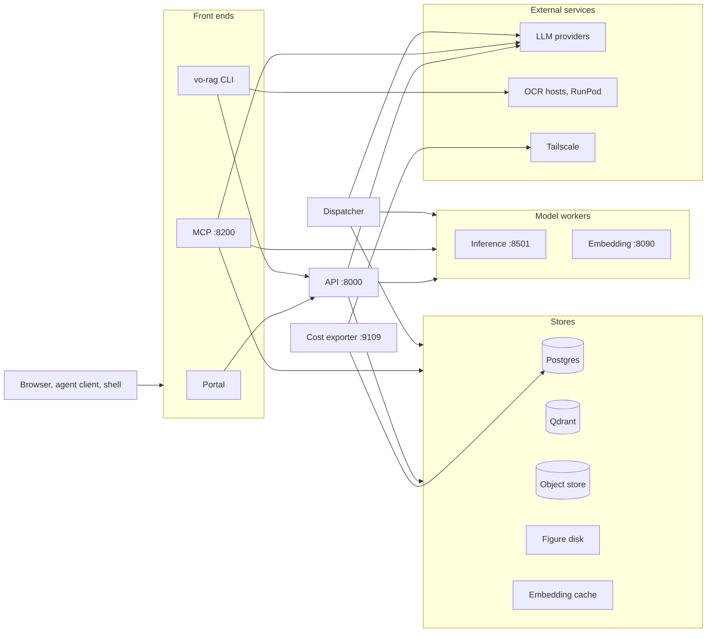
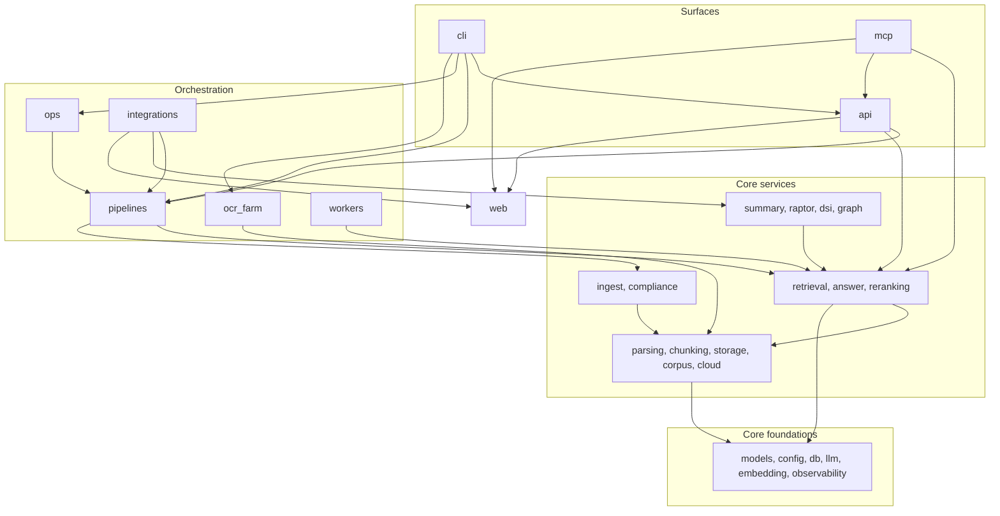

# Architecture

[README](../README.md) · [Capabilities](capabilities.md) · [Data model](data-model.md) · [Engineering decisions](engineering.md)

vo-rag keeps durable ingestion state, searchable evidence and stored artifacts in three separate stores, and treats model inference as an external service. Five long-running processes and one cost exporter share one Python package, `vo_rag`, and one settings file. This page covers the processes, the package map, the dependency rules, the LLM seam and the settings loader.

## System overview



The CLI and the portal call the HTTP API for query, answer and intake. The MCP server does not: it builds the same service container in-process (`mcp/runtime.py`) and calls retrieval and envelope insertion directly. The CLI also talks to the stores directly for maintenance commands such as `vo-rag corpus` and `vo-rag build`. The default URLs for embedding, reranking and the vision-language gateway all point at the inference worker on port 8501; the standalone embedding worker on 8090 serves the same `/embed` contract and can stand in for it. The embedding cache lives in the calling process (API, dispatcher or MCP server), not in the worker.

## Processes

| Process | What it does | How it starts | Port |
| --- | --- | --- | --- |
| API | FastAPI app: auth, 28 routes, readiness, metrics | `uv run uvicorn vo_rag.api.main:app --host 127.0.0.1 --port 8000` | 8000 |
| Dispatcher | Claims intake envelopes from Postgres and runs the ingest workflow; see [ingestion](ingestion.md) | `uv run python -m vo_rag.pipelines.book_rag.dispatcher` (a long-lived process; SIGTERM or SIGINT starts a 240 s graceful shutdown) | none |
| MCP server | Four tools over stdio or streamable HTTP, served from its own in-process service container rather than through the API; see [mcp](mcp.md) | `uv run python -m vo_rag.mcp.server --transport stdio`, or `--transport streamable-http` with `VORAG_MCP_API_KEY` set | 8200 |
| Inference worker | One GPU process that serves `/embed`, `/rerank` and a gateway that forwards vision-language requests to a local llama.cpp server | ASGI app `vo_rag.workers.inference.server:app`, served with uvicorn | 8501 |
| Embedding worker | The standalone BGE-M3 embedding server with the same `/embed` contract | Container entrypoint [`workers/embedding/entrypoint.sh`](../workers/embedding/entrypoint.sh), which runs `uvicorn vo_rag.workers.embedding.server:app` | 8090 (`PORT`) |
| Cost exporter | Prometheus exporter for cloud spend, budget and kill-switch state | `uv run python -m services.cloud_cost_exporter.app` | 9109 |
| Portal | React single-page app | `pnpm --filter @vo-rag/portal dev`, or the nginx container built from [`packages/portal/Dockerfile`](../packages/portal/Dockerfile) | 5173 dev, 80 container |

The OCR farm is not a daemon. `vo-rag corpus ocr-farm` plans a backlog, runs it on ssh hosts or RunPod pods and stores results in the object store; see [OCR](ocr.md). Nothing runs on a schedule inside the processes except their own loops: the API's 20 s operational sampler, the dispatcher's poll and heartbeat, and the inference worker's 15 s vision-gateway health poll.

The dispatcher exists because `POST /api/v1/intake` only records an envelope. Without a dispatcher the envelope stays `received`. The API reports `dispatch_status` as `queued` only for a complete file-drop envelope while the dispatcher's heartbeat file is fresh; otherwise it reports `not_configured`. The API reads that file from its own filesystem, so the two processes must see the same heartbeat path (`VORAG_BOOK_RAG_DISPATCHER_HEARTBEAT_PATH`).

## Package map

Every package under `src/vo_rag`, plus the two top-level service trees. Links go to the code.

| Package | Role |
| --- | --- |
| [`vo_rag.api`](../src/vo_rag/api) | App factory, auth and CSRF middleware, service container, operational sampler |
| [`vo_rag.api.routes`](../src/vo_rag/api/routes) | One module per route group: system, admin, query, answer, ingest, books, figures |
| [`vo_rag.cli`](../src/vo_rag/cli) | Click command tree for `vo-rag` |
| [`vo_rag.mcp`](../src/vo_rag/mcp) | MCP server, tool models and transports |
| [`vo_rag.pipelines`](../src/vo_rag/pipelines) | Pipeline roster; one package per pipeline |
| [`vo_rag.pipelines.book_rag`](../src/vo_rag/pipelines/book_rag) | The active pipeline: dispatcher, workflow, validator, smoke gate, visual sidecar |
| [`vo_rag.pipelines.book_rag.steps`](../src/vo_rag/pipelines/book_rag/steps) | The parse, chunk-and-embed and sterilize steps |
| [`vo_rag.pipelines.vce`](../src/vo_rag/pipelines/vce) | Video extraction pipeline (planned in the roster, code present) |
| [`vo_rag.ops`](../src/vo_rag/ops) | Operator tools: source repair, publication probe, `brain_sync` |
| [`vo_rag.ocr_farm`](../src/vo_rag/ocr_farm) | OCR farm coordinator and host definitions |
| [`vo_rag.ocr_farm.runpod`](../src/vo_rag/ocr_farm/runpod) | RunPod variant: plan, stage, run, collect, verify |
| [`vo_rag.ocr_farm.worker`](../src/vo_rag/ocr_farm/worker) | The script that runs on each OCR host |
| [`vo_rag.workers`](../src/vo_rag/workers) | Worker registry loaded from `pyproject.toml` |
| [`vo_rag.workers.inference`](../src/vo_rag/workers/inference) | Unified embedding, rerank and vision-gateway server |
| [`vo_rag.workers.embedding`](../src/vo_rag/workers/embedding) | Standalone BGE-M3 embedding server |
| [`vo_rag.workers.runpod_vllm`](../src/vo_rag/workers/runpod_vllm) | Request contracts for RunPod serverless vLLM workers |
| [`vo_rag.integrations`](../src/vo_rag/integrations) | Adapters to external frameworks |
| [`vo_rag.integrations.llamaindex`](../src/vo_rag/integrations/llamaindex) | LlamaIndex retriever, reranker, synthesizer, graph store and build workflow |
| [`vo_rag.integrations.llamaindex.agents`](../src/vo_rag/integrations/llamaindex/agents) | Agent patterns on the adapters |
| [`vo_rag.integrations.llamaindex.agents.tools`](../src/vo_rag/integrations/llamaindex/agents/tools) | Book search, graph lookup and web search tools |
| [`vo_rag.web`](../src/vo_rag/web) | SSRF gate and connect-time DNS pinning for outbound HTTP |
| [`vo_rag.core`](../src/vo_rag/core) | Shared libraries; the packages below |
| [`vo_rag.core.models`](../src/vo_rag/core/models) | Pydantic models and enums: envelope, artifact, license class, generation state |
| [`vo_rag.core.config`](../src/vo_rag/core/config) | Settings model and YAML loader |
| [`vo_rag.core.db`](../src/vo_rag/core/db) | asyncpg pool and migration runner |
| [`vo_rag.core.db.queries`](../src/vo_rag/core/db/queries) | One query module per table group |
| [`vo_rag.core.storage`](../src/vo_rag/core/storage) | Qdrant store, S3 client, figure store, publication read view |
| [`vo_rag.core.parsing`](../src/vo_rag/core/parsing) | Parser router, preflight, corruption and quality gates |
| [`vo_rag.core.parsing.parsers`](../src/vo_rag/core/parsing/parsers) | Docling, EPUB and formula parsers |
| [`vo_rag.core.chunking`](../src/vo_rag/core/chunking) | Hierarchical chunker and its heading, contents and artifact filters |
| [`vo_rag.core.embedding`](../src/vo_rag/core/embedding) | Embedding client, on-disk cache and point-vector assembly |
| [`vo_rag.core.retrieval`](../src/vo_rag/core/retrieval) | Query modes, hybrid search, RRF fusion, auto-merge (off by default; not wired on the HTTP query path) |
| [`vo_rag.core.reranking`](../src/vo_rag/core/reranking) | GTE ONNX, GPU, Cohere and remote rerankers |
| [`vo_rag.core.answer`](../src/vo_rag/core/answer) | Cited answer synthesis |
| [`vo_rag.core.llm`](../src/vo_rag/core/llm) | The LLM client seam, retry, structured and protected completion |
| [`vo_rag.core.llm.providers`](../src/vo_rag/core/llm/providers) | Anthropic, Kimi, llama.cpp and RunPod serverless providers |
| [`vo_rag.core.compliance`](../src/vo_rag/core/compliance) | License filter and the sterilizer |
| [`vo_rag.core.ingest`](../src/vo_rag/core/ingest) | Intake normalization, object verification, source publication, repair evidence |
| [`vo_rag.core.corpus`](../src/vo_rag/core/corpus) | Health, purge, duplicates, canary gates, rechunk preview, tag store |
| [`vo_rag.core.cloud`](../src/vo_rag/core/cloud) | RunPod serverless client, budget gate, kill switch, workload router |
| [`vo_rag.core.observability`](../src/vo_rag/core/observability) | Prometheus metrics, OpenTelemetry, redaction, cost accumulator |
| [`vo_rag.core.eval`](../src/vo_rag/core/eval) | Evaluation harness, regression gate, qrels, judge calibration |
| [`vo_rag.core.summary`](../src/vo_rag/core/summary) | Summary-tree layer |
| [`vo_rag.core.raptor`](../src/vo_rag/core/raptor) | RAPTOR clustering layer |
| [`vo_rag.core.dsi`](../src/vo_rag/core/dsi) | DSI category-routing layer |
| [`vo_rag.core.graph`](../src/vo_rag/core/graph) | Entity-graph layer |
| [`vo_rag.core.contextual`](../src/vo_rag/core/contextual) | Intentionally empty; contextual retrieval is gated and only its A/B math is kept, in `core.eval` |
| [`services/cloud_cost_exporter`](../services/cloud_cost_exporter) | Cost exporter app and Dockerfile |
| [`workers`](../workers) | Dockerfiles and RunPod templates for the worker roster |

`core/idempotency.py` holds the deterministic-ID helpers described in the [data model](data-model.md#deterministic-ids).

## Dependency rules

The rules below come from an import scan of `src/vo_rag`. A linter does not enforce them; the code follows them with the exceptions listed.



1. Surfaces depend downward. Nothing in `core`, `pipelines`, `ops`, `workers`, `ocr_farm` or `integrations` imports `api`, `cli` or `mcp` at module level. The one exception is deferred: `pipelines/book_rag/runner.py` imports `vo_rag.api.singletons` inside two functions to reuse the service container. The MCP server does the same in `mcp/runtime.py` (the `mcp --> api` edge), so it builds exactly the container the API does.
2. `core` never imports a surface. `core.models`, `core.config` and `core.idempotency` import nothing else from the package. `core.observability` imports only `config` and `models`, and `core.storage` imports observability, never the reverse.
3. Every external service sits behind an injected seam: Garage, Qdrant, the embedding client, the LLM client, the retriever and the parser router are passed into the workflow. That is why the whole ingest DAG runs in tests with fakes, without a GPU or a database.
4. Inference on RunPod serverless endpoints goes through one transport, `core.cloud.serverless.ServerlessClient`. A test in `tests/workers/test_no_runpod_bypass.py` scans the worker packages and fails if a worker reaches the RunPod API another way or reintroduces dynamic pod launching. The only other RunPod REST code is the pod-termination helper the kill switch uses.
5. Exception to one-way layering: `core.chunking`, `core.corpus` and `core.eval` each import a helper from `pipelines.book_rag` (`ocr_quality`, `boilerplate`, `visual_sidecar`). `core.storage` and `core.corpus` also import each other for tag-schema constants.

## Service assembly

`create_app` in [`api/main.py`](../src/vo_rag/api/main.py) builds routing and middleware. Importing the module opens no sockets. The lifespan in [`api/lifespan.py`](../src/vo_rag/api/lifespan.py) calls `build_surface_services`, which fills a `SurfaceServices` dataclass: database pool, Qdrant, object store, embedding client, retriever, reranker, answer synthesizer, cost tracker and kill switch. A dependency that fails to initialize leaves its slot `None` and records a reason, so `/ready/query` and `/ready/intake` can say what is missing while `/health` stays green.

Tests inject a prepared container with `create_app(services=...)`, which skips the lifespan entirely.

`SurfaceServices` is also where you supply the compliance gate for public answer modes. In `publication` and `partner` mode, `POST /api/v1/answer` returns 403 `answer_compliance_gate_not_configured` unless the container carries an `answer_compliance_gate`, either as an attribute or as `services.extra["answer_compliance_gate"]` ([`answer.py`](../src/vo_rag/api/routes/answer.py)). The gate object is whatever your deployment provides, as long as it satisfies the `AnswerComplianceGate` protocol in [`answer_gate.py`](../src/vo_rag/core/compliance/answer_gate.py): a `check(*, mode, hits, caller)` method that returns an `AnswerGateDecision(allowed, reason)`. After retrieval and before synthesis the route calls it once per request with the mode, the retrieved hits and the caller. A decision with `allowed=False` returns 403 `answer_compliance_gate_denied`, a gate that raises returns 403 `answer_compliance_gate_error`, and an object without a callable `check`, an async `check`, a non-decision return value, or a decision whose `allowed` is not exactly `True` or `False` (or whose `reason` is not a string) returns 403 `answer_compliance_gate_invalid`. When the gate allows, the response reports `compliance.status` as `allowed`. The `internal` mode never consults the gate.

```python
from vo_rag.api.main import create_app
from vo_rag.api.singletons import build_surface_services
from vo_rag.core.config import get_settings

settings = get_settings()
services = await build_surface_services(settings)   # inside an async startup hook
services.extra["answer_compliance_gate"] = my_gate   # your policy object
app = create_app(settings=settings, services=services)
```

Passing `services` to `create_app` skips the default lifespan, so the operational sampler and the background index reconcile do not run; start them from your own lifespan if you need them.

## The LLM seam

Every LLM call in the system goes through `LLMClient` in [`core/llm/client.py`](../src/vo_rag/core/llm/client.py). The client picks a provider (`anthropic`, `llama_cpp`, `kimi` or `runpod_serverless`), applies retry with backoff, enforces structured output with retry on validation failure, fetches prompts from a registry with optional weighted variants, and records Prometheus metrics, cost and one OpenTelemetry span per logical call. Prompt and response text are never written to span attributes. Callers that handle untrusted text use `complete_json_protected` in `core/llm/protected.py`, which wraps the input as untrusted, plants a canary and validates the output afterwards. Because the seam is one class, swapping a provider or running offline with a fake needs no change in the callers.

## The settings loader

`get_settings()` in [`core/config/settings.py`](../src/vo_rag/core/config/settings.py) reads `config/settings.yaml`, or the file named by `VORAG_SETTINGS_PATH`. It replaces `${VAR}` and `${VAR:default}` from the environment, validates the result into a `Settings` model with 18 sections, and caches it. Every sub-model forbids unknown keys, so a typo in the YAML fails at load time. `SIGHUP` clears the cache for a reload without a restart. The `.env` file is not loaded automatically; export it into the shell first. Keys and defaults are listed in [configuration](configuration.md).

## Persistence boundaries

Postgres records envelopes, generations, publication pointers, query and answer audit rows. Qdrant stores retrieval vectors and evidence payloads. The S3-compatible store holds uploaded files, parse results and the OCR cache. A successful object write alone does not make a book searchable; searchability comes from a validated, published generation. Table, collection and key layouts are in the [data model](data-model.md).

## Optional paths

Reranking, answer providers, visual descriptions, sterilization, the summary, RAPTOR, DSI and graph layers, and source-publication writes are configurable and off or opt-in by default. An adapter's presence does not show that its external service is healthy, that hosted egress is authorized, or that model weights are installed. The [README](../README.md#status) and [engineering decisions](engineering.md) say which parts are contract-tested.
