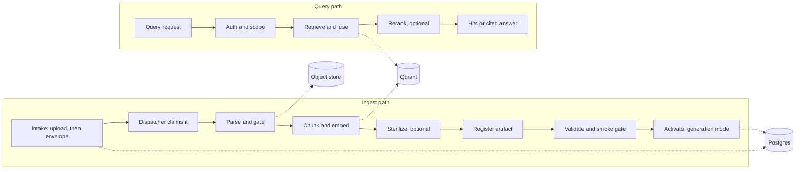

# Data and API flows

[README](../README.md) · [Architecture](architecture.md) · [Security](security.md) · [Operations](operations.md)

This page is the map of how a request moves through the system. It stays short on purpose: the ingest path is explained in [Ingestion](ingestion.md), the query and answer path in [Retrieval and answers](retrieval-and-answers.md), and every route, command and tool in the generated references ([HTTP API](api.md), [CLI](cli.md), [MCP](mcp.md)).



## Ingest path

`POST /api/v1/intake` records an *envelope* in Postgres and returns at once. A separate dispatcher process claims the envelope, runs the parse, chunk, embed and validation steps, and makes the result searchable. If no dispatcher is running, the envelope stays `received` and the response says `dispatch_status: "not_configured"`. How to start the dispatcher, the envelope states, the claim rules and the activation switch are in [Ingestion](ingestion.md). Scanned books take a detour through the [OCR farm](ocr.md), and the choice of parser and the quality gates are in [Parsing and chunking](parsing-and-chunking.md).

Migrations and Qdrant collections are not created at startup. Run the bootstrap in [Data model](data-model.md#bootstrapping-a-new-deployment) once against your own services.

## Query path

`POST /api/v1/query` authenticates the caller, enforces collection and mode scope, resolves the collections to search and runs retrieval. The retriever combines several vector lanes with reciprocal-rank fusion and removes duplicates. Rights-based filters constrain which evidence a mode can see, and reranking is an explicit choice in the request (`rerank`).

```sh
# Requires a configured, ready API and your own exported VORAG_API_KEY.
curl -sS http://127.0.0.1:8000/api/v1/query \
  -H "Content-Type: application/json" \
  -H "X-API-Key: $VORAG_API_KEY" \
  -d '{"query": "How does the sample library store passages?", "top_k": 5}'
```

Example response (shape from `QueryResponse`; the ID, score and payload are illustrative). Payloads carry the source and heading path so a hit can be cited:

```json
{
  "results": [
    {
      "id": "3f1c9e52-7a0b-5c1e-9d4a-2b6e8f0a1c77",
      "score": 0.82,
      "collection": "vo_rag_books_raw_v1",
      "payload": {
        "source_id": "vo-rag-corpus-sha256:9cd33ad5...",
        "source_book": "Handbook",
        "section_path": "[Handbook > 1 Storing passages]",
        "page_number": 3,
        "content": "A passage is stored with the heading path that leads to it ..."
      }
    }
  ]
}
```

[`api/schemas.py`](../src/vo_rag/api/schemas.py) is authoritative for request and response fields. Do not infer supported modes, collection scope or fields from this example alone.

## Answer generation

`POST /api/v1/answer` adds cited synthesis on top of retrieval when answer generation is enabled and a permitted provider is configured. In `publication` and `partner` mode it fails closed: it returns 403 until you supply a compliance gate, and then calls the gate on every request. See [Rights and compliance](rights-and-compliance.md). A citation-bearing answer is not a guarantee that it is correct.

## Surfaces and health

| Surface | Purpose | Auth |
| --- | --- | --- |
| `/health` | Process liveness | None |
| `/ready/query`, `/ready/intake` | Dependency readiness for each capability; can return 503 with the reasons | None |
| `/status`, `/api/v1/rag/status` | Operator summaries of state and collection readiness | API key |
| `/api/v1/intake` | Submit ingestion work | API key |
| `/api/v1/query` | Ranked evidence | API key |
| `/api/v1/answer` | Optional cited synthesis | API key |
| CLI and MCP | The same services from a terminal or an agent | The CLI uses the API; MCP builds its own service container |

For supported CLI syntax use `vo-rag ingest --help`, `vo-rag query --help` and `vo-rag answer --help`. Liveness does not mean ingestion or retrieval can run; check the readiness routes.
