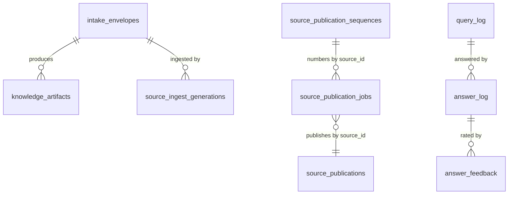
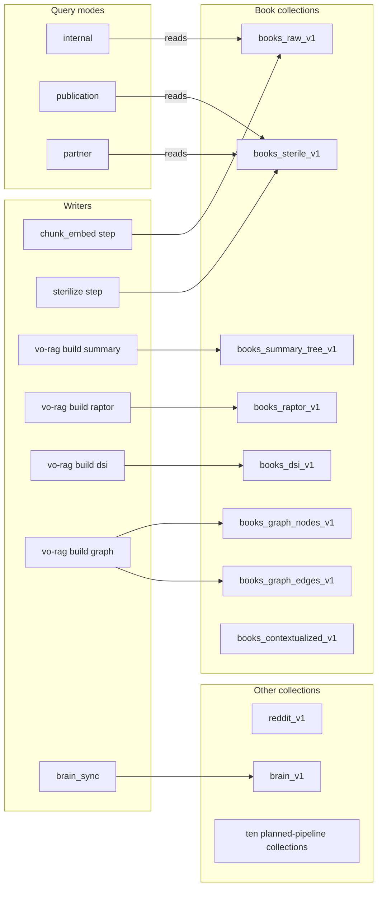

# Data model

[README](../README.md) · [Architecture](architecture.md) · [Capabilities](capabilities.md) · [Configuration](configuration.md)

vo-rag persists state in three main stores and four smaller local ones. Postgres holds control state: intake envelopes, ingest generations, publication pointers and audit rows. Qdrant holds searchable evidence. An S3-compatible object store (Garage in the reference setup) holds uploaded files, parse results and the OCR cache. This page lists what lives where and the identifiers that tie the stores together.

| Store | Location | Holds |
| --- | --- | --- |
| Postgres | `VORAG_POSTGRES_URL` | 47 tables created by the migrations, plus `schema_migrations` |
| Qdrant | `QDRANT_URL` | 19 collections, plus `vo_rag_brain_v1` when `brain_sync` runs |
| Object store | `GARAGE_ENDPOINT`, bucket `vorag-artifacts` | Uploads, parse results, OCR cache |
| Figure store | `VORAG_FIGURES_ROOT`, default `./var/figures` | Extracted figure images on local disk |
| Embedding cache | `VORAG_EMBEDDING_CACHE_DIR`, default `/var/lib/vo_rag/cache/embeddings` | Embedding vectors on local disk |
| OCR farm state | `VORAG_OCR_FARM_STATE`, default `~/.config/vo-rag/ocr-farm-hosts.json`, plus a job directory per RunPod run | Host definitions and per-job plan files |
| `brain_sync` state | `~/.local/state/vo-rag/brain_sync.json` | Last synced commit and last error |

The dispatcher also writes a small heartbeat file, by default `/run/vo-rag/dispatcher-heartbeat.json` (override with `VORAG_BOOK_RAG_DISPATCHER_HEARTBEAT_PATH`), so the API can report whether a dispatcher is alive. The CLI reads `~/.config/vo-rag/config.yaml` or the file named by `VORAG_CLI_CONFIG`.

## Bootstrapping a new deployment

Neither the API nor the dispatcher creates tables or collections at startup. Run the migration runner and the collection setup once against your own services (a library call, shown here as a script):

```python
import asyncio
from pathlib import Path

from qdrant_client import AsyncQdrantClient

from vo_rag.core.config import get_settings
from vo_rag.core.db.postgres import close_pool, get_pool, run_migrations
from vo_rag.core.storage.qdrant import setup_collections


async def main() -> None:
    settings = get_settings()
    pool = await get_pool(settings.database.url)
    await run_migrations(pool, Path(settings.database.migrations_dir))
    await close_pool()
    client = AsyncQdrantClient(url=settings.qdrant.url, api_key=settings.qdrant.api_key or None)
    await setup_collections(client)


asyncio.run(main())
```

`run_migrations` applies each unapplied `.sql` file in a transaction and records its SHA-256 in `schema_migrations`. If an applied file has changed since, it raises `MigrationChecksumError` instead of continuing. `setup_collections` is idempotent and raises on a schema mismatch. The read-only check [`scripts/check_migrations.py`](../scripts/check_migrations.py) reports migration state without changing anything. The migration files are numbered `001` to `037`, and the numbers are not contiguous (`031`, `033` and `034` are absent); the runner applies the files in sorted order and tolerates gaps.

## Postgres tables

The 47 tables fall into eight groups. Definitions are in [`core/db/migrations`](../src/vo_rag/core/db/migrations) and query helpers in [`core/db/queries`](../src/vo_rag/core/db/queries).



Foreign keys tie artifacts and generations to their envelope and answers to their query. The publication tables relate to each other by `source_id` (`vo-rag-corpus-sha256:<file hash>`) rather than by foreign key, because the same ID is also the Qdrant payload key.

### Intake and artifacts

| Table | Holds |
| --- | --- |
| `intake_envelopes` | One row per submitted input. `status` is one of the `EnvelopeStatus` values; the dispatcher claims rows in `received` |
| `sources` | Source registry read by source-identity resolution, the books route and purge; carries `license_class` |
| `knowledge_artifacts` | One row per retrievable output of a pipeline, with the Qdrant collection and point IDs it produced |
| `provenance_records` | Which sources contributed to an output, in which query mode and collection scope |
| `ideas` | Enrichment rows for idea envelopes |

### Generations and publication

| Table | Holds |
| --- | --- |
| `source_ingest_generations` | One row per ingest attempt of a source: lease owner and expiry, expected and actual point counts, validation and smoke decisions. `state` is an `IngestGenerationState` |
| `source_publication_sequences` | The last revision number issued per `(corpus, source_id)` |
| `source_publications` | The active revision pointer per `(corpus, collection, source_id)`; this pointer is authoritative, and Qdrant payloads are staged by revision |
| `source_publication_jobs` | Resumable publication jobs with a `PublicationState`, checkpoint and retention disposition |

In generation mode (`VORAG_INGEST_GENERATIONS=1`, off by default), a database constraint refuses to mark a generation `active` unless its expected and actual raw, sterile and artifact counts match, validation passed and the smoke decision is `pass` or `skipped`. See [reliability](reliability.md) for the state machines.

### Query and answer audit

| Table | Holds |
| --- | --- |
| `query_log` | One row per query: text, mode, collections, caller |
| `query_source_hit` | Per-caller source hits used for rate limiting |
| `answer_log` | One row per answer: profile, model, context scope, cost, latency, compliance outcome |
| `answer_feedback` | Up or down ratings on an answer |
| `citation_assignments` | Per-segment citation tier and source for an answer |

### Rights and compliance

| Table | Holds |
| --- | --- |
| `compliance_log` | Output-compliance checks, in enforcement or monitoring mode |
| `compliance_sub_chunks` | Sub-chunks cut from a parent chunk, kept with their position in the parent |
| `sterile_samples` | Raw and sterile text pairs for review |
| `regurgitation_reports` | Results of extraction and reconstruction tests |
| `pii_subjects` | Reverse lookup from a subject hash to envelope IDs and Qdrant point IDs, for purge-by-subject |

### Cost and cloud

| Table | Holds |
| --- | --- |
| `cloud_cost` | Cloud spend ledger behind the budget gate |
| `pipeline_cost` | Cost and wall-clock breakdown per envelope |
| `triage_cost`, `vlm_cost`, `training_cost` | Per-purpose cost ledgers |
| `cloud_kill_log` | Kill-switch actions |
| `agent_termination_log` | Why an agent run stopped (step, cost, time or loop limit) |
| `r2_staging_log`, `r2_staging_cleanup_run` | Staging objects in the temporary cloud bucket and their cleanup runs |
| `runpod_templates` | Cache of RunPod template IDs by name and image |

### Reviewed tags

| Table | Holds |
| --- | --- |
| `tf_book_tags` | Book-level tags with a `reviewed` flag and a tag version |
| `tf_chunk_tags` | Chunk-level tags keyed by content hash, so a re-ingest re-applies them |

### Video extraction

The `vce` schema has seven tables: `video_manifest`, `stage_run_log`, `coach_persona`, `coaching_graph_nodes`, `coaching_graph_edges`, `record_graph_membership` and `record_signature_points`. The runner keeps one row per `(video, stage)` in `stage_run_log` so a run resumes where it stopped. See [integrations](integrations.md).

### Platform

`schema_migration_legacy_mappings` maps old migration versions to current ones. `backup_log` records backup runs. `lora_adapters` and `adapter_eval_reports` register fine-tuned adapters and their reports. `portal_upload_sessions` and `portal_audit_log` back the portal's chunked uploads. `scraped_sources` and `scraped_records_generic` back the planned structured-scrape pipeline. `task_audit` records worker task runs.

Nothing in `src/` reads or writes `adapter_eval_reports`, `portal_upload_sessions`, `portal_audit_log`, `runpod_templates`, `scraped_sources`, `scraped_records_generic`, `sterile_samples` or `task_audit` today. They are part of the schema for features that are planned or not yet wired.

## Qdrant collections

Collection names are the persistence contract. Every read and write targets one of these strings, so renaming one orphans every point stored in it. They are declared in `COLLECTION_NAMES` in [`core/storage/qdrant.py`](../src/vo_rag/core/storage/qdrant.py) and resolved per query mode in [`core/retrieval/query_mode.py`](../src/vo_rag/core/retrieval/query_mode.py).

Each collection has four named vectors: `dense` (1024 dimensions, cosine), `colbert` (a 1024-dimension multivector compared with MaxSim, with no ANN index; the slot is always present, holding a dense-vector stand-in unless real ColBERT vectors are enabled at ingest, and it is never used for ranking), and two sparse vectors, `sparse` (BGE-M3 lexical weights) and `bm25` (hashed tokens), both with IDF weighting. The exception is `vo_rag_books_graph_edges_v1`, which is dense-only. Payload indexes are created for `project_id`, `source_id`, `envelope_id`, `content_type`, `pipeline`, `generation_id`, `ingest_state` and `bm25_representation` on every collection, with extra indexes per family such as `author`, `chapter`, `page_number` and `license_class` on the two main book collections.



All names carry the prefix `vo_rag_` and the suffix shown, for example `vo_rag_books_raw_v1`.

| Collection | Purpose | Written by |
| --- | --- | --- |
| `vo_rag_books_raw_v1` | Raw chunks of ingested books; the default for `internal` mode | `chunk_embed` step |
| `vo_rag_books_sterile_v1` | Rewritten chunks that keep facts and drop authorial expression; the default for `publication` and `partner` modes | `sterilize` step, only when `sterilize_enabled` is set |
| `vo_rag_books_summary_tree_v1` | Hierarchical summaries per book | `vo-rag build summary` |
| `vo_rag_books_raptor_v1` | RAPTOR cluster-summary tree | `vo-rag build raptor` |
| `vo_rag_books_dsi_v1` | Category-routing index | `vo-rag build dsi` |
| `vo_rag_books_graph_nodes_v1`, `vo_rag_books_graph_edges_v1` | Entity graph | `vo-rag build graph` |
| `vo_rag_books_contextualized_v1` | Reserved for contextual retrieval, which is gated; nothing writes it | none |
| `vo_rag_reddit_v1` | Reddit archive corpus; takes part in publication revisions and repair | see [ingestion](ingestion.md) |
| `vo_rag_repos_v1`, `vo_rag_research_v1`, `vo_rag_ideas_v1`, `vo_rag_articles_v1`, `vo_rag_tools_v1`, `vo_rag_urls_v1`, `vo_rag_structured_v1`, `vo_rag_code_chunks_v1`, `vo_rag_code_repo_summaries_v1`, `vo_rag_code_collection_prototypes_v1` | Schemas for the planned pipelines; no active pipeline writes them | none |
| `vo_rag_brain_v1` | Markdown pages from a Git repository, one chunk per heading; created by `brain_sync` and not in the 19 | `vo_rag.ops.brain_sync` |

Mode resolution in `resolve_collections`: with no explicit collections, `internal` searches `vo_rag_books_raw_v1` plus the mode-agnostic collections (articles, repos, research, ideas, tools, URLs, structured, code chunks and Reddit), while `publication` and `partner` swap the raw books collection for `vo_rag_books_sterile_v1`. An explicit request for the raw collection in those two modes is rewritten to the sterile one. See [rights and compliance](rights-and-compliance.md).

## Object-store keys

The bucket comes from `garage.buckets.artifacts` in the settings, `vorag-artifacts` by default. `vorag-models` and `vorag-backups` are declared next to it.

| Key | Written by | Holds |
| --- | --- | --- |
| `intake/<ulid>/<filename>` | `POST /api/v1/intake/upload-url` (presigned upload) | The uploaded file. Object verification requires this prefix and a matching SHA-256 before an envelope is claimable |
| `parsed/<envelope_id>/parsed.json` | `parse` step | The parsed document |
| `parsed/<envelope_id>/vlm_descriptions.json` | visual sidecar | Figure descriptions from the vision model |
| `parsed/<envelope_id>/chunks_<variant>.json` | visual sidecar | Composite figure chunks |
| `ocr/<sha256>/docling.json` and `ocr/<sha256>/meta.json` | OCR farm | Cached OCR parse of a scanned book. `meta.json` carries a `pipeline` label (`native` or `ocr`) that steers the parser router |

The visual sidecar reads `VO_RAG_GARAGE_BUCKET` when it is set and otherwise uses `garage.buckets.artifacts` from the settings, `vorag-artifacts` by default, so it writes to the same bucket as the rest of the pipeline.

## Figure store

Extracted figures are plain files under `VORAG_FIGURES_ROOT`, addressed by a deterministic relative key:

```
<sha256 of source file>/p<page, 3+ digits>_img<index, 3+ digits>.<ext>
```

Equation, table and page renders use `p<page>_eq<hash>.png`, `p<page>_tbl<hash>.png` and `p<page>_pg<hash>.png`. Allowed extensions are `webp`, `png`, `jpg`, `jpeg` and `gif`; SVG is refused because raw SVG can carry script. The same source bytes and figure index always give the same key, so a re-ingest overwrites in place and the `image_ref` values in Qdrant payloads stay valid. `GET /api/v1/figures/{src}/{filename}` serves them after validating both path segments against the same patterns used on write.

## Embedding cache

`CachingEmbeddingClient` wraps the embedding client that the service container builds, so the API and the dispatcher use it, as do the `vo-rag build` commands. `brain_sync` and the RAPTOR persistence code call the plain client. It stores vectors in an on-disk `diskcache` store limited to `VORAG_EMBEDDING_CACHE_SIZE_GB` (20 by default). The key is `<model version>|<xxh64 of the text>`, where the model version comes from `BGE_M3_MODEL_VERSION` and falls back to `bge-m3@unversioned`, so changing the model version invalidates old entries. Concurrent identical misses share one request. If the directory is unusable or there is not enough free disk for the limit plus a reserve, the cache disables itself and requests go straight to the embedding service. Set `VORAG_EMBEDDING_CACHE_ENABLED=0` to turn it off.

## Deterministic IDs

Writes are idempotent because identifiers are derived from content rather than generated.

- A source ID is `vo-rag-corpus-sha256:<sha256 of the file bytes>`. The same file is the same source wherever it is ingested.
- A Qdrant point ID is `deterministic_uuid(source_id, chunk_index, stage[, version_hash])` ([`core/storage/qdrant.py`](../src/vo_rag/core/storage/qdrant.py)), which joins the parts with `|`, hashes them with SHA-256 and turns the first 16 bytes into a UUID ([`core/idempotency.py`](../src/vo_rag/core/idempotency.py)). `stage` is `raw` or `sterile` for books, and `brain` for `brain_sync`. Retrying a write produces the same IDs, so it overwrites instead of duplicating.
- Because raw and sterile points carry `source_id` in their payload and their IDs derive from that same value, removing everything about one source is a delete by filter, with no scan of unrelated points. The derived layer collections (summary tree, RAPTOR, DSI) filter on `book_id` instead, and shared graph nodes are detached rather than deleted. `vo-rag corpus purge` handles each case and defaults to a dry run.

Generation IDs are separate: each ingest attempt gets a new `generation_id`, and the generation row, not the point ID, decides whether its points are visible. See [reliability](reliability.md).

## `brain_sync`

[`vo_rag.ops.brain_sync`](../src/vo_rag/ops/brain_sync.py) indexes a Git repository of Markdown pages into `vo_rag_brain_v1`. It reads a Git ref directly rather than the working tree, makes one chunk per heading with the page title as context, and calls `delete_source` before every re-upsert so edited pages never leave stale chunks. Its state file records the last synced commit and the last error, so a caller can tell when the index lags Git. `--rebuild` drops the collection and re-syncs everything.
