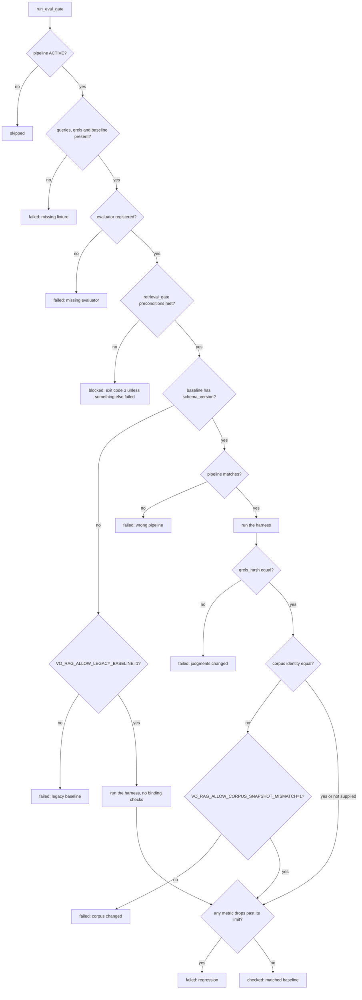

# Evaluation

[README](../README.md) · [Testing](testing.md) · [Retrieval and answers](retrieval-and-answers.md) · [Ingestion](ingestion.md) · [Advanced layers](advanced-layers.md)

vo-rag evaluates four different things, and it matters which is which. A **regression gate** compares retrieval quality with a frozen baseline. A **smoke gate** runs after every ingest and asks whether a book can find its own text. An **answer evaluation** scores generated answers for faithfulness and relevancy. And **layer decision gates** decide whether an advanced layer is worth keeping ([advanced layers](advanced-layers.md#stopgo-how-a-layer-earns-its-place)). This page covers the first three and the statistics behind them.

A caution first, because it shapes how to read everything else: the evaluation fixture in this repository is a synthetic two-document set with zero-valued baseline floors. It exists to exercise the tooling. It does not measure retrieval quality, and a passing `make eval-demo` says the plumbing works, not that search is good. To gate quality you build fixtures from a corpus you have the rights to use ([testing](testing.md#evaluation-boundaries)).

## Fixtures

A pipeline's fixtures live in `tests/fixtures/eval/<pipeline>/` ([`tests/fixtures/eval/book_rag`](../tests/fixtures/eval/book_rag) for the active pipeline):

| File | Holds |
| --- | --- |
| `queries.jsonl` | One query per line: `query_id` and `query_text` (or `text`) |
| `qrels.tsv` | Relevance judgments in TREC format: query id, an unused iteration column, document id, grade 0 to 3 |
| `baseline.json` | The frozen scores the gate compares against, plus the hashes that bind it to its inputs |
| `qrels_passage.tsv`, `baseline_passage.json` | The same judgments keyed by passage instead of chunk |
| `corpus_snapshot.jsonl` | Chunk text for the offline retriever: `chunk_id`, `source_id`, `text` |

The shipped demo fixture, in full:

```text
queries.jsonl   {"query_id": "demo-q1", "query_text": "How does the sample library store passages?", "synthetic_demo": true}
qrels.tsv       demo-q1	0	demo-d1	3
baseline.json   {"schema_version": 1, "pipeline": "book_rag", "qrels_hash": "439dd73d...", "corpus_snapshot": "sha256:5213fa3c...",
                 "created_at": "2026-10-12T00:00:00Z",
                 "aggregate": {"ndcg@5": 0.0, "recall@5": 0.0, "mrr": 0.0, "ndcg@10": 0.0, "recall@10": 0.0}}
```

(One of two queries shown; the files have two lines each.)

**Chunk or passage relevance.** By default a judgment names a chunk id. The trouble is that re-chunking a book changes chunk ids and orphans every judgment. In `passage` mode (`VO_RAG_EVAL_RELEVANCE_MODE=passage`) judgments and results are projected to page-based keys of the form `<source_id>#p<page>`, using each chunk's page range, so they survive a change in chunking ([`passages.py`](../src/vo_rag/core/eval/passages.py)).

**Metrics.** The harness ([`harness.py`](../src/vo_rag/core/eval/harness.py), [`metrics.py`](../src/vo_rag/core/eval/metrics.py)) runs every query in the judgments and reports recall, nDCG and precision at 1, 5, 10 and 20, MRR, and p50 and p95 latency, both per query and as means. The book pipeline's variant retrieves the top 10 with a prefetch of 100 and the reranker on.

## Two evaluator modes

The mode comes from `VO_RAG_EVAL_MODE` and defaults to `replay_smoke` ([`pipelines/book_rag/eval.py`](../src/vo_rag/pipelines/book_rag/eval.py)).

| Mode | What it searches | What it proves |
| --- | --- | --- |
| `replay_smoke` | Nothing. For each query it returns the judged-relevant ids, best grade first | That fixtures, judgments, hashes and metric code fit together. It needs no Qdrant and no GPU, and it scores perfectly by construction, so it measures no retrieval quality |
| `retrieval_gate` | The chunk text in `corpus_snapshot.jsonl`, with a plain term-overlap scorer, or a live retriever you pass in | Whether retrieval over that text meets the baseline |

`replay_smoke` is what runs in CI by default (`scripts/ci.sh`), and the script's own comment says that replay success does not establish semantic accuracy. `retrieval_gate` is the real check, and it is **fail-closed**: with no `corpus_snapshot.jsonl` file it reports `blocked_missing_corpus_snapshot`, with no retriever it reports `blocked_missing_retriever`, and in both cases the run exits non-zero. It never falls back to replay, because a quiet downgrade to a check that cannot fail is the failure mode the mode exists to prevent.

The file-backed retriever scores by term overlap, deliberately without a bonus for matching the query string verbatim: such a bonus only changes rankings when the corpus file was written from the queries themselves, and its absence keeps the retriever honest on real text. For a gate over the production retriever, `book_rag_evaluator` and `run_registered_eval_gate` accept a retriever (`HybridRetriever`-shaped, called through `hybrid_search`); `scripts/run_eval_gate.py` builds the file-backed retriever, and `vo-rag eval-gate` passes none, so in `retrieval_gate` mode the CLI reports blocked.

## Baselines are bound to their inputs

A score is only comparable with a baseline measured on the same judgments and the same corpus. Baseline schema version 1 therefore records the hash of the judgments (`qrels_hash`, a SHA-256 over the sorted query, document and grade triples) and an identity for the corpus (`corpus_snapshot`). The gate ([`gate.py`](../src/vo_rag/core/eval/gate.py)) checks them before it compares any number:

1. The baseline's `pipeline` must match the pipeline being gated.
2. The baseline's `qrels_hash` must equal the hash of the live judgments.
3. If a live corpus identity is supplied (an argument, or `VO_RAG_LIVE_CORPUS_SNAPSHOT`), the baseline's `corpus_snapshot` must equal it, unless `VO_RAG_ALLOW_CORPUS_SNAPSHOT_MISMATCH=1`.
4. A baseline without `schema_version` is refused unless `VO_RAG_ALLOW_LEGACY_BASELINE=1`, because it cannot prove what it was measured on. **That hatch disables input binding entirely.** A legacy baseline carries no pipeline, `qrels_hash` or corpus identity, so checks 1 to 3 are all skipped and only the metric comparison below runs. Use it only to read an old baseline you already trust.

Only then does the gate compare metrics ([`assert_no_regression`](../src/vo_rag/core/eval/harness.py)). A drop of more than 0.02 in any `ndcg@k` or in `mrr`, or more than 0.03 in any `recall@k`, is a regression. A metric absent from the baseline is not checked, and precision and latency are reported but not gated. The gate embeds no thresholds of its own: each pipeline's fixture carries the numbers it must hold.

There are two escape hatches, both environment variables an operator must set on purpose. `VO_RAG_ALLOW_CORPUS_SNAPSHOT_MISMATCH=1` skips check 3 only; the pipeline and `qrels_hash` checks still run. `VO_RAG_ALLOW_LEGACY_BASELINE=1` is much broader, as described in check 4: it skips all of checks 1 to 3.

An ACTIVE pipeline needs all of: a fixture set, a registered evaluator and a baseline. Missing any of them is a failure, not a skip. Inactive pipelines are reported as skipped.



Exit codes of [`scripts/run_eval_gate.py`](../scripts/run_eval_gate.py): 0 when every active pipeline matched its baseline, 1 on any failure, and 3 when the only problem is a blocked `retrieval_gate` precondition. A blocked pipeline never hides a real failure in another one: if anything else failed, the script exits 1.

### Running it

`make eval-demo` runs the gate in replay mode over the demo fixture. Output from a real run:

```text
$ make eval-demo
VO_RAG_EVAL_MODE=replay_smoke uv run python scripts/run_eval_gate.py
skipped inactive pipelines: ['code_rag', 'research_agent', 'idea_capture', 'article_extraction', 'structured_scrape', 'url_snapshot', 'repo_analysis', 'tool_evaluation', 'vce']
checked pipelines (matched baseline): ['book_rag']
eval gate PASS (active pipelines checked: ['book_rag'])
```

The same check is `vo-rag eval-gate`. Changing one grade in `qrels.tsv` without refreshing the baseline fails the gate, and the failure names the cause (messages from the gate's result, captured on a scratch copy of the fixture):

```text
book_rag: baseline qrels_hash does not match current report
book_rag: legacy baseline without schema_version; set VO_RAG_ALLOW_LEGACY_BASELINE=1 to allow
book_rag: retrieval quality regressed:
  ndcg@10: 0.0000 vs baseline 0.9000 (drop 0.9000)
  recall@10: 0.0000 vs baseline 0.9000 (drop 0.9000)
```

The first line is a changed judgment, the second a baseline written before schema versioning, and the last a retrieval-gate run against a baseline of 0.9 when the corpus text no longer matches the queries.

### Making the gate mean something

The repository ships the machinery and refuses shortcuts. To gate real quality:

1. Sample real chunks from your corpus and generate questions from their text ([`scripts/generate_book_rag_eval_dataset.py`](../scripts/generate_book_rag_eval_dataset.py)). Questions come from the chunk, so the judged chunk is ground truth without asking any retriever, and the export includes a large sample of distractor chunks so retrieval is a real needle-in-a-haystack task.
2. Rebuild the corpus file from that real export and freeze a baseline ([`scripts/rebuild_book_rag_eval_corpus.py`](../scripts/rebuild_book_rag_eval_corpus.py)). The script requires a real export, rejects any corpus chunk that contains a query verbatim, and refuses to freeze a baseline whose `mrr`, `ndcg@10` and `recall@10` are all exactly 1.0. A corpus file written from the answer key would make the gate a tautology that can never fail, and uniformly perfect scores over real text are a sign of exactly that.
3. Run with `VO_RAG_EVAL_MODE=retrieval_gate`. For passage mode, [`scripts/build_passage_qrels.py`](../scripts/build_passage_qrels.py) derives page-keyed judgments from chunk judgments and a gold map.

## The ingest smoke gate

The gate above compares fixed judgments. The ingest-time smoke gate needs none, because it generates its own. After a book is written, an LLM writes four questions from the book's own chunks (fixed seed), the book alone is searched for each, and the gate asks whether the chunk each question came from is in the top 10. The score is hits over scored queries, and the decision is `pass` at 0.6 or more, `quarantine` below 0.6, `fail` at exactly 0, and `quarantine` when no question could be scored ([`retrieval_smoke.py`](../src/vo_rag/pipelines/book_rag/retrieval_smoke.py)). It runs only when an LLM endpoint is configured; without one it is recorded as `skipped`. In generation mode a `fail` or `quarantine` blocks activation. The full description, with the decision flowchart, is in [ingestion](ingestion.md#self-retrieval-smoke-gate).

The two gates answer different questions. The smoke gate asks whether this book's ingestion is sound, on the real data, every time. The regression gate asks whether a change to retrieval made results worse on a fixed benchmark.

## Answer evaluation

[`scripts/run_answer_eval.py`](../scripts/run_answer_eval.py) scores generated answers instead of ranked lists. For each query in a fixture directory it retrieves from the `corpus_snapshot.jsonl` file, writes an answer with the same defended synthesizer the answer route uses, then has an LLM judge score two things on a 0 to 1 scale: **faithfulness** (is every claim supported by the retrieved context) and **relevancy** (does the answer address the question). The judges are protected like any other call over untrusted text, because both the answer and the context are attacker-controllable data: they run through the same wrap, canary and validate path as answers ([retrieval and answers](retrieval-and-answers.md#the-injection-defense-trio)), and a judge result carries its own `should_quarantine` flag.

```sh
uv run --no-sync python scripts/run_answer_eval.py \
  --fixture-dir tests/fixtures/eval/book_rag \
  --output artifacts/eval/run-1.jsonl \
  --answer-profile quality --judge-provider anthropic --self-test
```

The answer profile follows the usual rules ([retrieval and answers](retrieval-and-answers.md#profiles-and-hosted-gating)): a hosted profile needs its `answer.allow_*` switch on and a key, and the judge needs its own provider (`runpod_serverless` by default, or `anthropic`, `llama_cpp` or `kimi`). This script builds its own retrieval and synthesis; it does not go through the HTTP route, so the answer compliance gate is not involved.

The output is JSONL: one record per query, then one aggregate record. The aggregate holds `faithfulness_mean`, `faithfulness_min`, `faithfulness_variance`, the same three for relevancy, and `quarantine_rate`. A provenance block makes a run comparable later: the judge model, the answer profile, SHA-256 hashes of the query file and the corpus file, the hashes of the judge prompts and a timestamp. The script prints a JSON summary. Example (shape from the script; the numbers are illustrative):

```json
{
  "aggregate": {
    "faithfulness_mean": 0.86, "faithfulness_min": 0.62, "faithfulness_variance": 0.012,
    "quarantine_rate": 0.0,
    "relevancy_mean": 0.91, "relevancy_min": 0.74, "relevancy_variance": 0.007,
    "self_test_faithfulness_drop": 0.77, "self_test_original_faithfulness": 0.95,
    "self_test_swapped_faithfulness": 0.18
  },
  "n_queries": 24,
  "output": "artifacts/eval/run-1.jsonl",
  "provenance": {
    "answer_profile": "quality",
    "created_at": "2026-10-12T09:30:00+00:00",
    "judge_model": "judge-model-name",
    "prompt_hashes": {"faithfulness": "sha256:...", "relevancy": "sha256:..."},
    "query_set_hash": "sha256:...",
    "snapshot_hash": "sha256:..."
  }
}
```

An LLM judge can be fooled, or can be lazy, so the script guards against a run whose numbers look fabricated:

- **Uniformly perfect scores abort the run.** If every query scores 0.999 or more on both faithfulness and relevancy, the script raises `FabricationSmellError` and writes nothing.
- **`--self-test`** takes the best-scoring query, swaps in an answer written for a different question and re-judges it against the original context. Faithfulness must drop by at least 0.05, or the run fails: a judge that cannot tell a wrong answer from a right one is not measuring anything.
- **`--compare other.jsonl`** reports the mean per-evaluator score change over the query ids both runs share, so two profiles or two prompt versions can be compared on equal terms.

## Judge calibration

An LLM judge has a bias, and the size of the bias is knowable if a person scores some of the same items. [`judge_calibration.py`](../src/vo_rag/core/eval/judge_calibration.py) implements the ARES approach, prediction-powered inference: score everything with the judge, hand-label a small subset, measure the average gap on that subset, and correct the judge's overall mean by it.

- `compute_ppi_calibration` returns the corrected estimate `judge mean + mean(human − judge over the labeled subset)`, with a confidence interval from the variance of the judge scores over all items plus the variance of the gap over the labeled ones. With no labeled items it returns the uncorrected mean with an interval of width 2.0, which says plainly that nothing is known.
- `compute_agreement_rate` is the share of labeled items where judge and human differ by at most 0.1.
- `calibration_acceptance` passes a judge when that agreement is at least 0.85 and the interval is no wider than 0.10.

These are pure functions over scores you provide. They run no model, and no script or command in this repository invokes them yet; they are the acceptance test to apply to a judge before trusting its aggregate.

## The statistics shared with the layer gates

[`non_inferiority.py`](../src/vo_rag/core/eval/non_inferiority.py) holds recall@k and nDCG@k for single queries and `compute_non_inferiority`, the paired test used by the summary, RAPTOR and graph decision gates. For paired per-query scores it computes the mean difference (treatment minus control) and a one-sided lower confidence bound on it, using a normal approximation, and returns `non_inferior` when the bound is above minus the margin, `inferior` when it is below that margin and the mean difference is negative, and `inconclusive` otherwise. See [advanced layers](advanced-layers.md#stopgo-how-a-layer-earns-its-place) for how the layers use it.

## Code map

| Concern | Code |
| --- | --- |
| Gate and result model | [`core/eval/gate.py`](../src/vo_rag/core/eval/gate.py), [`registered.py`](../src/vo_rag/core/eval/registered.py) |
| Harness, metrics, qrels, passages | [`core/eval/harness.py`](../src/vo_rag/core/eval/harness.py), [`metrics.py`](../src/vo_rag/core/eval/metrics.py), [`qrels.py`](../src/vo_rag/core/eval/qrels.py), [`passages.py`](../src/vo_rag/core/eval/passages.py) |
| book_rag evaluator and file-backed retriever | [`pipelines/book_rag/eval.py`](../src/vo_rag/pipelines/book_rag/eval.py) |
| CI entry and CLI | [`scripts/run_eval_gate.py`](../scripts/run_eval_gate.py), [`cli/eval.py`](../src/vo_rag/cli/eval.py), `make eval-demo` |
| Answer evaluation | [`scripts/run_answer_eval.py`](../scripts/run_answer_eval.py), [`integrations/llamaindex/answer_eval.py`](../src/vo_rag/integrations/llamaindex/answer_eval.py) |
| Judge calibration and non-inferiority | [`core/eval/judge_calibration.py`](../src/vo_rag/core/eval/judge_calibration.py), [`core/eval/non_inferiority.py`](../src/vo_rag/core/eval/non_inferiority.py) |
| Smoke gate | [`pipelines/book_rag/retrieval_smoke.py`](../src/vo_rag/pipelines/book_rag/retrieval_smoke.py) |
