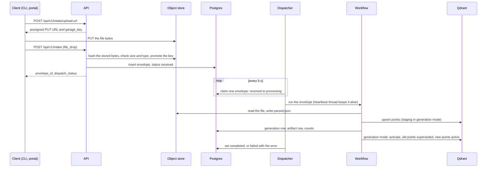
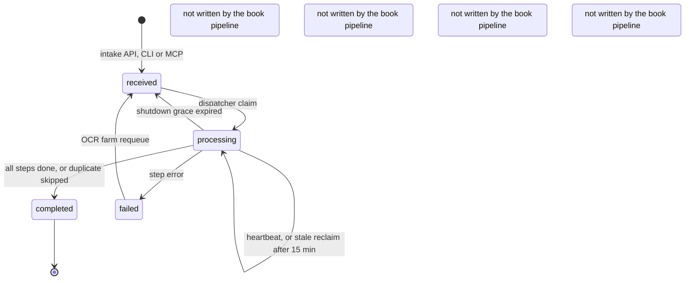
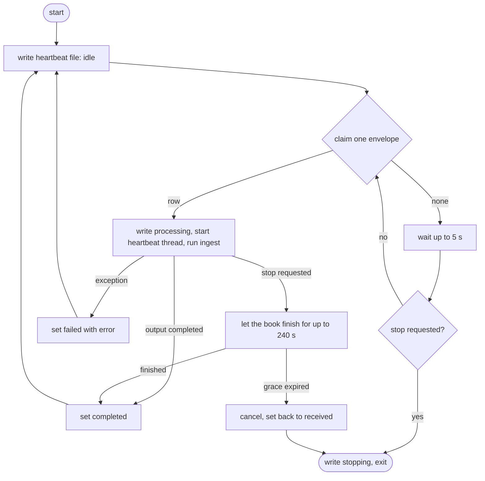
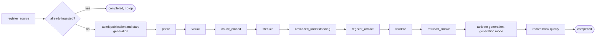
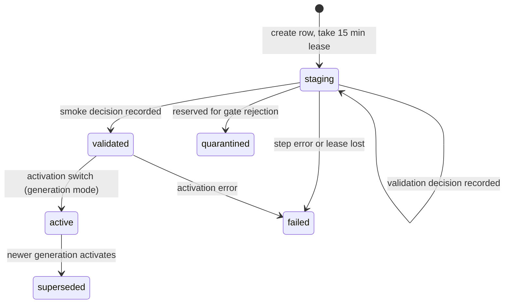
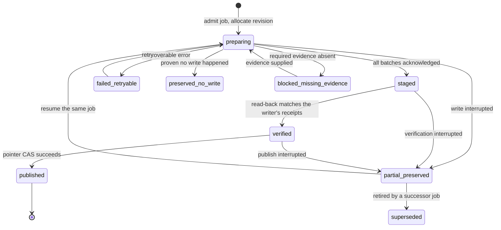
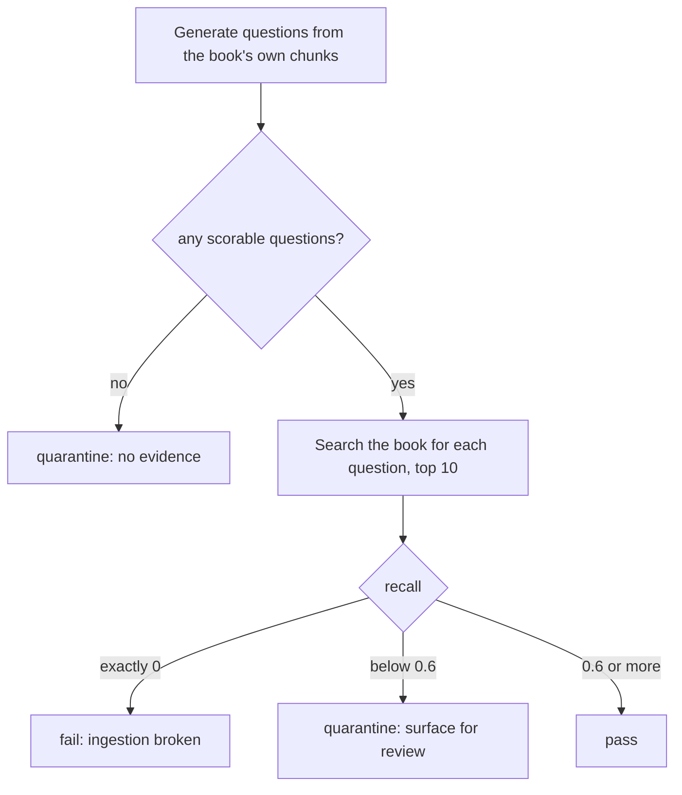
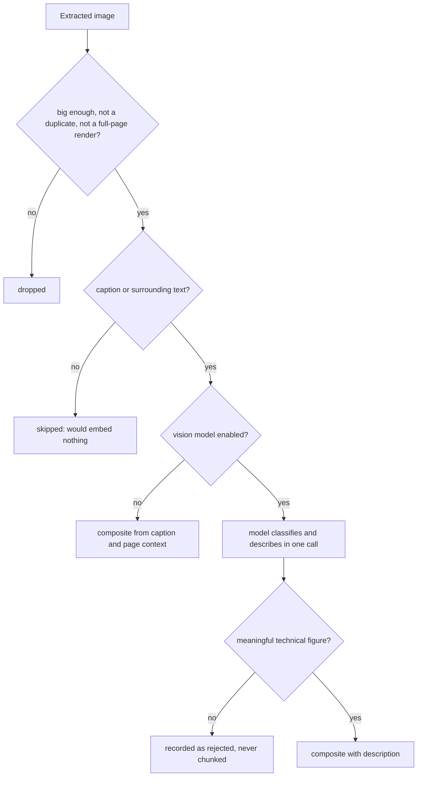

# Ingestion

[README](../README.md) · [Architecture](architecture.md) · [Data model](data-model.md) · [Parsing and chunking](parsing-and-chunking.md) · [OCR](ocr.md) · [Reliability](reliability.md)

Ingestion turns a submitted file into searchable evidence. A client records an *envelope* in Postgres, a long-running dispatcher claims it, and a fixed sequence of steps parses the file, cuts it into chunks, embeds them and writes them to Qdrant. This page covers the loop around that work: how envelopes get in, how the dispatcher claims and keeps them, what happens when a worker dies, and how a finished book becomes visible to queries. Parsing and chunking have [their own page](parsing-and-chunking.md).

## What the loop is built to guarantee

The design goal is that a crash in the middle of a book never leaves a half-ingested book that queries can see, and a retry never produces a duplicate. Several mechanisms contribute, and two of them are opt-in, so it matters which are on.

| Mechanism | What it does | Default |
| --- | --- | --- |
| Single-statement claim | One SQL statement picks a `received` envelope and marks it `processing`; `FOR UPDATE SKIP LOCKED` keeps two dispatchers off the same row | Always on |
| Heartbeat thread | A dedicated thread touches the envelope every 60 s so a live book is never mistaken for a dead one | Always on |
| Stale reclaim | A `processing` envelope with no heartbeat for 15 minutes is claimed again | Always on |
| Deterministic IDs | Source IDs come from the file hash and point IDs from source, chunk index and stage, so a rerun overwrites rather than duplicates | Always on |
| Count reconciliation | After writing, the step reads Qdrant back and refuses to continue if the stored point count differs from what it wrote | Generation mode only |
| Generation-scoped publication | New points are written as `staging` and stay invisible until one atomic switch makes them `active`; a database constraint refuses the switch unless counts match, validation passed and the smoke decision is `pass` or `skipped` | **Off.** Set `VORAG_INGEST_GENERATIONS=1` |
| Source publication revisions | A per-source revision pointer lets readers pin one version of a source; see [Source publication](#source-publication-revisions) | **Writes off.** `VORAG_SOURCE_PUBLICATION_WRITES_ENABLED=true` turns them on; it cannot be combined with generations |

With neither opt-in switch on, points are written straight to `active`. Deterministic IDs make a rerun overwrite them, but a crash in the middle of a book leaves the points written so far visible, and the validator and smoke gate only add warnings. Turn on generations for the full behavior described on this page. The sections below say which behavior needs the switch.

## Intake surfaces

Every surface ends in the same place: a row in `intake_envelopes` with status `received`. Only one kind of envelope is claimed by the dispatcher: a `file_drop` whose bytes the API has verified. The rest are stored, and wait for a pipeline that is not implemented.

| Surface | Command or route | Creates | Claimed by the dispatcher |
| --- | --- | --- | --- |
| Upload a local file | `vo-rag ingest file PATH` | A presigned upload, then a `file_drop` envelope | Yes |
| Bulk upload with preflight | `vo-rag ingest file-drop --preflight report.json PATH...` | `file_drop` envelopes carrying `metadata.preflight` (route, pages, kind, verdict) | Yes |
| File already in the object store | `vo-rag ingest file-drop GARAGE_KEY` | A `file_drop` envelope; the API verifies the stored bytes | Yes |
| Presigned upload by hand | `POST /api/v1/intake/upload-url`, then `POST /api/v1/intake` | A `file_drop` envelope | Yes |
| Text | `vo-rag ingest text`, `idea` (a `text_prompt` tagged `idea`) | A `text_prompt` envelope | No |
| URL | `vo-rag ingest url` | A `url` envelope, after the SSRF check | No |
| MCP | `vo_rag_ingest` (`source_type` is one of `file_drop`, `url`, `text_prompt`, `api`, `github_star`) | An envelope, status `received` | Only if it is a verified `file_drop`, which MCP does not produce |
| Progress stream | `GET /api/v1/intake/{id}/stream`, MCP `vo_rag_ingest_stream` | Nothing new: runs an existing envelope in this process | n/a |
| One-off run | `vo-rag ingest run --envelope-id ID` | Nothing new: runs an existing envelope in this process | n/a |

Two details are easy to miss.

- **`POST /api/v1/intake` alone never ingests anything.** It records the envelope. The response reports `dispatch_status: "queued"` only for a complete, verified `file_drop` envelope while the dispatcher's heartbeat file is fresh; otherwise it reports `not_configured`, and the envelope stays `received` until a dispatcher runs.
- **File-drop bytes are verified by the server, not trusted.** The API reads the stored object, computes its SHA-256, checks size and content type against what the client declared, and copies the object to a content-addressed key, `verified/sha256/<hash>.<ext>`, and deletes the staged upload once the envelope row has committed. A client-supplied `file_hash` is only an assertion that must match. The result is written to `raw_content.object_verification`, and the dispatcher's claim requires `status = verified` and a matching hash. MCP builds `file_drop` envelopes from a bare key without that step, so books go in through the API or CLI. The checks live in [`object_verification.py`](../src/vo_rag/core/ingest/object_verification.py) and [`api/routes/ingest.py`](../src/vo_rag/api/routes/ingest.py); intake normalization is in [`normalize.py`](../src/vo_rag/core/ingest/normalize.py).

The whole path for a file, from upload to a finished book:



The CLI wraps the upload (it sniffs the content type from magic bytes, requests a presigned URL, streams the file with a progress bar on stderr and hashes it on the way) and prints only the envelope ID. The same flow by hand:

```sh
# 1. Ask for a presigned upload URL (the filename is sanitised, the key is ULID-scoped).
curl -sS http://127.0.0.1:8000/api/v1/intake/upload-url \
  -H "Content-Type: application/json" -H "X-API-Key: $VORAG_API_KEY" \
  -d '{"filename": "handbook.pdf", "content_type": "application/pdf", "size_bytes": 48213}'

# 2. PUT the bytes to the returned upload_url, then register the envelope.
curl -sS http://127.0.0.1:8000/api/v1/intake \
  -H "Content-Type: application/json" -H "X-API-Key: $VORAG_API_KEY" \
  -d '{
        "source_type": "file_drop",
        "source_data": {"garage_key": "intake/01J9ZEXAMPLE/handbook.pdf"},
        "raw_content": {
          "garage_key": "intake/01J9ZEXAMPLE/handbook.pdf",
          "filename": "handbook.pdf",
          "content_type": "application/pdf",
          "size_bytes": 48213
        },
        "metadata": {"title": "Handbook", "tags": []}
      }'
```

Example response to the first call (shape from `UploadUrlResponse`; the URL is shortened):

```json
{
  "upload_url": "https://garage.example.internal/vorag-artifacts/intake/01J9ZEXAMPLE/handbook.pdf?X-Amz-Signature=...",
  "garage_key": "intake/01J9ZEXAMPLE/handbook.pdf",
  "bucket": "vorag-artifacts",
  "expires_in_s": 21600
}
```

Example response to the second call (shape from `EnvelopeResponse`, built from a real normalized envelope; IDs and hash are placeholders). The server has replaced the client's identity fields with what it measured and moved the bytes to a content-addressed key:

```json
{
  "envelope_id": "01M4SBAPR8NMHWTQJKZRQ0JFPY",
  "status": "received",
  "source_type": "file_drop",
  "target_pipeline": null,
  "priority": "medium",
  "sovereignty": "cloud_ok",
  "created_at": "2026-10-13T00:41:48.551285Z",
  "updated_at": "2026-10-13T00:41:48.551285Z",
  "raw_content": {
    "garage_key": "verified/sha256/9cd33ad5263959401ed620f416fea121c6deecc80cc1bf7f34a32b9a16973921.pdf",
    "filename": "handbook.pdf",
    "content_type": "application/pdf",
    "file_hash": "9cd33ad5263959401ed620f416fea121c6deecc80cc1bf7f34a32b9a16973921",
    "size_bytes": 48213,
    "object_verification": {
      "status": "verified",
      "sha256": "9cd33ad5263959401ed620f416fea121c6deecc80cc1bf7f34a32b9a16973921",
      "size_bytes": 48213,
      "content_type": "application/pdf",
      "etag": "5d41402abc4b2a76b9719d911017c592",
      "staged_key": "intake/01J9ZEXAMPLE/handbook.pdf",
      "authoritative_key": "verified/sha256/9cd33ad5263959401ed620f416fea121c6deecc80cc1bf7f34a32b9a16973921.pdf"
    }
  },
  "metadata": {"title": "Handbook", "tags": []},
  "dispatch_status": "queued"
}
```

`GET /api/v1/envelopes/{envelope_id}` and the MCP tool `vo_rag_status` report an envelope's status afterward.

### Streaming progress

`GET /api/v1/intake/{envelope_id}/stream` is a Server-Sent Events endpoint, but it is not a read-only view. It starts a new in-process ingest run for that envelope and streams the steps as they finish. A client disconnect closes the stream and does not stop the run; the envelope row stays the source of truth. While a stream is active it stamps `metadata.metrics.active_stream` and refreshes a stream heartbeat, and the dispatcher's claim skips an envelope whose stream heartbeat is under 10 minutes old, so the two never run the same book. A stream whose API process died is claimable again after those 10 minutes.

Each step emits an event named after it, with an `IngestProgress` payload, and a final `done` event carries the result:

```text
event: parse
data: {"envelope_id":"01M4SBAPR8NMHWTQJKZRQ0JFPY","step":"parse","detail":"docling","pct":null}

event: done
data: {"source_id":"vo-rag-corpus-sha256:9cd3...","status":"completed","qdrant_point_ids":["..."],"raw_point_ids":["..."],"sterile_point_ids":[],"smoke_decision":"pass","chunk_count":42,"idempotent_noop":false,"quality_warnings":[]}
```

The step names, in order, are `register_source`, `parse`, `visual`, `chunk_embed`, `sterilize`, `register_artifact`, `validate` and `retrieval_smoke` ([`events.py`](../src/vo_rag/pipelines/book_rag/events.py)). The streamed workflow ([`workflow_li.py`](../src/vo_rag/pipelines/book_rag/workflow_li.py)) is a LlamaIndex workflow that reuses the same step helpers and generation logic as the dispatcher's orchestrator, so the two paths write the same data. `ingest run` uses it when the optional `llamaindex` extra is installed and falls back to the plain orchestrator otherwise.

## Envelope lifecycle



`EnvelopeStatus` is defined at [`core/models/envelope.py:55`](../src/vo_rag/core/models/envelope.py). It lists eight values because it also serves a triage flow; nothing in `src/` writes `triaging`, `triaged`, `dispatched` or `discarded`, though the database constraint and the status summary still accept them. The book pipeline uses `received`, `processing`, `completed` and `failed`.

Failures are recorded on the row, not hidden: `error` holds the message and `metadata.metrics.failures` counts them. A `failed` envelope is not retried by the dispatcher. The [OCR farm](ocr.md) re-queues scanned books it has just recognized, and an operator can set a row back to `received` by hand.

## The dispatcher

The dispatcher is a long-lived process, separate from the API. Its poll loop is in [`dispatcher.py`](../src/vo_rag/pipelines/book_rag/dispatcher.py); the heartbeat file contract is in [`dispatcher_health.py`](../src/vo_rag/pipelines/book_rag/dispatcher_health.py).

### Starting it

```sh
uv run python -m vo_rag.pipelines.book_rag.dispatcher
```

Run it as a supervised service (for example under systemd) with the same environment as the API. None of the `VORAG_BOOK_RAG_*` variables is required; every one has a default. What the process does need is the service configuration that ingest uses:

| Needed | Variables | If unset or unreachable |
| --- | --- | --- |
| Postgres | `VORAG_POSTGRES_URL` | The process cannot open its pool and exits at startup |
| Qdrant | `QDRANT_URL`, `QDRANT_API_KEY` | Each claimed envelope fails when it first writes points |
| Object store | `GARAGE_ENDPOINT`, `GARAGE_ACCESS_KEY`, `GARAGE_SECRET_KEY` | Each claimed envelope fails at once with `service_unavailable:garage` |
| Embedding service | `BGE_M3_QUERY_URL` | Each claimed envelope fails at the embed step |

The service clients are built for each claimed envelope, so an unset or unreachable service fails books rather than stopping the loop. Most of these settings have `localhost` defaults in `config/settings.yaml`, so "unset" usually means "points at a service that is not there". Migrations and Qdrant collections are not created at startup; create them once first with the bootstrap script in [Data model](data-model.md#bootstrapping-a-new-deployment). Defaults and the full variable list are in [Configuration](configuration.md).

The optional dispatcher variables:

| Variable | Default | Effect |
| --- | --- | --- |
| `VORAG_BOOK_RAG_DISPATCHER_POLL_INTERVAL_S` | `5` | Wait between claim attempts when the queue is empty |
| `VORAG_BOOK_RAG_DISPATCHER_STALE_TIMEOUT_S` | `900` | Idle time after which a `processing` envelope may be reclaimed |
| `VORAG_BOOK_RAG_DISPATCHER_HEARTBEAT_INTERVAL_S` | `60` | Envelope heartbeat period |
| `VORAG_BOOK_RAG_DISPATCHER_SHUTDOWN_GRACE_S` | `240` | How long a running book may finish after SIGTERM or SIGINT |
| `VORAG_BOOK_RAG_DISPATCHER_CLAIM_NOT_BEFORE` | unset | ISO-8601 timestamp with a timezone; older envelopes are ignored. The dispatcher warns at startup if this hides the whole backlog |
| `VORAG_BOOK_RAG_DISPATCHER_ONLY_EXTENSIONS` | unset | Comma list such as `epub,mobi,md,txt`; claim only those file types (for lanes without a GPU) |
| `VORAG_BOOK_RAG_LANE_CLASS` | unset | `giant`, `normal` or unset; see [Lanes](#lanes) |
| `VORAG_BOOK_RAG_GIANT_FALLBACK_AFTER_S` | `21600` | Age after which a normal lane may take a waiting giant |
| `VORAG_BOOK_RAG_DISPATCHER_HEARTBEAT_PATH` | `/run/vo-rag/dispatcher-heartbeat.json` | Where the liveness file is written |
| `VORAG_BOOK_RAG_DISPATCHER_HEARTBEAT_STALE_S` | `130` | Age after which the API treats the file as stale |

A malformed or negative number logs a warning and falls back to its default. For local development the default heartbeat path usually is not writable, so point both the dispatcher and the API at a path you own:

```sh
export VORAG_BOOK_RAG_DISPATCHER_HEARTBEAT_PATH="$PWD/var/dispatcher-heartbeat.json"
uv run python -m vo_rag.pipelines.book_rag.dispatcher
```

### The loop



Reading the loop from the top:

1. **Poll.** With nothing to claim, the loop waits up to 5 s (or until a stop request) and tries again. It handles one envelope at a time; run more dispatchers for more throughput.
2. **Claim.** One statement selects the oldest eligible envelope and updates it to `processing` in the same step. The selection runs `FOR UPDATE SKIP LOCKED`, so a second dispatcher skips a row the first has locked and takes the next one. An envelope is eligible when all of these hold:
   - its status is `received`, or it is `processing` and its `updated_at` is older than the stale timeout;
   - it is a `file_drop` for the book pipeline (`target_pipeline` is empty or `book_rag`);
   - it has a `garage_key` and `file_hash`, `object_verification.status` is `verified`, and the two hashes match;
   - it is newer than `claim_not_before`, if set, and its file extension is in the allow-list, if set;
   - no streaming ingest is actively running it;
   - it passes the lane test below.

   The claim also stamps `metadata.metrics.claimed_at_epoch_s` and counts reclaims in `stale_reclaims` (consecutive, reset by a fresh claim) and `stale_reclaims_total` (never reset). The counter `vo_rag_dispatcher_claims_total{kind="new|stale_reclaim"}` tracks the same split.
3. **Run.** The envelope goes through the workflow below. The service clients (Garage, Qdrant, embedding client, parser router) are built for this envelope.
4. **Finish.** A completed run writes `completed`. A raised error writes `failed` plus the message and increments the failure count. If another runner already owns the same generation (`IngestGenerationClaimed`), the dispatcher leaves the envelope in `processing` and does nothing: the owner, or stale reclaim after a crash, is authoritative, and failing or requeueing here would only add a second writer.

### Heartbeat and stale reclaim

While a book runs, a dedicated thread updates the envelope row every 60 s. The update is a no-op, but a trigger on `intake_envelopes` bumps `updated_at` on every write, and `updated_at` is what the stale test reads. If a dispatcher dies, its envelope stops being touched and, 15 minutes later, the next claim takes it back and the book runs again from the start.

The heartbeat is a thread, not an asyncio task, and it opens a short-lived connection for each beat. An in-loop heartbeat would stop whenever a long synchronous step blocks the event loop. A figure-heavy visual build can do that for hours, the 15-minute timer would expire, another lane would reclaim a book that is still running, and the lanes would converge on one book and leave the rest idle. A thread keeps beating through CPU-bound Python, because the interpreter releases the GIL between bytecode slices. A fresh connection per beat is needed because an asyncpg pool belongs to the event loop that created it, and the thread has its own.

A second, separate signal serves the API: the dispatcher rewrites a small JSON file on every state change and every beat, atomically, with no envelope IDs or content in it. Example of the file (from `write_dispatcher_heartbeat`):

```json
{"observed_at":"2026-10-13T00:41:48.552467+00:00","schema_version":1,"state":"processing"}
```

`state` is `idle`, `processing` or `stopping`. The API treats the dispatcher as alive only when the file exists, is well formed and not a symlink, is younger than the stale limit (130 s by default) and the state is not `stopping`. A missing file is reported as `not_configured`.

### Graceful shutdown

SIGTERM and SIGINT set a stop flag. An idle dispatcher exits at once. A dispatcher in the middle of a book lets it run for up to 240 s. If the book finishes, its result is saved normally. If not, the run is cancelled, the envelope goes back to `received` with an error note saying the dispatcher was interrupted, and the dispatcher exits. The next claim starts the book again; that is safe because generation IDs and point IDs are deterministic, so the rerun lands on the same identifiers. `vo_rag_dispatcher_stop_requests_total` and `vo_rag_dispatcher_cancellations_total` count these events. Set your service manager's stop timeout above 240 s.

### Lanes

A *lane* is one dispatcher process with a filter on what it claims. Lanes exist because books differ by orders of magnitude: a 4,000-page scan can occupy a GPU for hours, and you do not want it to starve a queue of ordinary books or be started by a host that cannot do the work.

- **`VORAG_BOOK_RAG_DISPATCHER_ONLY_EXTENSIONS`** restricts a lane to file types. A GPU-free lane takes ebooks and text and never claims a PDF that would need GPU OCR.
- **`VORAG_BOOK_RAG_LANE_CLASS`** works on the `route` that [preflight](parsing-and-chunking.md#preflight) wrote into `metadata.preflight.route`. A `giant` lane claims only `route = giant`. A `normal` lane claims everything else, including envelopes with no preflight metadata. Unset claims anything.

Giants must not wait forever when no giant lane is running, so a `normal` lane may take a giant that has waited longer than 6 hours. It may do so only while no giant lane is alive, meaning no giant envelope is `processing` with an `updated_at` newer than the stale timeout. Without that second condition, a long bulk run would age every queued giant past 6 hours, and the normal lanes would take all of them even though a working giant lane would have handled them in order. A giant is a PDF over 1,000 pages, or one of 700 pages or more that is not text-native.

## The workflow

`BookRagPipeline.ingest` in [`workflow.py`](../src/vo_rag/pipelines/book_rag/workflow.py) runs the steps below for one envelope. It is a plain async class, not a workflow engine: each step is a coroutine over a shared typed context, and the external services (object store, Qdrant, embedding client, LLM client, retriever, parser router) are injected. That is what lets the whole sequence run in tests against fakes with no GPU or live service. See [engineering decisions](engineering.md) for the trade-off.



| Step | What it does | Why it sits here |
| --- | --- | --- |
| `register_source` | Requires verified bytes, derives `source_id = vo-rag-corpus-sha256:<file hash>` | Identity must exist before the duplicate check and before any paid work |
| duplicate check | If the source already has complete active data, mark the envelope `completed` and stop. `VORAG_BOOK_RAG_FORCE_REINGEST=1` bypasses it | A rerun of a finished book costs nothing. Overwrite re-ingest stays possible because point IDs are deterministic |
| admit publication, start generation | Pin the source revision (publication mode) or create the generation row and take its lease (generation mode) | Ownership is settled before the parser or any model runs |
| `parse` | Downloads the file, re-hashes it against the source ID, routes it to a parser, applies the quality gates and writes `parsed/<envelope_id>/parsed.json`. Details: [Parsing and chunking](parsing-and-chunking.md) | Failing here is cheap; nothing has been embedded yet |
| `visual` | Builds figure chunks from extracted images, optionally described by a vision model; see [Figures](#figures) | The chunker needs figure chunks as input so it can place them in reading order |
| `chunk_embed` | Chunks the parsed document, embeds each chunk and upserts to the raw collection | Everything after this depends on stored points |
| `sterilize` | When `sterilize_enabled` is set, rewrites each chunk through an LLM and writes `vo_rag_books_sterile_v1`; otherwise records zero sterile points | Sterile points derive from the raw chunks, one for one. See [Rights and compliance](rights-and-compliance.md) |
| `advanced_understanding` | A placeholder position: with every advanced-layer flag off (the only configuration the runner builds) it does nothing | Those layers need corpus-level inputs; build them after ingest with `vo-rag build summary\|raptor\|dsi\|graph`. Enabling a flag here raises an error rather than skipping silently |
| `register_artifact` | Inserts the `knowledge_artifacts` row listing the point IDs written | The validator checks that the artifact exists |
| `validate` | The eight-check audit | Cheap structural check before the model-based one |
| `retrieval_smoke` | Self-retrieval probe; see [below](#self-retrieval-smoke-gate) | Needs the points to exist and an LLM; skipped when no LLM is configured |
| activate generation (generation mode) | The atomic switch to `active` | Last, so everything it publishes has been checked |
| record book quality | Scans the stored points for findings and writes `metadata.quality` | Best-effort: an error here never fails a finished book |

Sterilization is opt-in. `BookRagConfig.sterilize_enabled` defaults to `False` and the production runner does not change it, because sterilizing makes one LLM call per chunk and writes a second, rights-filtered collection; it should never run on an ingest nobody asked it for.

Each step is timed into `metadata.metrics` on the envelope and flushed every 60 s while it runs, so a long book shows its current stage and its embedding rate-limit counts before it finishes.

### Warnings versus failures

The workflow keeps one rule: a quality problem is recorded, not turned into an outage, unless it means the data would be wrong or unsafe. Findings accumulate as `quality_warnings` (`stage`, `code`, `severity`, `details`) on the envelope metadata, on the intake status and on the stored passages.

| Condition | Result |
| --- | --- |
| Garbled text from a broken font (control characters, or letters shifted by a fixed offset) | Fails the envelope before any model spend |
| PDF parsed by an unapproved parser, or with no text at all | Fails |
| No chunks after all fallbacks, or runaway output that cannot be repacked | Fails |
| Stored point count differs from the written count (generation mode) | Fails |
| Lease lost to another runner | Stops without failing the other owner |
| Generation mode: validation did not pass, or smoke decision is `quarantine` or `fail` | Activation is refused by the database constraint, so the book fails and the previous generation stays live |
| Vision-model describe yield below 90% of eligible images | Fails |
| Low-confidence pages, low page coverage, degenerate chunk counts, a failed validator check, a non-`pass` smoke decision | Warning. In generation mode the last two also block activation, as above |
| Quality audit unavailable (timeout or error) | Warning `audit_unavailable`; in generation mode it records `passed: false`, so activation is refused |

The generation row has a `quarantined` state and `_reject_generation` can set it, but no shipped step calls it today: the validator and smoke steps record their decision and a warning, and the activation constraint is the enforcement point.

## Generations and leases

Everything in this section is opt-in: it applies only when `VORAG_INGEST_GENERATIONS=1`, and with the default settings none of it runs. A *generation* is one attempt to ingest one source. Its ID is a hash of the envelope, source, collection, schema version, chunking strategy and sterilize flag, so a retry of the same envelope with the same settings maps to the same generation.



`IngestGenerationState` is defined at [`core/models/ingest_generation.py:11`](../src/vo_rag/core/models/ingest_generation.py), and the table is created by migration `035_source_ingest_generations.sql`.

**Staging is invisible.** Points are upserted with `ingest_state = staging`. Retrieval filters to `ingest_state = active` or an absent field (data written before generations existed), so staged points never appear in a query.

**The lease is a fencing token.** Creating the generation stores a random owner token and an expiry 15 minutes ahead. An asyncio task refreshes it every 60 s. Before and after every step, the runner checks that its token still owns an unexpired lease. If a runner stops refreshing (it crashed, or its event loop was blocked longer than the lease), the next run of the same generation takes over with a new token, and the old runner's next write or check fails its fence and stops. Every state change, count update and artifact insert is conditional on the owner token, so a runner that lost its lease cannot write over the new one. The refresher shares the event loop with the steps, unlike the envelope heartbeat, which has its own thread.

**Activation (generation mode) is one switch with a rollback.** The runner takes a per-source Postgres advisory lock, re-checks that it still owns a `validated` generation, then in this order: marks the previous generation's points `superseded` (for a source's first generation, its pre-generation points instead), marks the new points `active`, re-counts the active points per collection against what it wrote, and updates the generation row to `active` (the constraint from migration 035 is checked here). If anything in that sequence raises, the runner restores the old states in reverse, so readers see the previous version, never a mix. Old points are deleted only after the switch commits; a cleanup failure sets `cleanup_required` on the row, and the next submission of that source retries it, but it never un-publishes the new data.

**A changed configuration re-ingests.** The duplicate check only skips a source whose active generation was built with the current schema version, chunking strategy and sterilize flag and whose artifact and point counts still match Qdrant. Change the chunking strategy or turn sterilization on and the same file ingests again as a new generation that replaces the old one atomically.

**Ambiguous commits are reconciled.** Qdrant and Postgres cannot commit together, so an error can arrive after the Postgres transaction actually committed (a lost reply, a cancellation at exit). When the activation transaction raises, `_reconcile_activation_after_transaction_error` re-takes the source lock, reads which generation Postgres says is active, and makes Qdrant agree: if the new generation won, it re-marks the new points active and the old ones superseded and flags cleanup; if it lost, it hides the new points and restores the old view. The failure path does the same check before marking a generation `failed`, so an activation that committed is never hidden by a late error. Postgres is the authority; Qdrant is repaired to match it.

Cancellation is handled the same way: a cancelled run releases its lease immediately so a retry does not wait 15 minutes, and the Postgres side of reconciliation is shielded from a second cancellation.

## Source publication revisions

Generations protect one ingest attempt. A second mechanism, source publication, protects readers across *writers*: ingest, derived-layer builds and repairs all write points for the same source, and a reader should see one consistent revision of it. [`source_publication.py`](../src/vo_rag/core/ingest/source_publication.py) keeps a durable job per collection-scoped revision. Each job moves through the states below, and a job is published by a compare-and-swap on a per-source pointer in `source_publications`, which readers consult. Old revisions' points are retained, not deleted, at publication.



`PublicationState` is defined at [`core/ingest/source_publication.py:116`](../src/vo_rag/core/ingest/source_publication.py); the full transition table is `_ALLOWED_TRANSITIONS` in the same file, and the diagram shows its main paths. A job that is not terminal blocks other jobs for that source until it is resumed, which is how an interrupted writer quarantines only its own source. Publishing is refused if the active pointer is not the revision the job expected, so a stale writer cannot overwrite a newer one.

Publication reads are enabled by default (`VORAG_SOURCE_PUBLICATION_ENABLED`), and writes are not (`VORAG_SOURCE_PUBLICATION_WRITES_ENABLED`, default `false`). The ingest workflow raises an error if publication writes and generations are both enabled: pick one write protocol per deployment. Repairs of a published source replay the normal producer from an immutable evidence file validated by [`repair_evidence.py`](../src/vo_rag/core/ingest/repair_evidence.py); see [Operations](operations.md).

## The eight-check validator

Eight structural checks run on every ingest, after the points are written and before the smoke gate. [`validator.py`](../src/vo_rag/pipelines/book_rag/validator.py) audits the points a source has just written. It runs against staging points in generation mode and against active points otherwise, under a 10 s timeout. Each check records `name`, `passed` and `detail`.

| Check | Passes when |
| --- | --- |
| `raw_sterile_1to1` | Sterilization is on and the raw and sterile point counts are equal, or sterilization is off (reported as skipped) |
| `chunk_output_not_degenerate` | The chunk count, density and size are plausible for the page count (floors below) |
| `metadata_completeness` | For each of `source_book`, `license_class` and `canonical_source_id`, a real value is more common across the chunks than a missing one. `license_class = unknown` counts as missing. `author` and `domain_tags` only warn. `VO_RAG_BOOK_RAG_METADATA_GUARD=warn` downgrades failures to a pass |
| `payload_fields_complete` | A sample of five chunks all carry `source_id`, `page_number` and `section_title` |
| `images_resolve` | Every `image_ref` in that sample exists in the figure store |
| `artifact_exists` | A `knowledge_artifacts` row exists for the source (skipped without a database pool) |
| `sub_chunks_present` | Always passes today; it reports that compliance sub-chunking has not run |
| `sample_query_returns` | A search filtered to the source returns at least one hit, from the sterile collection when sterilization is on |

When the caller passes an artifact ID, a ninth entry, `artifact_id_exists`, is added; it is not part of the eight. The design drops a separate "any points at all" check because an empty source already fails `chunk_output_not_degenerate` and `sample_query_returns`.

The degeneracy floors apply only to documents of at least 25 pages, to avoid judging one-page fixtures. A book of that size needs at least 11 chunks and at least 0.08 chunks per page (one chunk per 12.5 pages), and at least 20 tokens per page; the chunk floor is the larger of 11 and the density figure. The chunk floor sits just above the 1 to 10 chunks that degenerate parses produce, and a typical book yields well above the floors. Each floor can be changed through `VO_RAG_BOOK_RAG_DEGENERATE_MIN_PAGES`, `..._MIN_CHUNKS`, `..._MIN_CHUNKS_PER_PAGE` and `..._MIN_TOKENS_PER_PAGE`. The validator variables use the prefix `VO_RAG_BOOK_RAG_`, unlike the dispatcher's `VORAG_BOOK_RAG_`.

A separate *runaway* check runs inside chunking, before any embedding spend: a scanned or garbled document that explodes into tiny chunks (above 60 chunks per page with a mean under 40 tokens) is repacked by a bounded plain-text splitter instead of being embedded as is. It needs both a high chunk rate and small chunks, because reflowable ebooks have tiny synthetic page counts and would otherwise be flagged by the rate alone.

Example report (shape from `ValidationReport`; two of the eight entries shown):

```json
{
  "document_id": "9cd33ad5...",
  "source_id": "vo-rag-corpus-sha256:9cd33ad5...",
  "checks": [
    {"name": "raw_sterile_1to1", "passed": true, "detail": "skipped: sterilize disabled"},
    {"name": "chunk_output_not_degenerate", "passed": true, "detail": "..."}
  ],
  "passed": true
}
```

## Self-retrieval smoke gate

The validator catches gross failures. [`retrieval_smoke.py`](../src/vo_rag/pipelines/book_rag/retrieval_smoke.py) catches the quiet ones: a book that parses cleanly but whose chunks are mis-embedded or incoherent, which you would otherwise learn about at query time.

The idea is self-retrieval. The gate asks an LLM to write a few questions from the book's own chunks (4 by default, with a fixed seed), then searches *only that book* for each question and checks that the chunk the question came from is in the top 10. If a question generated from chunk C cannot retrieve C from its own book, the fault is in ingestion, not in the retrieval architecture. The score is `hits / scored queries`.



`GateDecision` is defined at [`pipelines/book_rag/retrieval_smoke.py:95`](../src/vo_rag/pipelines/book_rag/retrieval_smoke.py) with the values `pass`, `quarantine` and `fail`. Zero scorable questions is `quarantine`, never `fail`, because "could not probe" is not proof that nothing is retrievable. The gate is skipped, and recorded as `skipped`, when no LLM client is configured or `retrieval_smoke_enabled` is off, which lets a parse-and-embed-only ingest run without a model endpoint. The whole probe has a 10 s budget; a timeout is a warning, not a failure, unless generation mode turns it into one as described above.

## Figures

This section covers the `visual` step, which runs on every ingest after parsing. It builds one *composite* chunk per useful figure, so that figures are searchable and their image is retrievable. It runs by default and needs no GPU in its basic form ([`visual_sidecar.py`](../src/vo_rag/pipelines/book_rag/visual_sidecar.py), with image eligibility rules in [`image_filters.py`](../src/vo_rag/core/parsing/image_filters.py)).



- **Eligibility.** Icons under 96 by 96 pixels, perceptual duplicates, renders covering over 75% of a page and images with almost no page footprint are dropped before any model call.
- **Without a vision model** (`VLM_ENABLED` unset), a composite is built from the caption and the nearby page text. An image with neither is skipped, and a run of consecutive identical contexts (a chart sliced into tiles) emits one chunk.
- **With a vision model** (`VLM_ENABLED=true`), one structured call returns the description and an admission verdict: `figure_kind` (`diagram`, `chart`, `table`, `technical_photo`, `logo`, `cover`, `portrait`, `decorative` or `unknown`), `is_meaningful_technical_figure` and a `rejection_reason`. A figure is admitted only when it is meaningful, its kind is one of the first four, its description is non-empty and the description does not declare itself a cover, author photo or blank page. Rejected figures are saved in `parsed/<envelope_id>/vlm_descriptions.json` with `admitted: false` and a reason, and never become chunks. If fewer than 90% of eligible images get a description (`VO_RAG_MIN_VLM_DESCRIBE_YIELD`), the book fails.
- **Storage.** A composite's `content` holds the caption, a short page-context excerpt and the description. Its wider embedding window, with the neighboring prose, is used only to compute the vector and is stripped from query hits. Figure bytes live in the figure store and are served by `GET /api/v1/figures/{src}/{filename}`; see [Data model](data-model.md#figure-store).

## Timers at a glance

| What | Interval | Where |
| --- | --- | --- |
| Dispatcher poll | 5 s | `VORAG_BOOK_RAG_DISPATCHER_POLL_INTERVAL_S` |
| Envelope heartbeat (thread) | 60 s | `VORAG_BOOK_RAG_DISPATCHER_HEARTBEAT_INTERVAL_S` |
| Stale reclaim | 15 min | `VORAG_BOOK_RAG_DISPATCHER_STALE_TIMEOUT_S` |
| Graceful shutdown | 240 s | `VORAG_BOOK_RAG_DISPATCHER_SHUTDOWN_GRACE_S` |
| Giant starvation fallback | 6 h | `VORAG_BOOK_RAG_GIANT_FALLBACK_AFTER_S` |
| Heartbeat file considered stale | 130 s | `VORAG_BOOK_RAG_DISPATCHER_HEARTBEAT_STALE_S` |
| Generation lease, and its refresh | 15 min, every 60 s | `GENERATION_CLAIM_LEASE` in `workflow.py` |
| Streaming ingest considered dead | 10 min without a stream heartbeat | `STREAM_HEARTBEAT_STALE_S` in the metrics module |
| Ingest metrics flush to the envelope | 60 s | `INGEST_METRICS_FLUSH_INTERVAL_S` |
| Validator and smoke probe timeout | 10 s each | `QUALITY_AUDIT_TIMEOUT_SECONDS` |

Nothing here is scheduled by cron or an in-process scheduler; these are the loops of the dispatcher and the ingest run itself.

## Reddit archive documents

This section covers an optional converter for Reddit archives, used before intake rather than inside the workflow. [`reddit_archive.py`](../src/vo_rag/core/ingest/reddit_archive.py) converts an archive of Reddit posts (a JSON list of posts, each with nested comment replies) into Markdown documents that the normal file-drop path can ingest, because the parser router does not read JSON. It is a library module with no CLI of its own.

- **One post is one document**, so a retrieved chunk sits inside a single thread, and the permalink in the header travels with it for attribution. Filenames are `<subreddit>-<post_id>-<title slug>.md`; the post ID keeps them unique when titles repeat.
- **Short comments are dropped, their replies are not.** A comment under 40 characters is noise, but a substantive reply beneath it is promoted to its depth.
- **Recurring daily threads are skipped.** A title counts as a recurring thread only when it has both a megathread keyword ("daily discussion", "game thread" and similar) and a date. "Daily discussion - 8/13" is skipped; a one-off thread such as "Event 330: post-event discussion" is kept. The date requirement is what stops the keyword rule from deleting real discussion; these recurring threads carry most of an archive's bytes and are mostly bot rules and logging, so left in they crowd real answers out of the top results.
- **Blank lines between comments are required.** The text parser splits on blank lines and the chunker packs the resulting elements; without them a whole comment tree becomes one element the packer cannot split, and the result is a single chunk of around 15,000 tokens, past the embedding model's 8,192-token limit, so most of it would be truncated out of its own embedding.

Run the dispatcher with `VORAG_RAW_COLLECTION=vo_rag_reddit_v1` to write these documents to the Reddit collection, which takes part in publication revisions and repair. [`repair_reddit_lineage.py`](../src/vo_rag/core/ingest/repair_reddit_lineage.py) verifies a rendered document's identity against the retained archive record by hashing it.

## Code map

| Concern | Module |
| --- | --- |
| Dispatcher loop, claim SQL, heartbeat thread | [`pipelines/book_rag/dispatcher.py`](../src/vo_rag/pipelines/book_rag/dispatcher.py) |
| Heartbeat file | [`pipelines/book_rag/dispatcher_health.py`](../src/vo_rag/pipelines/book_rag/dispatcher_health.py) |
| Building the services and running one envelope | [`pipelines/book_rag/runner.py`](../src/vo_rag/pipelines/book_rag/runner.py) |
| Step orchestration, generations, activation | [`pipelines/book_rag/workflow.py`](../src/vo_rag/pipelines/book_rag/workflow.py) |
| Streaming (LlamaIndex) workflow | [`pipelines/book_rag/workflow_li.py`](../src/vo_rag/pipelines/book_rag/workflow_li.py) |
| Parse, chunk and embed, sterilize steps | [`steps/parse.py`](../src/vo_rag/pipelines/book_rag/steps/parse.py), [`steps/chunk_embed.py`](../src/vo_rag/pipelines/book_rag/steps/chunk_embed.py), [`steps/sterilize.py`](../src/vo_rag/pipelines/book_rag/steps/sterilize.py) |
| Validator and smoke gate | [`validator.py`](../src/vo_rag/pipelines/book_rag/validator.py), [`retrieval_smoke.py`](../src/vo_rag/pipelines/book_rag/retrieval_smoke.py); the questions come from [`synthetic_queries.py`](../src/vo_rag/pipelines/book_rag/synthetic_queries.py) |
| Figures | [`visual_sidecar.py`](../src/vo_rag/pipelines/book_rag/visual_sidecar.py) |
| Generation rows and transitions | [`core/db/queries/ingest_generations.py`](../src/vo_rag/core/db/queries/ingest_generations.py), [`core/models/ingest_generation.py`](../src/vo_rag/core/models/ingest_generation.py) |
| Publication revisions | [`core/ingest/source_publication.py`](../src/vo_rag/core/ingest/source_publication.py) |
| Intake HTTP, CLI and MCP | [`api/routes/ingest.py`](../src/vo_rag/api/routes/ingest.py), [`cli/ingest.py`](../src/vo_rag/cli/ingest.py), [`mcp/tools.py`](../src/vo_rag/mcp/tools.py) |
| Retrieval evaluator for the regression gate | [`pipelines/book_rag/eval.py`](../src/vo_rag/pipelines/book_rag/eval.py); see [Evaluation](evaluation.md) |

## Related

- [Parsing and chunking](parsing-and-chunking.md): what `parse` and `chunk_embed` do to a document.
- [OCR](ocr.md): the farm that recovers scanned books the dispatcher could not parse.
- [Reliability](reliability.md): idempotency, retries and the partial-failure table.
- [Data and API flows](data-and-api.md): the request path from intake to query.
