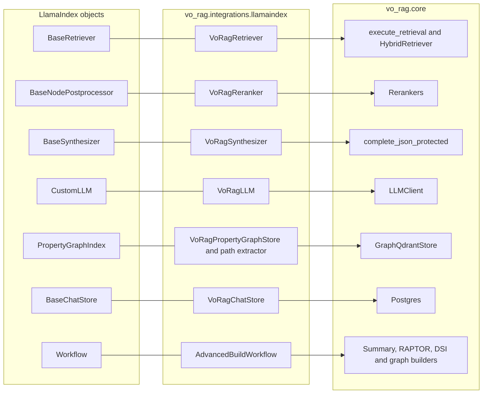
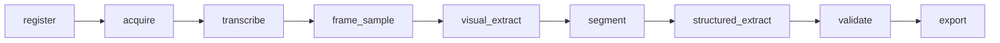
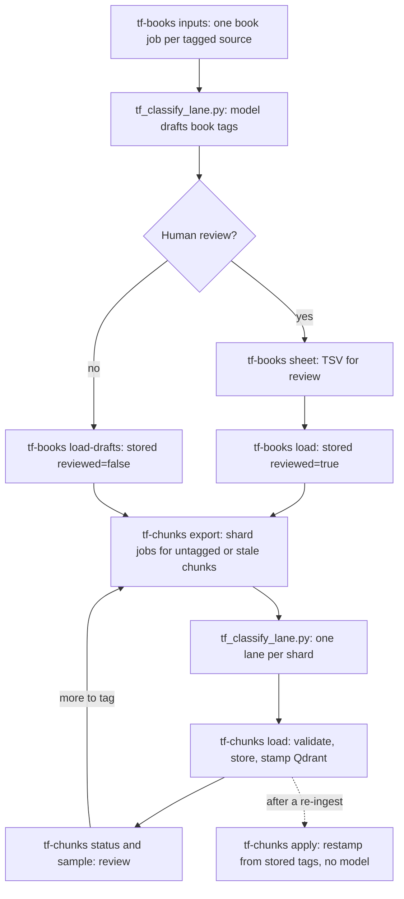

# Integrations

[Architecture](architecture.md) · [Operations](operations.md) · [Advanced layers](advanced-layers.md) · [Engineering](engineering.md)

The core of vo-rag does not depend on any agent framework. This page covers the three optional pieces built around it: an adapter tier that makes the production retrieval and synthesis path usable from LlamaIndex, a video extraction pipeline with its own stage runner, and two pluggable example domain packs (a controlled vocabulary for ingest-time tags, and a human-in-the-loop tagging workflow). It ends with the static workload router that decides where each kind of model work runs.

## LlamaIndex tier

[`integrations/llamaindex`](../src/vo_rag/integrations/llamaindex) makes vo-rag's objects satisfy LlamaIndex's interfaces, so they drop into LlamaIndex query engines, chat engines, agents and workflows without changing the core. It needs the optional `llamaindex` extra (`uv sync --locked --extra llamaindex`). The package root is import-safe without it: adapter symbols resolve lazily, and a module that defines LlamaIndex classes raises a clear install hint only when you import it directly. The dependency runs one way. Nothing in `vo_rag.core` may import this package, so the hot path stays light and the adapters can change without touching retrieval.

### Adapter map



| Module | Adapter | What to know |
| --- | --- | --- |
| [`retriever.py`](../src/vo_rag/integrations/llamaindex/retriever.py) | `VoRagRetriever` | Wraps `execute_retrieval`, so the hybrid, fusion, visual-intent and license logic stays behind one class. The query mode is bound at construction and defaults to the safe `publication` mode (sterile text), so a query engine cannot be re-routed to raw text by a per-call argument. Using `internal` mode requires an explicit `allow_internal=True` |
| [`reranker.py`](../src/vo_rag/integrations/llamaindex/reranker.py) | `VoRagReranker` | Wraps a synchronous reranker backend. Async backends are rejected at construction, because LlamaIndex's synchronous postprocessor contract cannot bridge into a running event loop; async hosts pass the reranker as `rerank_fn` to the retriever instead |
| [`synthesizer.py`](../src/vo_rag/integrations/llamaindex/synthesizer.py) | `VoRagSynthesizer` | The trust boundary. Synthesis over retrieved text goes through `complete_json_protected` (canary, output validation, quarantine), with the egress lockdown and the raw-to-sterile remap, never through the plain LLM seam |
| [`llm.py`](../src/vo_rag/integrations/llamaindex/llm.py) | `VoRagLLM` | A `CustomLLM` over `LLMClient`. It applies no injection defense, so it is for trusted prompts only (the fusion retriever's query rewrites, for example) |
| [`query_engine.py`](../src/vo_rag/integrations/llamaindex/query_engine.py), [`fusion.py`](../src/vo_rag/integrations/llamaindex/fusion.py) | `build_vo_rag_query_engine`, `VoRagQueryFusionRetriever`, `build_fusion_query_engine` | Compose the three adapters into a `RetrieverQueryEngine`. The factory deliberately has no per-call mode or collection argument. The fusion retriever asks the model for query rewrites and merges the results with RRF, deduplicating by chunk id |
| [`postprocessors.py`](../src/vo_rag/integrations/llamaindex/postprocessors.py) | `DiversityPostprocessor`, `DomainTagFilterPostprocessor` | Optional and off by default: maximal-marginal-relevance reordering, and a filter on the `domain_tags` payload. Both are pure post-processing on already-retrieved nodes |
| [`convert.py`](../src/vo_rag/integrations/llamaindex/convert.py) | Type converters | The load-bearing rule is ID fidelity: a `TextNode` built from a chunk carries the chunk's own id, so LlamaIndex does not re-key it and break the deterministic-write guarantees |
| [`graph_store.py`](../src/vo_rag/integrations/llamaindex/graph_store.py), [`pg_extractor.py`](../src/vo_rag/integrations/llamaindex/pg_extractor.py), [`pg_retriever.py`](../src/vo_rag/integrations/llamaindex/pg_retriever.py), [`property_graph_index.py`](../src/vo_rag/integrations/llamaindex/property_graph_index.py) | `VoRagPropertyGraphStore` and friends | Expose the entity graph in Qdrant to a `PropertyGraphIndex`, built `from_existing` with no re-extraction. `graph_store.py` delivers the read path and the converters only; direct writes are refused, because graph writes must go through the graph build so extraction, edge direction, embedding and provenance stay together |
| [`chat_store.py`](../src/vo_rag/integrations/llamaindex/chat_store.py) | `VoRagChatStore` | Postgres-backed chat memory (`chat_memory` table). Each block records a trust level and is redacted before it is stored, so untrusted tool output is not replayed as if it were trusted |
| [`observability.py`](../src/vo_rag/integrations/llamaindex/observability.py) | `install_bridge`, `enable_otel_export` | Routes LlamaIndex events and spans into vo-rag's Prometheus metrics, cost accumulator and redaction, with labels checked for safety. Nothing calls it by default |
| [`build_workflow.py`](../src/vo_rag/integrations/llamaindex/build_workflow.py) | `AdvancedBuildWorkflow` | A LlamaIndex `Workflow` that fans out the summary, RAPTOR, DSI and graph builds for agent surfaces, with a graph direction gate and a RAPTOR preflight gate. It is not what `vo-rag build` runs: the CLI calls the core builders directly so it stays import-safe without the extra |

### Agents

[`agents/`](../src/vo_rag/integrations/llamaindex/agents) shows how the adapters compose into the planned pipelines. `AgentPipelineBase` ([`agents/base.py`](../src/vo_rag/integrations/llamaindex/agents/base.py)) keeps the agent an implementation detail inside a pipeline step, so the pipeline output and its persistence contract do not change. The shipped pieces are:

- **`book_search` and `graph_lookup` tools** ([`agents/tools/`](../src/vo_rag/integrations/llamaindex/agents/tools)). Trusted tools that read vetted internal collections, locked to internal mode and never aimed at a scratch collection.
- **`web_search` and `fetch_url` tools** ([`agents/tools/web_search.py`](../src/vo_rag/integrations/llamaindex/agents/tools/web_search.py), [`agents/extraction.py`](../src/vo_rag/integrations/llamaindex/agents/extraction.py)). The untrusted arm. The target passes the URL safety gate and a per-tool domain allowlist (an empty list refuses everything) before any request, and fetched bytes are only ever the untrusted input of a protected completion; the agent sees a structured summary and a quarantine flag, never raw page text. This is where the SSRF protections in [security](security.md#url-safety) meet an agent.
- **Code and extraction agents.** `list_imports` ([`agents/code_rag.py`](../src/vo_rag/integrations/llamaindex/agents/code_rag.py)) parses a Python module with `ast` and never runs it; the extraction module builds article, tool-evaluation and structured-scrape agents.
- **`fold_agent_output`** ([`agents/output.py`](../src/vo_rag/integrations/llamaindex/agents/output.py)) folds an agent answer into a pipeline artifact. The artifact is quarantined unless the answer used only corpus evidence and was not flagged. `assert_agent_llm_substrate` checks that an agent's LLM workload is routed through the static router below: a `homelab_only` envelope may not use a serverless workload, and a serverless workload requires a cost gate.
- **`patterns.py`** is a decision table from each planned pipeline to a multi-agent pattern (`agent_workflow`, `orchestrator`, `custom_planner` or none), with the guardrails that apply at every hop: protected completion for untrusted text, cost metering per agent, and the egress lockdown on the final answer.

The pipelines these agents serve (`code_rag`, `research_agent`, article extraction and the rest) are listed as planned in the roster; the agent code exists and is tested, but no CLI command or route starts them. See [engineering](engineering.md#implemented-experimental-and-planned).

### Evaluation helpers

[`answer_eval.py`](../src/vo_rag/integrations/llamaindex/answer_eval.py) provides faithfulness, relevancy and correctness judges. They do not use LlamaIndex's stock evaluators, because those put retrieved text and the candidate answer into a judge prompt, and both are attacker-controllable; the judges go through the protected completion path instead. [`eval_dataset.py`](../src/vo_rag/integrations/llamaindex/eval_dataset.py) generates synthetic question sets over the live corpus with three guards: the LLM must be injected explicitly (the functions raise before LlamaIndex can fall back to a global default), judgments are keyed on the real content-addressed chunk ids, and `assert_qrels_resolve` refuses a judgment set that points at ids missing from the corpus before it can become a baseline. [`graph_ab.py`](../src/vo_rag/integrations/llamaindex/graph_ab.py) runs the graph layer's A/B decision over the LlamaIndex-wrapped read path. How these feed the gates is in [evaluation](evaluation.md).

### The ingest workflow port

[`pipelines/book_rag/workflow_li.py`](../src/vo_rag/pipelines/book_rag/workflow_li.py) re-expresses the ingest sequence as a LlamaIndex `Workflow` with typed events, calling the same helpers as the plain orchestrator. The surfaces that stream progress use it: the SSE endpoint, the MCP `vo_rag_ingest_stream` tool and `vo-rag ingest run` when the extra is installed. The dispatcher runs the plain orchestrator in [`workflow.py`](../src/vo_rag/pipelines/book_rag/workflow.py). Both are described in [ingestion](ingestion.md#the-workflow).

## Video extraction (VCE)

The VCE pipeline turns videos into time-stamped, transcript-anchored observations and writes them as a JSON export that another system can consume. It lives in [`pipelines/vce`](../src/vo_rag/pipelines/vce) with the CLI group `vo-rag vce`, and the roster lists it as `planned`: the code and tests exist, but it is not an active producer and it has had no end-to-end run against real services.



[`runner.py`](../src/vo_rag/pipelines/vce/runner.py) runs the nine stages per video, persists a checkpoint blob after each (under `vo_rag/checkpoints/vce/<run_id>/<video_id>/<stage>.json`, deleted when the export succeeds), and records every stage in `vce.video_manifest.stage_status` and `vce.stage_run_log`. A retry of the same run resumes from the last finished stage, and one failed video is marked failed without failing the batch. What each stage does today:

| Stage | Today |
| --- | --- |
| `register`, `acquire` | Record state; `acquire` checks nothing beyond the manifest row |
| `transcribe` | Runs the chosen executor. The runner refuses to advance unless the transcript was uploaded and has a blob key: persistence comes first, because the failure this design avoids is a transcript that existed only in memory |
| `frame_sample`, `visual_extract` | Placeholders. They record empty results and the vision step stays off |
| `segment` | Every transcript segment containing one of ten fixed cue phrases becomes a candidate interval |
| `structured_extract` | Builds one export row per candidate. Ids are derived from the video and the interval, so a rerun yields the same ids. If the baseline file has a row at exactly that interval, its legacy id, observation, evidence class and anchors are reused; if an interval shifted, the old id is recorded as superseded |
| `validate`, `export` | Run the checks and write the files below |

[`transcription.py`](../src/vo_rag/pipelines/vce/transcription.py) defines the executor protocol (`run(video_id, path)` returning segments and a non-null blob key) and four implementations selected by `--executor`: `stub` (canned segments from fixture files, the default), `local` (WhisperX on CPU, an optional dependency), `remote` (a WhisperX host at `VORAG_VCE_TRANSCRIPTION_ENDPOINT_URL`) and `speaches` (an OpenAI-compatible audio endpoint at `VORAG_VCE_TRANSCRIPTION_ENDPOINT_URL` or `VORAG_VCE_SPEACHES_URL`). Adding a fifth means implementing the protocol; the runner does not change.

```sh
# Example: run the stage DAG for two manifest videos with the stub executor.
uv run vo-rag vce run --export-dir ./var/vce-export --video-ids yt:demo_video1 --video-ids yt:demo_video2
uv run vo-rag vce status
uv run vo-rag vce validate ./var/vce-export --baseline examples/vce-baseline.json
```

`vce run` needs Postgres and the object store, and the videos must already be rows in `vce.video_manifest`; this repository ships a helper that inserts one (`upsert_video_manifest`) but no command that fills the table. It prints `run_id`, `videos_processed`, `videos_failed`, `rows_written`, `cost_usd` and the export path (or the same as JSON with `--json`). The export directory holds `vce-episode-export.json` (a JSON array under contract version `vce-episode-export@2`, rows sorted by video and interval so a rerun on the same inputs is byte-equal), `superseded.json` (old id to new id), one `<video_id>.transcript.json` per video and `manifest.json`.

[`validator.py`](../src/vo_rag/pipelines/vce/validator.py) checks an export directory, and `vo-rag vce validate` exits 1 if any check fails. It runs seven checks: `schema` (every row parses under the row model), `interval_validity`, `envelope_consistency` (a video's rows reference only that video), `transcript_coverage` (at least 90% of rows carry a transcript excerpt, adjustable with `--coverage-threshold`), `transcript_substring` (every excerpt is a substring of that video's transcript file), `superseded_completeness` and `baseline_preservation` (baseline ids are kept wherever the interval is unchanged). An `idempotency` check name exists in the validator's enum, but nothing implements it and the CLI does not run it; reproducibility rests on the sorted output and the derived ids. [`examples/vce-baseline.json`](../examples/vce-baseline.json) is a synthetic baseline for trying the flow.

## Domain packs

vo-rag ships with two example domain packs. They show how to specialize the library to a subject area; neither is required, and the core retrieval, ingestion and rights logic knows nothing about a domain. The shipped vocabulary pack targets a technical domain (vehicle dynamics), and the shipped tagging workflow targets athletics coaching literature.

### Vocabulary pack

[`pipelines/book_rag/domain_vocab.py`](../src/vo_rag/pipelines/book_rag/domain_vocab.py) holds a controlled vocabulary (twenty tags such as `vehicle_dynamics` and `tire_mechanics`) and, for each tag, a tuple of keywords. [`domain_tagger.py`](../src/vo_rag/pipelines/book_rag/domain_tagger.py) uses it two ways:

- **At ingest, heuristically.** When an envelope carries no `domain_tags`, the chunk-and-embed step counts keyword occurrences in the first 50 chunks (up to 20,000 characters), keeps the top six tags (ties broken by vocabulary order, so the output is deterministic) and stamps them on every chunk as `domain_tags`. Tags you supply at intake (`--tags`) are never overwritten. The tags are a payload field with a Qdrant keyword index, so they can be used in `filters`.
- **On demand, with a model.** `DomainTagger` asks an LLM for tags from the vocabulary through the protected completion path, because the chunk text is attacker-controllable; a failed or invalid answer returns an empty list rather than raising.

To use a different subject area, pass `vocabulary=` and `keywords=` to `DomainTagger`; the ingest-time heuristic reads the module constants, so change `DOMAIN_VOCABULARY` and `DOMAIN_KEYWORDS` there (or wrap `heuristic_domain_tags`) for it. The pack is data, not logic.

### Tagging workflow

The workflow in [`cli/corpus_tf.py`](../src/vo_rag/cli/corpus_tf.py), backed by [`core/corpus/tf_schema.py`](../src/vo_rag/core/corpus/tf_schema.py) (allowed values, validation, the Qdrant payload), [`tf_prompts.py`](../src/vo_rag/core/corpus/tf_prompts.py) (the classifier prompts), [`tf_store.py`](../src/vo_rag/core/corpus/tf_store.py) (Postgres and Qdrant persistence) and the lane script [`scripts/tf_classify_lane.py`](../scripts/tf_classify_lane.py), tags every book and chunk of an athletics collection with structured context a query can filter on: book-level source type, evidence type, publication year and population (level, age group, sex), and chunk-level event family, event, physical quality, discipline, training phase, intervention and claim basis. It is a human-in-the-loop cycle that uses a model for drafting and never for the final authority on a book. The model's output is untrusted: every value must be in the allowed set, lists may not mix `not_stated` or `none` with real values, and nothing is coerced.



A source takes part when its `domain_tags` payload contains `track-and-field`, which you supply at intake (`vo-rag ingest file book.pdf --tags track-and-field`).

```sh
# Example cycle. Paths are placeholders.
uv run vo-rag corpus tf-books inputs --out jobs/books.jsonl
uv run python scripts/tf_classify_lane.py jobs/books.jsonl results/books.jsonl \
    --api-url http://127.0.0.1:9292/v1/chat/completions
uv run vo-rag corpus tf-books sheet results/books.jsonl --out review/books.tsv   # edit the TSV
uv run vo-rag corpus tf-books load review/books.tsv                              # reviewed=true
uv run vo-rag corpus tf-chunks export --shards 5 --out-dir jobs/chunks
# one classifier lane per shard file, then:
uv run vo-rag corpus tf-chunks load results/chunks-*.jsonl
uv run vo-rag corpus tf-chunks status
```

The design choices worth knowing:

- **Lanes are plain processes over files.** `tf_classify_lane.py` classifies one shard, appends each validated result immediately (a restarted lane resumes), accepts a chunk batch chunk by chunk and re-asks only for the ids that failed, and sends failures to a `failed` file after the attempt limit. It calls an OpenAI-compatible endpoint (`--api-url` or `VORAG_TF_TAGGER_URL`) with no tools, or falls back to an agent shim script.
- **A book is never split across lanes.** `tf-chunks export` puts all of a book's jobs in one shard and places books largest-first, so one large book cannot leave a lane idle. A chunk is exported only when its stamped `tf_tag_version` is not current.
- **Tags follow the text, not the point.** Chunk tags are stored in `tf_chunk_tags` keyed by a hash of the chunk content, and book tags in `tf_book_tags`. After a purge and re-ingest, `tf-chunks apply` re-stamps Qdrant from the stored tags without calling the model, and `tf-chunks rekey` migrates tags written under an older key scheme. A human-reviewed book record is never overwritten by a later draft.
- **Failures are explicit.** Every unreadable line, wrong-shaped record, schema rejection or store error becomes a failed job that names its source, and the run continues.

The chunk fields are indexed in Qdrant (`TF_INDEXED_FIELDS`), so a query can filter on them, for example `{"tf_pub_year": {"gte": 1990}}` (see [retrieval](retrieval-and-answers.md)). To adapt the workflow to another subject, change the allowed values in `tf_schema.py` and the prompts in `tf_prompts.py`, and bump `TF_TAG_VERSION` so existing chunks read as stale.

## Static workload router

Where a kind of model work runs is a fixed table in [`core/cloud/router.py`](../src/vo_rag/core/cloud/router.py), not a runtime decision:

| Workload | Location |
| --- | --- |
| `text-gen`, `vlm`, `dsi` | RunPod serverless |
| `embedding`, `query-handling` | Local |

`workload_location(name)` returns the location or raises `ValueError` for an unknown name. The table is consulted in three places: the worker registry, which refuses to load if a declared worker disagrees with it ([`workers/registry.py`](../src/vo_rag/workers/registry.py)); the admin status route, which reports the placement; and the agent substrate check above. The reasoning for a table over dynamic routing is in [engineering](engineering.md#decisions-visible-in-the-code).
