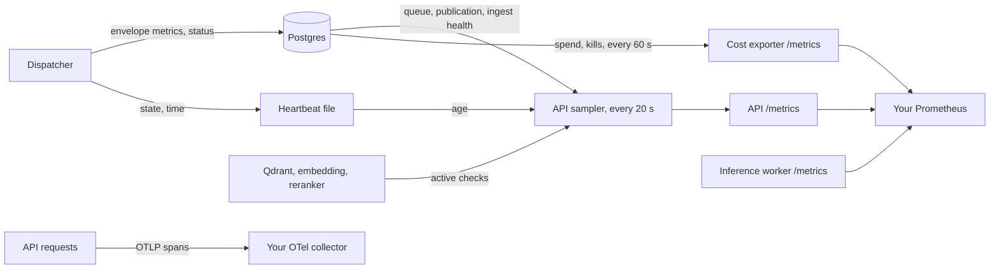

# Observability

[README](../README.md) · [Operations](operations.md) · [Reliability](reliability.md) · [Security](security.md)

What the system reports about itself, and where to read it: Prometheus metrics, a background sampler that turns database and heartbeat state into gauges, per-envelope ingest metrics, OpenTelemetry traces, structured logs and the audit tables. Nothing here ships a dashboard or an alert rule. The page says what each signal means so that you can write your own.

## Signals at a glance

| Signal | Where it lives | Who emits it |
| --- | --- | --- |
| Prometheus metrics | `GET /metrics` on the API, the inference worker and the cost exporter | The module [`core/observability/metrics.py`](../src/vo_rag/core/observability/metrics.py), the exporter and the workers |
| Operational gauges | API `/metrics` | A sampler inside the API ([`api/operational_sampler.py`](../src/vo_rag/api/operational_sampler.py)) |
| Ingest metrics | `intake_envelopes.metadata->'metrics'`, then API gauges | Every running ingest, flushed to its own row |
| Traces | An OTLP/HTTP collector you run | The API process, when enabled |
| Logs | The console of each process | structlog in every process |
| Audit rows | Postgres tables | The query and answer routes, the cost tracker |



The map explains a design choice. The dispatcher is a separate long-running process with no HTTP server, so it cannot be scraped. Instead it leaves its state where the API can read it (a row per envelope, and a small heartbeat file), and the API's sampler publishes gauges derived from that state. The API and the cost exporter also read Postgres, and only the API process exports traces. A dispatcher counter exists for each of its events, but unless you add an exposition to the dispatcher those counters are visible only inside that process.

## Where `/metrics` is served

| Endpoint | Process | Authentication | Series you get |
| --- | --- | --- | --- |
| `GET /metrics` on the API port | API | None; it is in `EXEMPT_PATHS` | The shared catalog below, plus the Python process collectors |
| `GET /metrics` on the inference worker | `vo_rag.workers.inference.server` | None | The shared catalog; the inference and vision-gateway series are the live ones |
| `GET /metrics` on the embedding worker | `vo_rag.workers.embedding.server` | None | Python process collectors only; that worker does not import the shared module |
| `/metrics` and `/healthz` on port 9109 | `services/cloud_cost_exporter` | None | The seven `vo_rag_cloud_*` gauges |
| none | Dispatcher | n/a | Nothing is exposed |

Every process that imports the shared module registers every series in it, so a series can appear with a zero value in a process that never changes it. Use the "Emitted by" column below to know which process to scrape for which series. The endpoints are unauthenticated by design; see [security](security.md#probes-and-exemptions) for how to restrict them.

An excerpt of the API's `/metrics` right after a sample with no database, no Qdrant and no dispatcher, and with an in-process reranker object loaded (produced by the sampler against a service container holding only that reranker):

```text
vo_rag_dependency_up{dependency="db_pool"} 0.0
vo_rag_dependency_up{dependency="qdrant"} 0.0
vo_rag_dependency_up{dependency="embedding"} 0.0
vo_rag_dependency_up{dependency="reranker"} 1.0
vo_rag_dependency_up{dependency="dispatcher"} 0.0
vo_rag_readiness{surface="query"} 0.0
vo_rag_readiness{surface="intake"} 0.0
vo_rag_dispatcher_heartbeat_age_seconds -1.0
vo_rag_intake_envelopes{status="received"} -1.0
vo_rag_oldest_claimable_age_seconds -1.0
vo_rag_envelope_processing_seconds_max -1.0
vo_rag_source_publication_pending_age_seconds{corpus="books"} -1.0
vo_rag_operational_sampler_errors_total{component="source_publication"} 1.0
```

The reranker reads `1` only because a local reranker is loaded and has nothing to probe; with no reranker object it reads `0`, like the others. The `-1` values are the convention for "unknown", used throughout so that a failed sample can never be mistaken for a healthy zero.

## The operational sampler

The API's lifespan starts one background task, `run_operational_sampler`. It samples immediately and then every 20 seconds. `VORAG_OPERATIONAL_SAMPLE_INTERVAL_S` changes the cadence but the value is clamped to 15 to 30 seconds, and an unparsable value falls back to 20. A sample does five things.

1. **Active dependency checks.** It calls the same helpers the readiness routes use (database `SELECT 1`, Qdrant `get_collections`, the embedding service's `/health`, the remote reranker's `/ready`), so an alert on `vo_rag_readiness` and a probe of `/ready/query` cannot disagree. The embedding and reranker probes time out after 1 second; the database and Qdrant probes use their clients' own timeouts, so a hung dependency can delay a sample.
2. **Dispatcher heartbeat.** It reads the heartbeat file and publishes its age. A missing, malformed, symlinked or stale file reads `-1` or an old age; see [ingestion](ingestion.md#heartbeat-and-stale-reclaim) for the file and its 130 second limit.
3. **Queue depth.** One aggregate query counts `received` and `processing` envelopes and finds the oldest claimable verified book and the most recent completion.
4. **Ingest health.** `sample_ingest_health` derives the stuck-ingest gauges from the metrics each ingest wrote into its envelope row (next section).
5. **Publication health.** One read-only repeatable-read transaction counts publication jobs by state, finds the oldest pending job and counts pointers and derived sources that disagree with their job.

Failure is explicit. If any piece fails, its gauges are set to `-1`, `vo_rag_operational_sampler_errors_total{component=...}` is incremented and the log records the exception. The sampler never raises into the API. A failed queue query also marks the database down, which makes both readiness gauges 0. A failure in the ingest-health or publication sample sets only its own gauges to `-1` and leaves readiness alone.

The sampler runs only when the API starts through its lifespan. An app built with injected services (tests, embedded use) skips it, so those deployments have no operational gauges.

## Ingest metrics flush

A book can run for hours in a process that nothing scrapes, so each ingest records what it did in its own envelope row, under `metadata->'metrics'`. [`IngestMetricsRecorder`](../src/vo_rag/core/observability/metrics.py) accumulates stage timings, embed calls and 429 retries, the page count, the current stage and a summary of Qdrant call latency. It flushes after every workflow step and, for a long step, every 60 seconds (`INGEST_METRICS_FLUSH_INTERVAL_S`). The API then reads the rows. An example of the stored document, with placeholder values:

```json
{
  "claimed_at_epoch_s": 1790000000.0,
  "stale_reclaims": 0,
  "stale_reclaims_total": 1,
  "failures": 0,
  "current_stage": "chunk_embed",
  "pages": 412,
  "stages": {"parse": {"seconds": 38.2}, "chunk_embed": {"seconds": 611.4}},
  "stages_attempt": "5f0c0b6e0f4d4c1a9d7b0a1e2c3d4e5f",
  "embed": {"calls": 129, "retries_429": 3, "attempts": {"5f0c0b6e0f4d4c1a9d7b0a1e2c3d4e5f": {"calls": 129, "retries_429": 3}}},
  "qdrant": {"calls": 87, "p95_s": 0.41, "max_s": 2.9}
}
```

Three properties make this safe to rely on.

- **Idempotent writes.** Embed totals are sent as the attempt's absolute totals under an attempt ID, and the row's sum is recomputed under the row lock. A replayed flush, or a zombie worker writing after a stale reclaim, cannot count an attempt twice.
- **Best effort.** A failed write is logged and swallowed, and the next flush sends everything again. Recording never fails a book.
- **A budget per envelope.** The sampler compares the in-flight envelope's elapsed time with `max(15 minutes, 6 seconds x pages)`, or one hour while the page count is unknown and parsing has not finished. `vo_rag_envelope_processing_seconds_max` against `vo_rag_envelope_budget_seconds` is the signal for a stuck or oversized book.

A streaming ingest run by the API (the SSE route, the MCP stream tool) has no dispatcher heartbeat, so it stamps `stream_heartbeat_epoch_s` on each flush. An envelope whose stream heartbeat is older than 10 minutes stops counting as in flight, which keeps a crashed API from pinning the gauges forever. The fleet-wide embed totals are recomputed from all rows at most every 5 minutes.

## Metrics catalog

62 metric names: 53 defined with `Counter`, `Gauge` or `Histogram` in `core/observability/metrics.py`, 2 more produced by a custom collector in the same module, and 7 gauges in the cost exporter. The list was produced by an AST scan of `Counter`, `Gauge`, `Histogram` and `Summary` definitions, and there is no generator for it. To regenerate it, run `grep -rn -A1 -E '= (Counter|Gauge|Histogram|Summary)\($' src services workers --include=*.py | grep -oE '"vo_rag_[a-z_0-9]+"' | sort -u` (60 names) and add the two collector series from `_IngestTotalsCollector`. Counters are listed by their exposed `_total` name. Labels are small bounded sets (collection names, states, outcomes), not IDs, titles or query text. `assert_safe_labels` rejects a label value that looks like an email address, phone number, SSN or API key, and the LlamaIndex bridge applies it.

### Readiness and queue depth

Set by the API's [operational sampler](#the-operational-sampler) from `api/operational_sampler.py`. `-1` always means unknown.

| Series | Type | Labels | Meaning | Emitted by |
| --- | --- | --- | --- | --- |
| `vo_rag_dependency_up` | gauge | `dependency` | 1 if the dependency passed its active check at the last sample, else 0. `dependency` is `db_pool`, `qdrant`, `embedding`, `reranker` or `dispatcher`. | API sampler |
| `vo_rag_readiness` | gauge | `surface` | 1 if every dependency the surface needs is up. `surface` is `query` (database, Qdrant, embedding, reranker) or `intake` (database, dispatcher). | API sampler |
| `vo_rag_operational_sampler_errors_total` | counter | `component` | Sampler failures. `component` is `sampler`, `postgres_queue`, `source_publication`, `ingest_health` or `ingest_totals`. | API sampler |
| `vo_rag_dispatcher_heartbeat_age_seconds` | gauge | none | Age of the dispatcher's heartbeat file; `-1` when it is missing or unreadable. | API sampler |
| `vo_rag_intake_envelopes` | gauge | `status` | Envelopes in `received` and `processing`; `-1` without a database. | API sampler |
| `vo_rag_oldest_claimable_age_seconds` | gauge | none | Age of the oldest verified book upload the dispatcher could claim: a `received` envelope, or a `processing` one untouched for over 6 hours. `-1` when none. | API sampler |
| `vo_rag_last_completion_age_seconds` | gauge | none | Seconds since the last envelope reached `completed`; `-1` when none has. | API sampler |

### Stuck or overloaded ingest

Derived from the metrics each ingest writes into its own envelope row (see [ingest metrics](#ingest-metrics-flush)); sampled by the API in `core/observability/metrics.py`.

| Series | Type | Labels | Meaning | Emitted by |
| --- | --- | --- | --- | --- |
| `vo_rag_envelope_processing_seconds_max` | gauge | none | Seconds since work started on the in-flight envelope that is furthest over its budget; `-1` when none. | API sampler |
| `vo_rag_envelope_budget_seconds` | gauge | none | The budget of that same envelope: the larger of 15 minutes and 6 seconds per page; 60 minutes while the page count is unknown and parsing has not finished. | API sampler |
| `vo_rag_envelope_reclaims_max` | gauge | none | The most stale reclaims any `processing` envelope has accumulated. | API sampler |
| `vo_rag_intake_failures_last_hour` | gauge | none | Envelopes recorded as failed within the past hour. | API sampler |
| `vo_rag_embed_calls_total` | counter | none | Embed requests made by ingests, summed from envelope rows every 5 minutes. Held at its high-water mark so a deleted row cannot look like a counter reset. | API sampler |
| `vo_rag_embed_retries_total` | counter | `reason` | Embed retries absorbed by ingests, summed the same way. `reason` is `429`. | API sampler |

### Publication health

Sampled by the API from the source publication tables for the `books` and `reddit` corpora, in one read-only repeatable-read transaction. `-1` means the sample failed.

| Series | Type | Labels | Meaning | Emitted by |
| --- | --- | --- | --- | --- |
| `vo_rag_source_publication_jobs` | gauge | `corpus`, `state` | Durable publication jobs by `state` (the nine `PublicationState` values). | API sampler |
| `vo_rag_source_publication_pending_age_seconds` | gauge | `corpus` | Age of the oldest job that is not terminal (preparing, staged, verified, partial, blocked or retryable); 0 when none. | API sampler |
| `vo_rag_source_publication_pointer_mismatches` | gauge | `corpus` | Active-revision pointers whose job is missing, unpublished or for a different source or revision. | API sampler |
| `vo_rag_source_publication_dependency_mismatches` | gauge | `corpus` | Derived sources whose recorded raw-source revision is no longer the active one. | API sampler |

### Dispatcher

Incremented inside the dispatcher process, which serves no `/metrics`. In a stock deployment these are not scraped; the API's sampler reports the dispatcher's state through the heartbeat file and Postgres instead. Scrape them only if you add an exposition to the dispatcher.

| Series | Type | Labels | Meaning | Emitted by |
| --- | --- | --- | --- | --- |
| `vo_rag_dispatcher_claims_total` | counter | `kind` | Envelopes claimed. `kind` is `new` or `stale_reclaim`. | dispatcher |
| `vo_rag_dispatcher_active_ingest` | gauge | none | Ingests running now. | dispatcher |
| `vo_rag_dispatcher_cancellations_total` | counter | none | Ingests cancelled when the shutdown grace expired. | dispatcher |
| `vo_rag_dispatcher_heartbeat_failures_total` | counter | `target` | Failed heartbeat writes. `target` is `database` or `file`. | dispatcher |
| `vo_rag_dispatcher_stop_requests_total` | counter | none | SIGTERM or SIGINT received. | dispatcher |

### Inference worker

Emitted by `workers/inference/server.py` and served from that worker's own `/metrics`.

| Series | Type | Labels | Meaning | Emitted by |
| --- | --- | --- | --- | --- |
| `vo_rag_inference_requests_total` | counter | `operation`, `outcome` | Requests by `operation` (`embed` or `rerank`) and `outcome` (`success`, `failure`, `overloaded`). | inference worker |
| `vo_rag_inference_active_requests` | gauge | `operation` | Requests holding a model execution slot. | inference worker |
| `vo_rag_inference_overload_total` | counter | `operation` | Requests refused with 429 because every slot was busy. | inference worker |
| `vo_rag_inference_request_duration_seconds` | histogram | `operation` | Wall time per request. | inference worker |
| `vo_rag_vlm_gateway_requests_total` | counter | `outcome` | Vision-model gateway requests by `outcome`: `success`, `upstream_error`, `upstream_failure`, `unavailable` or `admission_timeout`. | inference worker |
| `vo_rag_vlm_gateway_active_requests` | gauge | none | Vision requests currently forwarded upstream. | inference worker |
| `vo_rag_vlm_gateway_queue_seconds` | histogram | none | Time a vision request waited for retrieval to go idle. | inference worker |
| `vo_rag_vlm_gateway_duration_seconds` | histogram | none | Upstream time per vision request after admission. | inference worker |
| `vo_rag_vlm_gateway_admission_timeouts_total` | counter | none | Vision requests whose wait for retrieval-idle expired. | inference worker |
| `vo_rag_vlm_gateway_up` | gauge | none | 1 if the local vision server passed its latest probe or request. | inference worker |

### LLM calls

Emitted in whichever process makes the call (`core/llm`).

| Series | Type | Labels | Meaning | Emitted by |
| --- | --- | --- | --- | --- |
| `vo_rag_llm_calls_total` | counter | `provider`, `model`, `prompt_name`, `result` | Completed calls, `result` `success`. The optional LlamaIndex bridge also records `started`. | LLM client |
| `vo_rag_llm_latency_seconds` | histogram | `provider`, `model` | Call latency. The optional LlamaIndex bridge also observes it with provider `llamaindex`. | LLM client |
| `vo_rag_llm_retries_total` | counter | `provider`, `model`, `reason` | Transport retries by `reason` (`rate_limit` or `server_error`). Only `LLMClient.complete` retries; see [reliability](reliability.md#retries-and-backoff). | `core/llm/retry.py` |
| `vo_rag_llm_structured_parse_failures_total` | counter | `prompt_name` | Calls that exhausted schema-validation retries. | `core/llm/structured.py` |
| `vo_rag_llm_variant_selections_total` | counter | `prompt_name`, `variant` | Which prompt variant an A/B weighting chose. | `core/llm/variants.py` |
| `vo_rag_llm_usage_extraction_failed_total` | counter | none | Responses whose token usage could not be attributed. Counted only while a cost accumulator is active, and no shipped process installs one. | `core/observability/cost.py` |

### Injection defense and caches

| Series | Type | Labels | Meaning | Emitted by |
| --- | --- | --- | --- | --- |
| `vo_rag_injection_suspected_total` | counter | `pipeline`, `kind` | Validator signals on a protected call. `kind` is `canary_echoed`, `verbatim_untrusted_echo`, `system_prompt_leaked` or `url_exfil_attempt`. | `core/llm/protected.py` |
| `vo_rag_injection_quarantined_total` | counter | `pipeline` | Protected calls that returned `should_quarantine`, by `pipeline`. | `core/llm/protected.py` |
| `vo_rag_cache_requests_total` | counter | `cache`, `result` | Cache lookups. `cache` is `embedding`; `result` is `hit`, `miss` or `skip` (cache disabled or failed). | `core/embedding/cache.py` |
| `vo_rag_cache_size_bytes` | gauge | `cache` | On-disk size of the embedding cache; 0 when it disabled itself. | `core/embedding/cache.py` |
| `vo_rag_qdrant_upsert_points_total` | counter | `collection` | Points written, by collection. The Qdrant store is wrapped at import. | any process that upserts |

### Defined with no emitter in this tree

These exist in `core/observability/metrics.py` and appear on `/metrics` (unlabelled ones as zero), but no shipped process increments them. They are hooks for an embedding application. `vo_rag_pipeline_duration_seconds` and the `started` result above are emitted only after an application calls `install_bridge()` from `integrations/llamaindex/observability.py`.

| Series | Type | Labels | Meaning | Emitted by |
| --- | --- | --- | --- | --- |
| `vo_rag_pipeline_runs_total` | counter | `pipeline`, `outcome` | Pipeline runs by `outcome`. Written only by `track_pipeline_run` and `instrument_pipeline_call`, which nothing calls. | none |
| `vo_rag_active_pipeline_runs` | gauge | `pipeline` | Pipelines running now. Same helpers. | none |
| `vo_rag_pipeline_duration_seconds` | histogram | `pipeline` | Pipeline wall time (histogram). Emitted by the LlamaIndex bridge when installed. | opt-in bridge |
| `vo_rag_pipeline_cost_usd` | histogram | `pipeline` | Per-step USD rollup, observed when `append_step_cost` persists. Nothing calls it. | none |
| `vo_rag_pipeline_artifacts_total` | counter | `pipeline`, `status` | Terminal pipeline outcomes. Written by `finalize_envelope_cost`, which nothing calls. | none |
| `vo_rag_embedding_latency_seconds` | histogram | `endpoint` | Embed call latency by `endpoint`. | none |
| `vo_rag_triage_fallback_total` | counter | `reason` | Triage calls that fell back to Claude. | none |
| `vo_rag_cache_saved_cost_usd_total` | counter | none | Estimated USD saved by cache hits. | none |
| `vo_rag_agent_termination_total` | counter | `pipeline`, `reason` | Bounded-agent runs by `reason`. | none |
| `vo_rag_agent_steps` | histogram | `pipeline` | Steps used by a bounded-agent run. | none |
| `vo_rag_agent_cost_usd` | histogram | `pipeline` | USD used by a bounded-agent run. | none |
| `vo_rag_agent_wall_clock_s` | histogram | `pipeline` | Wall-clock seconds used by a bounded-agent run. | none |

### Cloud cost exporter

Gauges set every 60 seconds by `services/cloud_cost_exporter/app.py` and served from that service's `/metrics` (port 9109 by default). They are emitted only there.

| Series | Type | Labels | Meaning | Emitted by |
| --- | --- | --- | --- | --- |
| `vo_rag_cloud_spend_month_usd` | gauge | `workload`, `provider`, `gpu_type` | Month-to-date spend. Each series has exactly one of its three labels set, so sum within a label, not across. | cost exporter |
| `vo_rag_cloud_active_workers` | gauge | `provider`, `gpu_type` | Cloud workers seen as Tailscale devices, by provider and GPU type; one series `not_configured` when Tailscale is not configured. | cost exporter |
| `vo_rag_cloud_budget_pct` | gauge | none | Percent of the monthly budget used. | cost exporter |
| `vo_rag_cloud_budget_usd` | gauge | none | Monthly budget. | cost exporter |
| `vo_rag_cloud_budget_remaining_usd` | gauge | none | Budget left. | cost exporter |
| `vo_rag_cloud_jobs_this_month` | gauge | none | Cloud jobs launched this month. | cost exporter |
| `vo_rag_cloud_kill_switch_triggers_7d` | gauge | none | Kill-switch activations in the last 7 days. | cost exporter |

### Suggested alerts

None of these ships. They are examples of what the series above support, so check the thresholds against your own workload.

| Condition | Expression |
| --- | --- |
| Query surface not ready for 2 minutes | `vo_rag_readiness{surface="query"} == 0` |
| Dispatcher gone | `vo_rag_dispatcher_heartbeat_age_seconds > 130 or vo_rag_dispatcher_heartbeat_age_seconds < 0` |
| A book is over its budget | `vo_rag_envelope_processing_seconds_max > vo_rag_envelope_budget_seconds > 0` |
| Embedding service is shedding load | `increase(vo_rag_embed_retries_total[15m]) > 0` |
| A publication job is stuck or unreadable | `vo_rag_source_publication_pending_age_seconds > 3600 or vo_rag_source_publication_pending_age_seconds < 0` |
| An active pointer has no published job | `vo_rag_source_publication_pointer_mismatches > 0` |
| Possible prompt injection | `increase(vo_rag_injection_quarantined_total[1h]) > 0` |
| Cloud budget | `vo_rag_cloud_budget_pct > 75` |

## Tracing with OpenTelemetry

Tracing is off by default. Set `VORAG_OTEL_ENABLED=true` (and `VORAG_OTEL_ENDPOINT`, default `http://127.0.0.1:4318`) before the API starts. The flag is read when the app object is constructed, not in the lifespan, because the server-span middleware must be in the stack before Starlette builds it; installing it later produces client spans but no server spans. [`create_app`](../src/vo_rag/api/main.py) then installs the tracer provider, FastAPI instrumentation and global httpx instrumentation. Spans leave through an OTLP/HTTP batch exporter to `<endpoint>/v1/traces`. Resource attributes are `service.name`, `service.namespace`, `deployment.environment.name`, `host.name` and `role`, all configurable (`VORAG_OTEL_*`; see [configuration](configuration.md)).

What you get:

| Span | From |
| --- | --- |
| HTTP server spans, excluding `health`, `ready`, `metrics`, `docs` and `openapi.json` | FastAPI instrumentation |
| `retrieval`, `retrieval_backfill`, `auto_merge`, `rerank` | `execute_retrieval`, around each phase of a query or answer |
| `answer_synthesis` | The answer route |
| `chat <model>` with `gen_ai.*` attributes (operation, system, model, token counts) | `LLMClient`, per completion |
| `ingest.<step>` with `vo_rag.source_id` | Each workflow step, when the ingest runs inside the API process |
| httpx client spans | Outbound httpx calls, such as the embedding and reranker services and the Anthropic SDK |

Only the API process installs a provider. The dispatcher, the CLI and the workers use the OpenTelemetry no-op tracer, so a book ingested by the dispatcher produces no exported spans; its timings are in the envelope metrics above. A streaming ingest started through the API does produce `ingest.*` spans.

Content stays out of traces. An LLM span records only the exception type and an error status, never the message, because a structured-output error embeds the raw model response. Span attributes carry token counts and model names, not prompts or completions.

The collector is optional at runtime. `setup_otel` imports the SDK lazily and returns `False`, logging the failure, if anything is missing or broken, so the API starts without it. If the collector is down while tracing is on, requests are unaffected: span creation does not block, the batch exporter retries in the background with backoff, then drops the batch and logs an error. Measured against an unreachable endpoint, 200 spans took about 2 ms to create.

## Logs

Logs are structured events (structlog) written to the console. The workers configure rendering themselves: `VORAG_JSON_LOGS` (JSON by default) and `VORAG_LOG_LEVEL`. The API and the dispatcher emit structlog's default console format, so run them under a supervisor or log shipper that adds the structure you want.

The API binds a few fields to every event in a request: `request_id`, `path` and `method`, plus `query_mode` and `collections` on query routes. `request_id` is the caller's `X-Request-Id` when sent and a new ULID otherwise, and it is echoed back in the response header. Each request ends with one `request` event carrying `duration_ms` and `status`. Two details matter when you build alerts on this:

- A request that raises an unhandled exception logs `status=None`; the client sees a bare 500.
- A request rejected by the authentication middleware is rejected before the logging middleware runs, so it has no `request` event and no `X-Request-Id`.

The dispatcher logs one structured event per lifecycle step (`book_rag_dispatcher_ingest_started`, `_completed`, `_failed`, `_interrupted`, `_drain_expired` and so on), each with the envelope ID, and an error with its traceback when an ingest fails.

What is deliberately absent from logs: request bodies, query text, prompts and completions, key material and file paths from the embedding cache (it logs the error type and the fallback only). See [security](security.md#secrets-and-redaction) for the redaction levels.

## Audit tables

Request-level audit lives in Postgres, written best-effort so that an audit failure never fails the request (a warning is logged with the exception type only).

| Table | Written by | Holds |
| --- | --- | --- |
| `query_log` | `POST /api/v1/query` | Query text, mode, resolved collections, `top_k`, caller, time |
| `answer_log` | `POST /api/v1/answer` | Profile, model, prompt name and version, collections, context scope, retrieved count, source IDs, latency, cost, compliance outcome, warnings |
| `answer_feedback` | Nothing in this tree: a query helper exists but no route calls it | Up or down, reason, selected sources, caller |
| `citation_assignments` | `POST /api/v1/answer` | One row per cited chunk ID at tier `chunk` |
| `cloud_cost`, `cloud_kill_log` | The cost tracker and kill switch | Launch ledger and teardown actions |

`query_log.query_text` is stored as sent, without redaction. The answer text is not stored; `answer_log` records the outcome and which sources fed it. The `answer_log.compliance_outcome` value `prompt_injection_suspected` is the audit trail of a quarantined answer.

Two examples of questions the tables answer:

```sh
# Which callers used which mode in the last day?
psql "$VORAG_POSTGRES_URL" -c "SELECT mode, caller, count(*) FROM query_log
  WHERE created_at > now() - interval '1 day' GROUP BY 1, 2 ORDER BY 3 DESC"

# How often did the answer path flag an injection, by model?
psql "$VORAG_POSTGRES_URL" -c "SELECT model, count(*) FROM answer_log
  WHERE compliance_outcome = 'prompt_injection_suspected' GROUP BY 1"
```

A per-envelope cost ledger, `pipeline_cost`, and the helpers that fill it (`append_step_cost`, `finalize_envelope_cost`, `cost_context`) are in [`core/observability/cost.py`](../src/vo_rag/core/observability/cost.py). They are a library for an embedding application: no shipped process opens a cost context, and `LLMClient` prices every call at 0.0 until a rate registry exists, so treat `cost_usd` on LLM calls as unpopulated.

## The cloud cost exporter

[`services/cloud_cost_exporter`](../services/cloud_cost_exporter) is a small FastAPI service that reports cloud spend as gauges. Every 60 seconds it asks `CloudCostTracker` for the month's spend report, counts kill-switch events from `cloud_kill_log` over the last 7 days and lists Tailscale devices to count active workers. `/metrics` serves the gauges and `/healthz` returns `{"ok": true}` without touching the database. Label values are reduced to `[a-zA-Z0-9_]`. A failed refresh is logged and the loop continues with the last values. The exporter reports spend; the budget gate that refuses launches is a separate mechanism described in [reliability](reliability.md#budgets).

## Where each piece lives

| Concern | Module |
| --- | --- |
| Series definitions, ingest recorder, ingest health sampling | [`core/observability/metrics.py`](../src/vo_rag/core/observability/metrics.py) |
| Operational sampler | [`api/operational_sampler.py`](../src/vo_rag/api/operational_sampler.py) |
| Probe helpers shared with the sampler | [`api/routes/system.py`](../src/vo_rag/api/routes/system.py) |
| OTel bootstrap | [`core/observability/otel.py`](../src/vo_rag/core/observability/otel.py) |
| Redaction | [`core/observability/redaction.py`](../src/vo_rag/core/observability/redaction.py) |
| Cost accumulator and `pipeline_cost` persistence | [`core/observability/cost.py`](../src/vo_rag/core/observability/cost.py) |
| LlamaIndex bridge to metrics and cost | [`integrations/llamaindex/observability.py`](../src/vo_rag/integrations/llamaindex/observability.py) |
| Request logging | [`api/middleware.py`](../src/vo_rag/api/middleware.py) |
| Audit queries | [`core/db/queries/query_log.py`](../src/vo_rag/core/db/queries/query_log.py), [`answer_generation.py`](../src/vo_rag/core/db/queries/answer_generation.py) |
| Exporter | [`services/cloud_cost_exporter/app.py`](../services/cloud_cost_exporter/app.py) |
