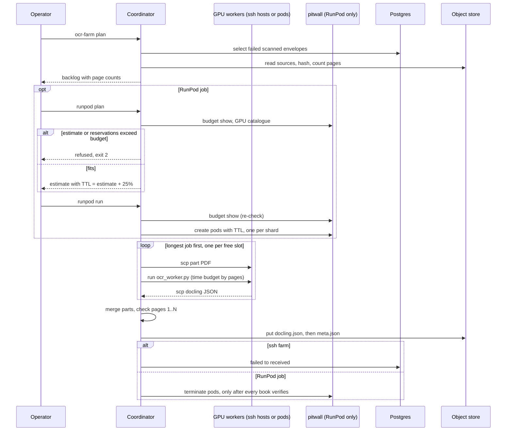

# OCR

[README](../README.md) · [Parsing and chunking](parsing-and-chunking.md) · [Ingestion](ingestion.md) · [Data model](data-model.md) · [Operations](operations.md)

Scanned books and page-image ebooks have no text layer, so they need optical character recognition before anything else can happen. OCR is the heaviest operation in the system: a few-thousand-page book keeps a GPU busy for hours. This page covers where OCR runs, the cache that connects it to ingestion, and the two ways to run it in bulk: a farm of ssh-reachable GPU hosts and a budgeted job on RunPod pods.

Three rules shape all of it:

- **OCR never runs on a CPU.** The default OCR engine in docling would silently use the CPU even with GPU flags set, so every OCR path checks `torch.cuda.is_available()` first and refuses to start without it.
- **OCR output is cached by file hash.** The result for a given file is stored once, at `ocr/<sha256>/docling.json`, and the parser reads that instead of OCR-ing again.
- **Bulk OCR is a recovery path.** Ingestion tries a scanned book itself. The farm works through the books that failed and puts them back in the queue.

## Where OCR happens

1. **In the dispatcher, on a GPU host.** The [router](parsing-and-chunking.md#the-router) sends a scanned PDF (or a page-scan EPUB, synthesized into a PDF of its page images) to `DoclingParser.parse_scanned`: full-page OCR with RapidOCR on the PyTorch backend, through the pypdfium2 PDF backend. `VORAG_DOCLING_DEVICE=cuda:N` selects a GPU.
2. **From the cache.** If `ocr/<sha256>/docling.json` already exists, the router maps it and skips OCR. The cache label (`ocr` or `native`) in `meta.json` decides whether the router trusts it; the table is in [Parsing and chunking](parsing-and-chunking.md#the-router).
3. **On the farm.** A dispatcher lane without a GPU cannot do (1), so it fails a scanned book with `OcrRequiresGpu`. A book can also fail because docling found content on only a few of its pages. The farm picks up exactly these failed envelopes, OCRs them elsewhere, writes the cache and re-queues them.


## The cache contract

| Object | Content |
| --- | --- |
| `ocr/<sha256>/docling.json` | A docling document for the whole book, pictures embedded |
| `ocr/<sha256>/meta.json` | Sidecar describing how it was made |

`<sha256>` is the hash of the source file's bytes, the same value that identifies the source everywhere else. Writers store `docling.json` first and `meta.json` second, because anything watching for `meta.json` acts on the book at that moment and the document must already be there. The envelope stays `failed` until both are written, so a parse can never see half a cache.

Example `meta.json` (the fields `run_farm` writes; values illustrative):

```json
{
  "pipeline": "ocr",
  "envelope_id": "01M4SBAPR8NMHWTQJKZRQ0JFPY",
  "title": "Field Guide",
  "host": "win,lin",
  "pages": 412,
  "fmt": "pdf",
  "parts": 2,
  "seconds": 812.4,
  "worker": ["ocr_worker: ok ... gpu_peak_bytes=...", "ocr_worker: ok ... gpu_peak_bytes=..."]
}
```

`pipeline: "ocr"` is what tells the router this is OCR output. Both farms write it, and `vo-rag corpus ocr-farm runpod verify` checks that it is present and that `pages` equals the planned page count. The router also accepts `native` for a layout-only parse made elsewhere; nothing in this repository writes that value.

## The ssh farm

`vo-rag corpus ocr-farm` drives GPU hosts you can reach over ssh. The coordinator runs on your machine and does all the I/O; the workers are thin. A worker holds a pinned docling and PyTorch virtual environment plus one script, `ocr_worker.py`, and has no credentials: it imports only the standard library, docling and torch, and never talks to Postgres, Qdrant or the object store. The coordinator copies a PDF over with scp, runs the worker over ssh, copies the JSON back and stores it. The code is in [`ocr_farm/coordinator.py`](../src/vo_rag/ocr_farm/coordinator.py), [`ocr_farm/hosts.py`](../src/vo_rag/ocr_farm/hosts.py) and [`ocr_farm/worker/ocr_worker.py`](../src/vo_rag/ocr_farm/worker/ocr_worker.py), with the CLI in [`cli/corpus_ocr.py`](../src/vo_rag/cli/corpus_ocr.py).

### Hosts

A host is an ssh alias plus an OS, a work directory, a number of worker slots and a Python path (`FarmHost`). Linux and Windows hosts are supported. The shipped definitions in `hosts.py` are examples named `win` and `lin`; `--hosts win,lin` can only choose among the definitions in that file, so to use your own machines edit `DEFAULT_HOSTS` and use ssh config aliases. Host order is preference order: the first host with a free slot gets the next job, so list the fastest GPU first. Resolved work paths are kept in `~/.config/vo-rag/ocr-farm-hosts.json` (override with `VORAG_OCR_FARM_STATE`).

### Commands

```sh
vo-rag corpus ocr-farm bootstrap          # create each host's venv (CUDA wheels), verify torch sees the GPU
vo-rag corpus ocr-farm plan > backlog.jsonl   # read-only: list books to OCR, with page counts and an estimate
vo-rag corpus ocr-farm run                # OCR the backlog, store the cache, re-queue the envelopes
vo-rag corpus ocr-farm run --limit 3 --no-requeue   # smoke test: three smallest books, leave envelopes failed
```

`plan` and `run` print one JSON object per line. `run` exits 1 when any book failed or a host was dropped; `bootstrap` exits 1 when a host fails its check. Example `plan` lines (shape from `FarmItem`; the last line is the summary the command computes):

```json
{"envelope_id": "01M4SBAPR8NMHWTQJKZRQ0JFPY", "garage_key": "intake/01J9ZEXAMPLE/field-guide.pdf", "sha256": "a3f10000...", "title": "Field Guide", "pages": 412, "fmt": "pdf", "cached": false, "problem": null, "duplicate_of": null}
{"books": 1, "to_ocr": 1, "cached": 0, "problems": 0, "pages": 412, "s_per_page": 0.48, "est_hours": 0.1}
```

Example `run` result and summary (shape from `FarmResult` and `FarmReport.summary()`):

```json
{"envelope_id": "01M4SBAPR8NMHWTQJKZRQ0JFPY", "title": "Field Guide", "sha256": "a3f10000...", "host": "win,lin", "pages": 412, "seconds": 812.4, "status": "ok", "requeued": true}
{"books": 1, "ok": 1, "cached": 0, "duplicate": 0, "failed": 0, "requeued": 1, "pages": 412, "seconds": 812.4, "host_errors": {}}
```

The `0.48` seconds per page is a throughput estimate for a two-host example farm, not a benchmark; calibrate it for your own GPUs before trusting `est_hours`.

### What `plan` selects

`plan` reads, and writes nothing. It selects envelopes with status `failed` whose error text says OCR needs a CUDA GPU, says the parse covered content on only a few pages, or carries the error text of an OCR engine that has since been removed, plus a short fixed list of image-only EPUB envelopes that failed before such books were routed to OCR. It then prunes:

- repeated failures of the same book (same normalized title) keep only the newest envelope;
- titles that already have a completed version are dropped;
- an envelope with the same bytes as one already kept is `duplicate_sha256` and rides on its twin's OCR;
- a book whose bytes are already in the books collection is `already_ingested` and is never OCR'd or re-queued;
- a book whose cache already exists is kept with `cached: true`, so `run` can still re-queue it;
- a book with no object, an unreadable file, an unsupported format or no pages gets a `problem` and is reported as `failed(<problem>)`.

### Scheduling

`run_farm` first prepares each host (make the jobs directory, copy the worker script, require `cuda True` from `ocr_worker.py --check`). A host that fails is dropped before any book is sent. Then:

1. **Books over 400 pages are split.** Each is cut into contiguous page-range sub-PDFs of at most 400 pages, and every part is its own job, so the parts of one book can run on different hosts at once. The limit is about memory. The worker keeps every batch's document, pictures included, until it concatenates them, so its memory grows with the pages it has been given, at roughly 1 to 2 MB per page. Two workers on multi-thousand-page books would pass 8 GB each within the first hour on a 32 GB host. At 400 pages a worker keeps at most 0.4 to 0.8 GB, twice that while concatenating and saving. Each part reloads the models (40 to 60 s), which is 1 to 10% of a 400-page part, so smaller parts would waste more. 400 is also a whole number of the worker's 100-page batches. A 4,000-page book becomes ten parts spread over every slot.
2. **Jobs run longest first.** The queue is sorted by page count, descending, and each job goes to the first host with a free slot. This is the standard greedy way to keep a pool busy: if a 4,000-page book were started last, every other slot would sit idle while one worker finished it. Starting the long jobs early lets the short ones fill the gaps at the end. A job returned to the queue after a host fault goes back to its sorted position.
3. **Each job has a time budget.** The OCR command gets `120 s + 10 s per page`, at least 300 s, so a 400-page part gets 4,120 s. The 120 s is twice the slowest observed model load, charged once per job, so the load does not eat the per-page allowance. 10 s per page is above the slowest observed dense-page rate (about 8 s per page) with room to spare. The budget is enforced locally; on expiry the remote worker is killed by its PID, but only after checking that the process's command line still names `ocr_worker.py` and that book's hash, so a recycled PID is never touched.
4. **Faults are host or book.** A worker exit of 69 (CUDA unavailable), 127, 9009 or 255 (ssh itself failed, confirmed with a reachability probe) says the host is broken: it is dropped for the rest of the run and its job goes back to the queue. Two timeouts in a row on one host with no success between them also drop the host and revive those books. Any other failure is the book's: exit 4 (the conversion finished but the GPU's peak memory was zero, meaning it did not run on the GPU), exit 5 (docling failed), bad output, or a timeout on a healthy host. A book fails whole: its other parts are cancelled, each one killing its remote worker and removing its files, and nothing is stored.
5. **Storing.** When every part is in, the coordinator merges the parts with `DoclingDocument.concatenate` and checks that the merged pages are exactly `1..N` (otherwise `failed(merged_pages)`), writes `docling.json` then `meta.json`, and sets the envelope from `failed` back to `received` (`--no-requeue` skips this). The requeue statement checks `status = 'failed'`, so it never resurrects an envelope something else has moved on, and it clears any streaming flag so the dispatcher can claim it.

SIGTERM and SIGINT cancel the run cleanly: every in-flight job kills its remote worker and removes its files before the process exits with status 130.

### Worker behavior

`ocr_worker.py` converts a book in 100-page batches and concatenates them. docling holds every page of a single `convert()` in memory, so books of 1,000 to 4,000 pages would commit 30 to 40 GB per process and die with PDFium's out-of-memory error on a 32 GB host. Pages docling drops are re-added empty so the batches stay contiguous and original page numbers survive; the merged document must have exactly pages `1..N` or the book fails. Oversize pages are rescaled the same way the local parser does it. Its pipeline options are a copy of `scanned_pipeline_options()`, and a test keeps the two identical.

## The RunPod farm

For a large backlog and no spare GPUs, `vo-rag corpus ocr-farm runpod` runs the same OCR on rented RunPod pods as one budgeted job. It differs from the ssh farm in three ways: pods are created and destroyed through a budget gate, units are sharded across pods up front, and the job is a directory of plain files you can inspect and resume.

**It needs `pitwall`, which is not bundled.** Every RunPod call goes through the external `pitwall` GPU-broker CLI (budget, GPU catalogue, pod create, get, list and terminate), always with `--json`. Install and configure it separately; if the binary is missing the RunPod commands report `cannot run 'pitwall'` and stop. `--pitwall PATH` points at another binary. The ssh farm does not use it. The adapter is [`ocr_farm/runpod/pitwall.py`](../src/vo_rag/ocr_farm/runpod/pitwall.py) and never reads or prints a credential.

The job lives in a local `--job-dir` and moves through four commands:

```sh
vo-rag corpus ocr-farm plan > backlog.jsonl
vo-rag corpus ocr-farm runpod plan    --backlog backlog.jsonl --job-dir ./ocr-job --pods 4
vo-rag corpus ocr-farm runpod run     --job-dir ./ocr-job
vo-rag corpus ocr-farm runpod collect --job-dir ./ocr-job
vo-rag corpus ocr-farm runpod verify  --job-dir ./ocr-job
```

| Step | What it does |
| --- | --- |
| `plan` | Estimates pages, GPU-hours, cost and per-pod reservations against the broker's remaining budget; writes `job.json` only if it fits |
| `run` | Stages each book as units of at most 400 pages and assigns them to pods; creates one pod per shard; bootstraps them with a bounded concurrency; starts a worker pool on each |
| `collect` | Pulls results from each pod, merges and uploads the cache, verifies every book, and terminates the pods only if every book verified |
| `verify` | Read-only: checks each staged book's `ocr/<sha256>/` cache |

The RunPod path writes the cache but does not touch envelopes. Re-queue the books afterwards: `vo-rag corpus ocr-farm run` finds them already `cached` and re-queues them (it needs one reachable worker host), or set the envelopes back to `received` yourself.

### Cost controls

Pod time is billed whether or not the pod is working, so every step is built to bound the spend. The code is in [`ocr_farm/runpod/job.py`](../src/vo_rag/ocr_farm/runpod/job.py).

- **A ceiling-rounded estimate is refused before anything is created.** GPU-hours round up to 0.01, dollars to the cent, TTLs to the minute, so the estimate errs high. `plan` compares it, and the sum of the per-pod reservations, with the broker's remaining monthly budget, and compares each reservation with the per-request cap. On any excess it writes no plan and exits 2.
- **`run` checks again, before creating pods.** The budget may have moved since `plan`, and a re-run after a lost pod creates new pods, so `run` recomputes the estimate for exactly the pods it is about to create and refuses if it no longer fits.
- **Every pod gets a TTL of the estimate plus 25%.** The pod stops billing on its own when the TTL ends, so a crashed coordinator or a forgotten job cannot run up charges indefinitely. The TTL includes the wait for a bootstrap slot, because pods queued behind the bootstrap limit are already billing: `(ceil(pods / setup_concurrency) - 1) x setup_minutes` is added to every pod.
- **A pod that cannot OCR is terminated at once.** One with no ssh address, no CUDA after bootstrap or a failed start only bills, so it is terminated immediately. If creating one pod fails, the pods already created in the same run are terminated, and a create whose reply was lost is looked up by its unique name before it is treated as failed.
- **Results move as files.** Each pod packs a `results.tar` that the coordinator copies with scp. A tar streamed through an ssh session hung or arrived corrupted by stray output, so nothing is piped.
- **`collect` terminates pods only when every book verifies.** If anything is missing or failed, the pods stay up so you can fix the cause and run `collect` again. A terminate that fails is reported and retried on the next run, and each pod is terminated independently so one failure leaves no other pod billing untried.
- **A pod is sized from its memory.** The pool on a pod is `container memory limit / 9 GB`, at most `--max-workers` (8 by default): a worker averages 4.4 GB but peaks at 8.9 GB, and the cgroup limit, not free memory, is what kills it.

Example `plan` output for a four-pod job (shape from `Estimate.to_dict()`; the GPU price, budget and page counts are illustrative):

```json
{
  "shard_ids": [0, 1, 2, 3],
  "shard_pages": [1800, 1750, 1700, 1650],
  "pages_per_gpu_hour": "6000",
  "setup_minutes": 15,
  "rate_usd_per_gpu_hour": "0.40",
  "remaining_budget_usd": "60",
  "per_request_max_usd": "8",
  "gpu_hours": "2.15",
  "cost_usd": "0.86",
  "ttl_minutes": [42, 41, 40, 40],
  "reservation_usd": ["0.28", "0.28", "0.27", "0.27"],
  "reserved_total_usd": "1.10",
  "setup_concurrency": 8,
  "queue_minutes": 0,
  "pages": 6900,
  "pods": 4,
  "within_budget": true,
  "refusals": []
}
```

The first pod's TTL follows from the numbers: 1,800 pages at 6,000 pages per GPU-hour is 18 minutes, plus a 15-minute setup allowance, is 33 minutes, times 1.25, rounded up, is 42. With only $1.00 of budget remaining, the same job is refused because the reservations ($1.10) exceed it, even though the raw cost ($0.86) would fit:

```json
{"refused": "pod reservations $1.10 (TTL x rate, per pod) exceed the remaining budget $1.00"}
```

`--pages-per-gpu-hour` defaults to 6000, which is deliberately conservative against measured rates of roughly 6,100 to 10,400 pages per hour per pod, so estimates and TTLs err high. `--setup-minutes` (15) is an allowance for the virtual environment, model warm-up and result pulls, not a measurement.

## Sequence



## Related

- [Parsing and chunking](parsing-and-chunking.md): how the router uses the cache and what the OCR-quality filter does with the text afterwards.
- [Ingestion](ingestion.md): the dispatcher lanes that decide which hosts attempt OCR, and the requeue that completes the loop.
- [Data model](data-model.md#object-store-keys): the `ocr/` keys and the farm's state files.
