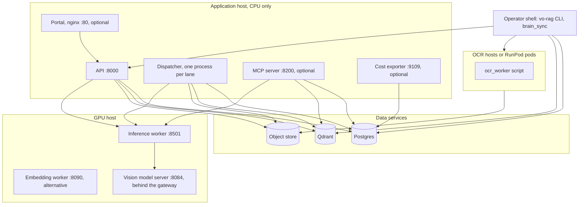
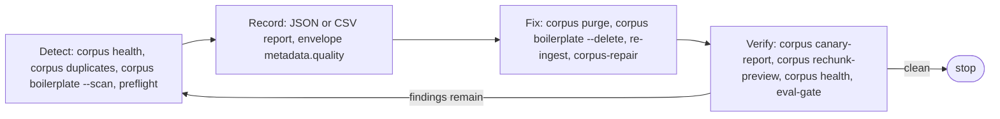
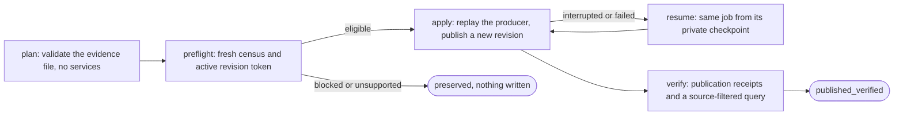

# Operations

[Setup](setup.md) · [Architecture](architecture.md) · [Reliability](reliability.md) · [Observability](observability.md) · [Testing](testing.md)

This is the runbook: which processes to start and in what order, how to tell they are healthy, how to keep a corpus clean, how to repair one source without a mixed state, how to change the schema, and how to stop a runaway cloud bill. It describes code contracts and checks you apply to your own environment; it does not prescribe a production topology, and nothing here was exercised against a live deployment.

## Deployment topology



The ports are the defaults in [`config/settings.yaml`](../config/settings.yaml) and the process code; every one can be changed. The API and the dispatcher are separate processes on purpose: the API only records an envelope, and the dispatcher does the work, so a long book can never block a request. Each process needs the same settings file and the same environment for the stores it touches.

## Starting the processes

Start the stores first, then run the one-time bootstrap in [data model](data-model.md#bootstrapping-a-new-deployment) (migrations and collections; neither the API nor the dispatcher creates them). After that, the order is: model workers, API, dispatcher, then the optional processes. The API starts without a dispatcher and without models, but its readiness probes then report 503 for the capabilities that need them.

| Process | Command (run from the repository root) | Port | Needs |
| --- | --- | --- | --- |
| Inference worker | `uv run --extra runtime uvicorn vo_rag.workers.inference.server:app --host 127.0.0.1 --port 8501` | 8501 | A CUDA GPU, the `runtime` extra, and (for figure descriptions) a llama.cpp server at `VORAG_VLM_UPSTREAM_URL` |
| Embedding worker | `uv run --extra runtime uvicorn vo_rag.workers.embedding.server:app --host 127.0.0.1 --port 8090`, or the container built from [`workers/embedding/Dockerfile`](../workers/embedding/Dockerfile) | 8090 | A GPU for speed; `BGE_M3_DEVICE=cpu` works for testing |
| API | `uv run uvicorn vo_rag.api.main:app --host 127.0.0.1 --port 8000` | 8000 | Postgres, Qdrant, the embedding endpoint and an API key |
| Dispatcher | `uv run python -m vo_rag.pipelines.book_rag.dispatcher` | none | The same environment as the API; see [ingestion](ingestion.md#the-dispatcher) for its variables, lanes and shutdown |
| MCP server | `uv run python -m vo_rag.mcp.server --transport stdio` | none (stdio), 8200 (HTTP) | The same environment as the API; see [MCP](mcp.md) |
| Cost exporter | `uv run python -m services.cloud_cost_exporter.app` | 9109 (`CLOUD_COST_EXPORTER_PORT`) | Postgres; Tailscale OAuth settings for the worker gauge |
| OCR worker | `python ocr_worker.py <in.pdf> <out.json>` (module `vo_rag.ocr_farm.worker.ocr_worker`) | none | Python, docling and torch on a GPU host; no vo-rag install |
| Local vLLM stand-in | `uv run python -m vo_rag.workers.runpod_vllm.harness --port 8188` | 8188 | Nothing; it returns canned text |
| Markdown indexer | `uv run python -m vo_rag.ops.brain_sync --repo ./var/brain --ref main` | none | Qdrant and an embedding endpoint |
| Passage migration | `uv run python -m vo_rag.ops.passage_migration` | none | Qdrant |
| Page-recovery replay | `python -m vo_rag.ops.repair_page_parse --original PDF --original-sha256 HASH --original-size BYTES --pages 3,4 --output FILE` | none | Started by `corpus-repair apply`; you do not run it by hand |

The three long-lived processes on the application host (API, dispatcher, MCP) read their configuration when they start. Run them under a supervisor of your choice and restart them after you change the environment. A SIGHUP clears the cached settings object, but code that already holds a `Settings` instance keeps it, so treat a restart as the supported way to reload.

What each less obvious entry is for:

- **Inference worker.** [`workers/inference/server.py`](../src/vo_rag/workers/inference/server.py) is the process every default URL points at. It serves `/embed` (the BGE-M3 dense, sparse and optional ColBERT vectors), `/rerank` (a GPU cross-encoder) and `/vlm/v1/chat/completions`, a gateway that forwards figure-description requests to a llama.cpp server one at a time, admitting each only after retrieval work has been idle for a short quiet period (2 s) and answering 429 with `Retry-After: 2` if that wait passes `VORAG_VLM_ADMISSION_WAIT_S` (120 s). It also serves `/ping`, `/health`, `/ready`, `/vlm/health` and `/metrics`. Concurrency, batch and depth limits come from `VORAG_INFERENCE_MAX_CONCURRENCY` (2), `VORAG_EMBED_MAX_BATCH` (32) and `VORAG_RERANK_MAX_DEPTH` (100). It has no container recipe in this repository.
- **Embedding worker.** The standalone BGE-M3 server speaks the same `/embed` contract, so you can point `BGE_M3_BATCH_URL` and `BGE_M3_QUERY_URL` at it instead. It exists so the embedding model can run on RunPod batch hardware or a smaller host; see [`workers/embedding/README.md`](../workers/embedding/README.md).
- **OCR worker.** The OCR farm places this script, with a pinned docling and torch environment, on each OCR host and the coordinator runs it there over ssh, so the module must stay free of vo-rag imports. Its exit codes carry meaning: 0 success, 2 usage, 4 the conversion finished but the GPU was never used, 5 docling reported failure, 69 CUDA unavailable. The coordinator treats 69 as a host fault and the others as a book failure. The farm itself is explained in [OCR](ocr.md).
- **Local vLLM stand-in.** [`workers/runpod_vllm/harness.py`](../src/vo_rag/workers/runpod_vllm/harness.py) mimics a RunPod serverless chat endpoint (`/openai/v1/chat/completions`, `/health`) so the serverless client can be exercised with no GPU and no bill. `--fail-first-n` makes the first requests return 502 to test retries. It is a test double, never a production server.
- **Passage migration.** [`ops/passage_migration.py`](../src/vo_rag/ops/passage_migration.py) audits by default and writes only with `--apply`. It stamps the current payload contract on older points and rebuilds the lexical (BM25) vector of the summary, RAPTOR and graph-node collections from their text, without re-embedding anything. Progress is checkpointed in a state file (`~/.local/state/vo-rag/passage-migration-v1.json`) only after Qdrant acknowledges a batch, and `--apply` needs explicit `--collection` names or `--all`.
- **Page-recovery replay.** [`ops/repair_page_parse.py`](../src/vo_rag/ops/repair_page_parse.py) re-parses a few physical pages of a PDF through the normal parser in an isolated subprocess (at most 5 pages per worker, 120 s, offline model settings) so a source repair can prove that recovered pages come from the real parser; [`ops/repair_legacy_parse.py`](../src/vo_rag/ops/repair_legacy_parse.py) is the read-only verifier that binds the stored original and parse bytes to the intake envelope. Both are called by `corpus-repair`.

## Health and readiness

Check liveness with `/health`, then the readiness probe for the capability you need. The API's probes, their bodies and their exemption from authentication are in [security](security.md#probes-and-exemptions); the metrics behind them are in [observability](observability.md). Do not treat a running API process, a declared collection or a successful upload as proof that retrieval or ingestion works.

```sh
curl -sS http://127.0.0.1:8000/health
# {"status":"ok","service":"vo-rag"}
curl -sS -o /dev/null -w '%{http_code}\n' http://127.0.0.1:8000/ready/query
# 200 when the database, Qdrant, the embedding service and the reranker are healthy; 503 otherwise
curl -sS -o /dev/null -w '%{http_code}\n' http://127.0.0.1:8000/ready/intake
# 200 when the database and a fresh dispatcher heartbeat are healthy; 503 otherwise
```

The other processes have their own probes: the inference and embedding workers answer `/ping` (204 while models load, 200 when ready), `/health` and `/metrics`; the inference worker adds `/ready` (503 until its models are resident); the cost exporter answers `/healthz` without touching the database. The dispatcher has no port: it writes a heartbeat file that the API reads, so a missing or stale file shows up as `dispatcher_unavailable` in `/ready/intake`.

## Corpus maintenance loops

A corpus of real books accumulates defects: scans that parsed to a few chunks, two copies of one title, running heads that slipped past the filters. The `vo-rag corpus` commands form one loop, and every step that changes data is a dry run until you say otherwise. The commands `purge`, `health`, `boilerplate`, `duplicates` and `canary-report` are registered by [`cli/corpus_ops.py`](../src/vo_rag/cli/corpus_ops.py), which only opens the connections and prints; `rechunk-preview` is registered by [`cli/corpus_rechunk.py`](../src/vo_rag/cli/corpus_rechunk.py); the logic behind each lives under [`core/corpus`](../src/vo_rag/core/corpus) and is named below.



| Command | Reads | Writes | What it answers |
| --- | --- | --- | --- |
| `corpus health [--source-id ID] [--json]` | The raw collection (payloads only, no vectors) and, for ebook detection, Postgres | Nothing | Which books are defective? Exits 1 unless the report is clean |
| `corpus duplicates --report FILE.csv` | The raw collection and Postgres | The CSV only | Which copies of a title should go? |
| `corpus boilerplate --scan` / `--delete [--yes]` | The raw, sterile and contextualized collections | Qdrant, only with `--delete --yes` | Which chunks are copyright or watermark lines? |
| `corpus purge SOURCE_ID... [--yes] [--drop-categories]` | Qdrant and Postgres | Both, only with `--yes` | Remove one book everywhere |
| `corpus canary-report ENVELOPE_ID...` | Envelope rows and Qdrant's index declarations | Nothing | Is a small trial batch healthy enough to run the whole batch? |
| `corpus rechunk-preview --source ID...` | Stored parses and live chunks | Nothing | Would today's chunker improve this book? |

**Detect: `corpus health`.** The scan itself is [`core/corpus/health.py`](../src/vo_rag/core/corpus/health.py). It scrolls each book's chunk payloads (1,024 per page, no vectors, counters only) and reports eleven kinds of finding. Four are whole-book structural defects: `degenerate` (more than 20% of chunks under 20 characters), `dominant_section` (one section title on more than 60% of a book of over 200 chunks), `unpaginated_page_titles` (`pp. N-M` titles on a book with no print pages, such as an EPUB) and `test_points` (chunks tagged `canary`, `rr03` or `test` that leaked into a real collection). Then `boilerplate_points`, `duplicate_groups` (groups with a planned delete), `empty_figures` (over 5% of figure chunks with neither a caption nor page context), `low_text_density` (a native-text book averaging under 300 characters per page), `image_only_suspect` (an EPUB where over 80% of chunks are figures), `too_few_chunks` (a native-text book of over 50 pages with fewer than one chunk per 10 pages) and `no_chunks`. Example output (the numbers are illustrative):

```text
$ uv run vo-rag corpus health
books: 212
degenerate: ['vo-rag-corpus-sha256:3fa1...']
dominant_section: []
unpaginated_page_titles: []
test_points: []
boilerplate_points: 0
duplicate_groups: 1
empty_figures: []
low_text_density: []
image_only_suspect: []
too_few_chunks: []
no_chunks: []
$ echo $?
1
```

The same findings are written to each envelope's `metadata.quality` when a book finishes ingesting, so the loop starts with a record, not only with a scan. The command takes no thresholds because the defects are structural.

**Detect and decide: `corpus duplicates`.** Books are grouped by normalized title and author. Normalization strips the file extension, a `.reencoded` marker, a trailing underscore, catalogue ids (a trailing `_12345678` or a bracketed run of five or more digits) and a `(YYYY)` year, then lowercases and removes punctuation, so `Systems_Handbook.pdf` and `Systems Handbook (2019).pdf` share a key ([`core/corpus/titles.py`](../src/vo_rag/core/corpus/titles.py)). Within a group the keeper is the copy with the fewest bad chunks (tiny or boilerplate), then not a `.reencoded` twin, then the most chunks, then the earliest completed intake envelope, then the lowest `source_id` as a pure tie-break so the plan does not depend on scan order. Each delete row names the first rule that separated it from the keeper. The command writes every planned row to the CSV and prints `{"groups": G, "delete": D}`; nothing is deleted, and the operator approves the `delete` rows first.

*Why editions are never merged.* The year is part of the grouping rule on purpose. Grouping on the normalized title alone would put the 2013 and 2019 editions of one book in the same group and mark one for deletion. Grouping transitively would fail in a subtler way: a copy with no year in its filename would be joined to both the 2013 and the 2019 copy and so bridge the two editions into one group. The rule therefore uses exact equality and no bridging ([`core/corpus/duplicates.py`](../src/vo_rag/core/corpus/duplicates.py)). If a title-and-author bucket holds at most one distinct explicit year, everything in it is one group, because a missing year is not evidence of a different edition. If it holds two or more distinct years, each exact year is its own group and is never merged with another, and the year-less copies form a separate group in which every row is forced to `keep` with the reason `ambiguous_year`. Nothing ambiguous can reach the delete list, and the group still appears in the CSV so a person can resolve it. An `ambiguous_year` group is keep-only, so it does not make `corpus health` fail. Example, from `plan_duplicates` over synthetic stats:

```text
group                                   source  action  reason
systems handbook|r. example|ambiguous   c3      keep    ambiguous_year
field guide|a. writer|no-year           d4      keep    fewest bad chunks, not reencoded, most chunks, earliest ingested
field guide|a. writer|no-year           e5      delete  more degenerate/boilerplate chunks than keeper
```

The 2013 and 2019 copies of the handbook form two single-copy groups and produce no rows; only the year-less copy is surfaced. To remove the approved rows, pass their `source_id` values to `corpus purge`.

**Detect and fix: `corpus boilerplate`.** The scan and delete logic is [`core/corpus/boilerplate_ops.py`](../src/vo_rag/core/corpus/boilerplate_ops.py). Exactly one of `--scan` and `--delete` is required. `--scan` prints one `{"source_id": ..., "boilerplate": N}` line per book and ends with `{"points": N}`. `--delete` without `--yes` prints the same report plus one line per derived collection; with `--yes` it deletes the matching points from the raw collection and also from the sterile and contextualized collections (a collection that does not exist is reported `absent`), because a chunk survives in every collection a query could still read. It uses the same matcher as `corpus health`, so the two counts cannot disagree. With source publication readers enabled the deletion goes through the publication client, limited to 10,000 points per run.

**Fix: `corpus purge`.** [`core/corpus/purge.py`](../src/vo_rag/core/corpus/purge.py) removes every trace of each source: its points from the raw, sterile and contextualized collections (filter `source_id`), the summary, RAPTOR and DSI collections (`book_id`), the graph nodes and edges, and its Postgres rows (`source_ingest_generations`, `knowledge_artifacts`, `sources`). A graph node that other books also cite is detached from this book instead of deleted. Intake envelopes are kept as history, and `ideas` and `compliance_log` rows are never deleted (their link to the artifact is set to null, which preserves the audit trail); they are only counted. Postgres commits first and Qdrant deletes run afterwards, so a database failure cannot leave vectors gone and rows present; if a Qdrant step fails after the commit, rerun the same purge, because every delete is idempotent. Output is one JSON line per source and a final `{"applied": true|false}`:

```text
$ uv run vo-rag corpus purge vo-rag-corpus-sha256:3fa1...
{"source_id": "vo-rag-corpus-sha256:3fa1...", "qdrant": {"vo_rag_books_raw_v1": 214, "vo_rag_books_sterile_v1": 0, "vo_rag_books_contextualized_v1": "absent", ...}, "graph_nodes_detached": 0, "postgres": {"ideas_unlinked": 0, "compliance_log_unlinked": 0, "source_ingest_generations": 0, "knowledge_artifacts": 1, "sources": 1, "book_categories": "kept"}}
{"applied": false}
```

The run above is a dry run (the default). `--yes` applies it. **With the default settings `--yes` refuses**: while source publication readers are enabled (`VORAG_SOURCE_PUBLICATION_ENABLED`, true by default) the command stops with an error that says it needs a coordinated cross-store erasure owner, because publication retains old revisions and a source-by-source delete cannot prove physical erasure. The dry run still works. To apply a purge you must start the command with `VORAG_SOURCE_PUBLICATION_ENABLED=false`, which also means you accept that old revisions are not cleaned up by it. (The sample `.env.example` sets that variable to false, so a shell that loaded it can apply a purge.) `--drop-categories` also deletes the `book_categories` rows, which are otherwise kept so a re-ingest reuses them.

**Verify: `corpus canary-report`.** The gates are pure functions in [`core/corpus/canary.py`](../src/vo_rag/core/corpus/canary.py), so tests run them on fakes. Before a big batch, ingest a small stratified sample (`vo-rag preflight --canary-out` writes one, see [parsing and chunking](parsing-and-chunking.md#preflight)) and pass its envelope IDs. The report evaluates six gates and prints `name: status -- detail` for each: `failed_envelopes`, `stage_budget` (no stage over `max(15 minutes, 6 s x pages)`), `embed_429_rate` (embedder retries on 429 under 1% of calls), `qdrant_p95` (worst book under 1 s), `payload_indexes` (the collection has the payload indexes the code declares) and `quality` (no book carries a health finding). A gate whose input was never recorded for an envelope is `unmeasured`, never a pass, and any unmeasured gate makes the verdict `INCOMPLETE`. The verdict is `PASS`, `FAIL` or `INCOMPLETE`, and the command exits 1 unless it is `PASS`. With `--total-pages` and `--lanes` it also projects the whole batch's wall time as total pages divided by measured pages per minute per lane, divided by the lane count; it does not suggest a higher lane count, because the 429 gate only shows whether the embedder kept up at the count you used. Example output (the figures are illustrative):

```text
$ uv run vo-rag corpus canary-report 01M4SBAPR8NMHWTQJKZRQ0JFPY --total-pages 90000 --lanes 2
{"envelope_id": "01M4SBAPR8NMHWTQJKZRQ0JFPY", "status": "completed", "pages": 240, "chunks": 611, "pages_per_min": 34.9, "wall_time_s": 412.0, "findings": [], ...}
failed_envelopes: pass -- 0 failed
stage_budget: pass -- every stage within max(15 min, pages x 6 s)
embed_429_rate: pass -- 0/40 = 0.00% (limit < 1%)
qdrant_p95: pass -- worst book p95 0.200s
payload_indexes: pass -- nothing missing
quality: pass -- every book clean
projection: projected_wall_time = total_pages / pages_per_min_per_lane / lane_count = 77364s (total_pages=90000, pages_per_min_per_lane=34.90, lane_count=2); lane_count is left unchanged at 2: ...
verdict: PASS
```

**Verify: `corpus rechunk-preview`.** The metric definitions are plain functions in [`core/corpus/rechunk_preview.py`](../src/vo_rag/core/corpus/rechunk_preview.py), and the I/O is in the CLI module. For each source it loads the stored parse (or, with `--reparse`, re-parses the original upload with docling on a GPU, in memory, with figures sent to a throwaway directory), rebuilds chunks with the chunker on your path and compares them with the book's live chunks. It writes nothing and embeds nothing. The comparison reports `live` against `new` for the chunk count and nine measures: `frag` (chunks under 300 characters), `frag_text` and `tiny_text` (body chunks under 300 and 150 characters), `figures`, `junk` (long chunks under a back-matter title such as Index that are really body text), `back_matter`, `garb` (letters under half the content), `fig_bleed` (figure chunks leaking neighbour-window text) and `path_quality` (the share of chunks whose heading path has a junk component), plus coverage figures (`coverage`, `sent_cov`, `input_cov`, `carry_over`), the OCR-noise counts and `new_ocr_drops`. Lower is better for the defect rates. It exits 1 if any source cannot be processed (no sha256, no completed envelope, zero chunks, or no CUDA with `--reparse`); the other books and the totals are still printed. Use it to prove a chunker change on real books before you pay for a re-ingest. `corpus health` and `eval-gate` ([evaluation](evaluation.md)) are the other verify steps.

## Source repair

`vo-rag corpus-repair` corrects one existing source without ever serving a mixed state. The implementation is [`ops/corpus_repair.py`](../src/vo_rag/ops/corpus_repair.py). It does not clean data in place. It replays the normal raw chunk, embed and point producer against an immutable evidence file and publishes the result as a new revision through the publication writer ([reliability](reliability.md#publication-revisions-and-copy-on-write-repair)), so readers see either the old revision or the new one. The evidence file is a JSON document that names the source, the target collection (`vo_rag_books_raw_v1` or `vo_rag_reddit_v1`), the approved before and after points with a disposition for each (`preserve`, `replace`, `unresolved`, `excluded`), a complete census of the live points, the writer recipe and a finite budget (defaults: one source, 500 replacement chunks, 20 MB of text, 50 MB of evidence, 1,800 s, no paid fallback). It is validated against [`core/ingest/repair_evidence.py`](../src/vo_rag/core/ingest/repair_evidence.py) with unknown fields rejected.



| Step | Command | What it does |
| --- | --- | --- |
| Plan | `vo-rag corpus-repair plan --manifest FILE` | Validates the file locally and prints a summary (counts, dispositions, budget, and `unsupported_reasons`). No service is opened. |
| Preflight | `vo-rag corpus-repair preflight --manifest FILE --state-dir DIR` | Reads the live source twice and checks it against the approved hashes and the active revision. Writes a private checkpoint. Fails with `active_revision_changed_since_evidence_capture` or `fresh_complete_census_differs_from_approved_hashes` if the source moved. |
| Apply | `vo-rag corpus-repair apply --manifest FILE --state-dir DIR` | Takes a before-backup, verifies the stored original and parse, replays the producer under the budget, publishes, and verifies by reading back. |
| Resume | `vo-rag corpus-repair resume --manifest FILE --state-dir DIR` | Continues the same job (the job id is derived from the manifest hash, source, revisions and writer code) after a crash. It recovers a revision that already published. |
| Verify | `vo-rag corpus-repair verify --manifest FILE --state-dir DIR` | Re-reads the publication receipts and checks that a query filtered to the source sees the new revision. |

Every command prints one JSON object. Terminal states recorded in the checkpoint are `eligible_preflight_read_only`, `applying`, `writer_published_needs_verify`, `published_verified`, `failed_retryable_preserved`, `preserved_no_write` and `blocked_budget`; a blocked step prints `disposition: blocked` and a short reason, a failed one prints its disposition and the exception class, and both exit non-zero. Replacement needs embeddings, so a manifest whose budget allows zero inference requests is reported `preserved_unsupported_producer`, and only the books-raw and Reddit targets have a producer wired here. Typed and derived collections (sterile, contextualized, graph, DSI) are refused with a reason. [`ops/publication_probe.py`](../src/vo_rag/ops/publication_probe.py) is a library, not a command: a zero-inference check of the publication writer that republishes one reviewed fixture source unchanged (its digest is fixed in the module), with prepare, execute and resume functions around a durable checkpoint. It is how the writer's partial-failure behaviour is exercised end to end, and it needs publication readers and writes both enabled and generation mode off.

## Migrations

Review migration state before changing a database. [`scripts/check_migrations.py`](../scripts/check_migrations.py) is read-only: it compares the `.sql` files in `database.migrations_dir` with the `schema_migrations` table and exits 0 when the database is current, 1 when a rollout should stop, and 2 when it could not connect (the JSON then holds only the exception type).

```sh
uv run --no-sync python scripts/check_migrations.py
```

Example output (the version names are illustrative):

```json
{
  "applied_count": 33,
  "checksum_drifted": [],
  "checksum_untracked": [],
  "expected_count": 34,
  "legacy_mapped": [],
  "ok": false,
  "pending": ["037_source_publication"],
  "unknown": []
}
```

`ok` is false when a migration is pending, when the database holds a version the code does not know, or when an applied file's checksum differs from the file on disk. Applying migrations is a library call (`run_migrations`), shown in [data model](data-model.md#bootstrapping-a-new-deployment); it runs each unapplied file in a transaction and raises `MigrationChecksumError` if an applied file has been edited. Back up your own metadata and object artifacts, identify the matching vector collection, and test recovery against disposable infrastructure; the repository provides migration definitions and this checker, not a tested production backup and restore procedure.

## Cloud cost governance

Cloud spending is gated at launch and observable afterwards. The settings are `cloud.monthly_budget_usd` (50.0 in `settings.yaml`) and `cloud.per_job_max_usd` (10.0). `CloudCostTracker` ([`core/cloud/cost_tracker.py`](../src/vo_rag/core/cloud/cost_tracker.py)) refuses a launch that would exceed either, reserving the spend in the same transaction as the check so concurrent launches cannot both pass; the 50, 75 and 90 percent crossings are logged. The details are in [reliability](reliability.md#budgets). The API builds a tracker at startup when the database is available and reports it in `/api/v1/admin/status` under `cloud`. The [cost exporter](observability.md#the-cloud-cost-exporter) publishes the month's spend, remaining budget, per-provider and per-workload breakdowns, active Tailscale workers and recent kill-switch events as Prometheus gauges every 60 s. It listens on all interfaces (`0.0.0.0`) at `CLOUD_COST_EXPORTER_PORT`, so bind it with your network policy.

**The kill switch.** [`core/cloud/kill_switch.py`](../src/vo_rag/core/cloud/kill_switch.py) is the emergency teardown, with a target runtime under 30 seconds. `CloudKillSwitch.activate(reason)` (a reason is required, as the audit trail) does three things in order and records the outcome of each in a `KillReport`, continuing past a failure: it overwrites the Tailscale ACL so the cloud-worker tag (`tag:vorag-cloud-worker`) has no allowed destinations, deletes every device carrying that tag, and terminates every RunPod pod whose name starts with `vorag-`. The API builds a switch at startup only when Tailscale OAuth credentials are configured, and `/api/v1/admin/status` reports whether it exists. Be clear about what is and is not wired: nothing in this repository calls `activate`, no route or scheduled job triggers it, and nothing writes the `cloud_kill_log` table the exporter counts, so a deployment needs its own caller (an alert hook or an operator script) and its own persistence call. The kill switch is a tested building block, not an automatic circuit breaker.

*Why there is no key-rotation step.* The switch has three steps and none rotates object-storage credentials: Cloudflare offers no REST endpoint for rotating permanent R2 access keys, which can be managed only from the dashboard. Time-bounded credentials limit exposure instead. Cloud workers never hold long-lived credentials, and [`core/cloud/r2_staging.py`](../src/vo_rag/core/cloud/r2_staging.py) hands them presigned GET and PUT URLs that expire (six hours by default). Exposure is bounded by time, so rotation after an incident is unnecessary for those workers.

**Workload placement.** Where a workload runs is a fixed table, not a runtime decision; see [engineering](engineering.md#decisions-visible-in-the-code). `/api/v1/admin/status` reports the placement it resolves.

## `brain_sync`

[`ops/brain_sync.py`](../src/vo_rag/ops/brain_sync.py) indexes a Git repository of Markdown pages into the `vo_rag_brain_v1` collection, so notes you keep in a repository become searchable beside your books. It is deliberately not an intake path: it reads a Git ref directly (never the working tree, so uncommitted edits are not indexed), makes one chunk per Markdown heading section with the page title as context (a section over about 8,000 characters is split on paragraph breaks so no chunk exceeds what the embedding model accepts), skips `log.md` and any non-Markdown file, and writes deterministic point IDs so a rerun changes nothing. Before each re-upsert it deletes the page's old chunks, and it deletes the chunks of any page that disappeared. A small state file (`~/.local/state/vo-rag/brain_sync.json` by default) records the last synced commit and the last error, so a caller can tell when the index lags Git.

```sh
uv run python -m vo_rag.ops.brain_sync --repo ./var/brain --ref main            # one pass
uv run python -m vo_rag.ops.brain_sync --repo ./var/brain --loop --interval-s 300 # poll forever
uv run python -m vo_rag.ops.brain_sync --repo ./var/brain --rebuild               # drop the collection, then sync
```

Each pass fetches `origin` first unless you pass `--no-fetch`, prints one summary line and exits 1 if any page failed. Example output (the figures are illustrative):

```text
brain_sync ./var/brain@main commit=9f2c1d4 pages=118 changed=3 deleted=0 points=1426 errors=0
```

It reads `QDRANT_URL`, `QDRANT_API_KEY` and `EMBED_URL` from the environment (defaults: `http://127.0.0.1:6400`, none, `http://127.0.0.1:8501/embed`). The collection layout is in [data model](data-model.md#brain_sync).

## Troubleshooting

| Symptom | First check | Interpretation |
| --- | --- | --- |
| HTTP 401 | Key export, scoped identity, configured Access verifier | Authentication failed before route execution |
| HTTP 403 for portal mutation | CSRF token and Access identity | A browser mutation needs a matching token |
| `/health` passes; readiness returns 503 | Dependency-specific unavailable reasons | The process is alive; the requested capability is unavailable |
| `POST /api/v1/intake` returns `dispatch_status: not_configured` | Is the dispatcher running, and do the API and dispatcher see the same heartbeat path? | The envelope is stored and stays `received` until a dispatcher claims it |
| Query produces no evidence | Explicit collections and mode, collection population, source publication state | Empty results do not establish a model failure |
| Ingestion fails in parsing or OCR | Runtime extras, parser executables and models, the GPU service | The core installation alone is insufficient for heavy parsing |
| `corpus purge --yes` stops with a cross-store erasure message | `VORAG_SOURCE_PUBLICATION_ENABLED` | Publication readers are on; see the purge section above |
| `corpus health` exits 1 | The named finding list | Fix, then rerun; a clean corpus exits 0 |
| Migration preflight fails | The selected database URL and the `pending`, `unknown` and `checksum_drifted` lists | Stop the rollout and reconcile the schema before proceeding |
| Synthetic eval passes | The fixture identity and evaluator mode | Replay wiring passed; retrieval quality remains unmeasured |

Do not print keys, session material or original document contents while investigating failures. Record redacted locations and types and use synthetic reproductions where possible.
