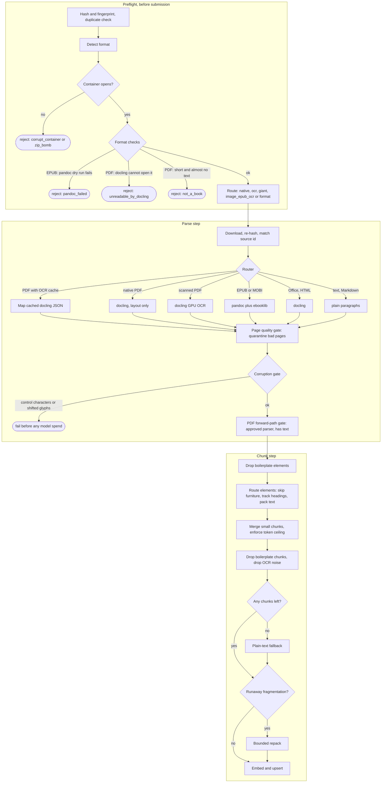

# Parsing and chunking

[README](../README.md) · [Ingestion](ingestion.md) · [OCR](ocr.md) · [Data model](data-model.md) · [Architecture](architecture.md)

A search system over books is only as good as the passages it indexes. Real books arrive as scans, ebooks with broken manifests, PDFs with running heads on every page, contents pages that look like headings, and watermark lines that look like text. This engine exists to turn those into clean, correctly labeled passages, and to refuse the files that cannot be turned into anything useful before they cost any GPU or embedding time. It is a large share of the product: the `core/parsing` and `core/chunking` packages plus the OCR-quality and boilerplate filters around them are about a sixth of the Python source.

The path from a file to stored passages has three stages. **Preflight** is an optional CPU-only triage you run before submitting files. The **parse step** inside ingestion detects the format, parses it and applies quality gates. The **chunk step** builds passages with heading paths, filters out furniture and noise, embeds and stores them.



## Preflight

`vo-rag preflight` checks files on the CPU with no network, Qdrant, Postgres or object store. It reuses the parsers' own detection code (format detection, the native-or-scanned test, the image-only EPUB test, the page-size limit, the zip-bomb guard), so preflight and ingest cannot disagree about a file. Its code is in [`core/parsing/preflight.py`](../src/vo_rag/core/parsing/preflight.py) and [`cli/preflight.py`](../src/vo_rag/cli/preflight.py).

For each file it records a verdict (`ok`, `reject` or `duplicate_of=<id>`), a route and the reasons it collected. Checks run in this order, and the first hard failure stops that file:

1. **Identity and duplicates.** SHA-256 and a content fingerprint. With `--catalog` a file whose hash or fingerprint is already in the catalog is `duplicate_of=<source_id>`; inside one batch, later copies are `duplicate_of=<hash of the first>`.
2. **Format.** Magic bytes, then MIME type, then extension, the same order the router uses. Nothing recognizable is `unknown_type`.
3. **Container.** An EPUB must pass the [zip-bomb guard](#epub-and-mobi) and `testzip()`; a PDF must open in PyMuPDF with at least one page. Failures are `zip_bomb` or `corrupt_container`.
4. **EPUB content.** A pandoc dry run (60 s limit) must succeed, or the file is `pandoc_failed: <reason>`. A book whose spine is page images is routed `image_epub_ocr`. Repairs the parser makes itself (a ZIP64 end record, manifest entries outside the OPF directory) are listed as information, never as rejects.
5. **PDF content.** docling's backend must be able to open the file; an owner-locked file that docling rejects but PyMuPDF can read is repaired and reported as `unlocked_for_docling`, and one that neither can open is `unreadable_by_docling`. A PDF of fewer than 10 pages with under 2,000 characters of text is `not_a_book`. Pages over 5,000 points on a side are reported as `oversize_pages` because the parser rescales them.
6. **Filename.** Names containing words like schedule, flyer, brochure, poster, program, menu, calendar or ticket reject short documents (under 40 pages, or no page count) as `not_a_book`. A 70-page training program is a book; a four-page race schedule is not.

The route tells ingestion where to send a file: `native` (text-layer PDF), `ocr` (scanned PDF), `giant` (over 1,000 pages, or 700 pages or more and not text-native), `image_epub_ocr`, `epub`, or the plain format name for anything else. [Ingestion lanes](ingestion.md#lanes) read the `giant` route. `inspect_file` never raises: an unexpected error becomes `reject: preflight_error: ...`, because one unreadable file must not abort a batch.

```sh
vo-rag preflight books --out report.json
```

Example output, trimmed to four files (hashes shortened). The command exits 1 because two files were rejected:

```json
{
  "ok": false,
  "schema_version": "2",
  "command": "preflight",
  "counts": {"route": {"none": 2, "text": 1, "native": 1}, "verdict": {"reject": 2, "ok": 2}},
  "duplicate_groups": {},
  "results": [
    {"path": "books/broken.pdf", "sha256": "9fe98d7e7114...", "fingerprint": null, "kind": "pdf",
     "pages": null, "route": null, "verdict": "reject", "reasons": ["corrupt_container"]},
    {"path": "books/form.pdf", "sha256": "8d5cf0611421...", "fingerprint": null, "kind": "pdf",
     "pages": 3, "route": null, "verdict": "reject", "reasons": ["not_a_book"]},
    {"path": "books/guide.md", "sha256": "ba0c211fd47d...", "fingerprint": null, "kind": "text",
     "pages": null, "route": "text", "verdict": "ok", "reasons": []},
    {"path": "books/handbook.pdf", "sha256": "9cd33ad52639...", "fingerprint": "pdf:12:b7819268d7d31e6774c2f44520f7bae5",
     "kind": "pdf", "pages": 12, "route": "native", "verdict": "ok", "reasons": []}
  ]
}
```

Options worth knowing:

| Option | Effect |
| --- | --- |
| `--out FILE`, `--csv FILE` | Write the full report as JSON, or a flat CSV |
| `--jobs N`, `--timeout S` | `--jobs` checks files in a process pool; with `--jobs` above 1, a file that exceeds `--timeout` (180 s default) becomes `reject: preflight_timeout`. `--timeout` has no effect at `--jobs 1` |
| `--catalog FILE` | JSON catalog for duplicate lookup |
| `--check-cache` | Annotate PDFs with `cache: native` or `cache: ocr` when the OCR cache already holds them; skipped quietly if the object store is not configured |
| `--canary-out FILE`, `--canary-n N` | Write a stratified sample (largest giants, image-only EPUBs, scans, long native PDFs, then random native files) to try before committing to a whole batch |

Feed the report to ingestion so each envelope carries its route, and rejected files are skipped:

```sh
vo-rag ingest file-drop --preflight report.json books/handbook.pdf books/form.pdf
```

`form.pdf` is skipped with a message and the command exits non-zero unless you pass `--allow-rejects`. Each submitted envelope gets `metadata.preflight = {route, pages, kind, verdict, sha256}`.

### Why pandoc is run as a subprocess

The pandoc dry run shells out to the `pandoc` binary with `subprocess.run(timeout=60)` and `--sandbox`, passing the input as an absolute path after `--`. A library wrapper called inside a `ThreadPoolExecutor` with a timeout on the future would give up waiting but could not stop the work: the thread, and the pandoc process under it, would keep running, and leaving the `with` block calls `shutdown(wait=True)`, which blocks on that thread forever, so one hung pandoc would hang the whole preflight. `subprocess.run` kills and reaps the child itself on timeout, so the call always returns within the limit plus teardown. For the same reason the batch runner uses `multiprocessing.Pool`, whose context manager terminates workers on exit, rather than a process-pool executor that waits for them.

## The router

[`ParserRouter`](../src/vo_rag/core/parsing/router.py) picks a parser. It detects the format (magic bytes, then MIME type, then extension) and dispatches:

| Format | Parser |
| --- | --- |
| PDF | See below: OCR cache, native docling, or GPU OCR |
| DOCX, PPTX, XLSX, HTML | docling |
| EPUB, MOBI | The ebook parser (pandoc and ebooklib); an image-only book is routed like a scanned PDF |
| `.txt`, `.md` | Blank-line paragraphs as one-page narrative text |

**Native or scanned.** A PDF is *native* when enough of a spread sample of its pages has a real text layer. The router samples 12 pages evenly from first to last, requires at least 40% of them to carry 50 or more characters, and requires the sampled text to pass a common-word check (at least 10% of its words must come from a short list of the most frequent English words, so a CID-encoded or garbled text layer reads as scanned). Sampling across the whole book matters: a book with a cover, plates and a blank verso up front is fully text-native in its body, and a first-pages-only probe sent it to OCR. Counting pages rather than averaging characters matters in the other direction: one text-heavy archive stamp must not turn a scan into a native book. The 0.4 threshold sits in the gap between the two populations measured on a sample of local PDFs (native books had text on at least 8 of 12 sampled pages; scans on at most 1), with room for covers and plate galleries.

**The OCR cache.** A scanned book may already have an OCR result at `ocr/<sha256>/docling.json` in the object store, produced by the [OCR farm](ocr.md). Its sidecar `meta.json` carries a `pipeline` label that decides how the router treats it:

| `meta.json` label | PDF the sampler calls native | PDF the sampler calls scanned |
| --- | --- | --- |
| `ocr` | Use the cached OCR result (parser `docling-ocr`) | Use it |
| `native` | Use the cached layout-only parse (parser `docling`) | Use it |
| none, or no sidecar | Ignore the cache and parse live; the pipeline is never guessed for native text | Treat as farm OCR output and use it |
| no `docling.json` | Parse live | Live GPU OCR |

The `ocr` row for a native-looking PDF is deliberate. The farm only OCRs books whose live parse already failed (for example a native PDF where docling found content on 0 of 34 pages), so parsing it live again would fail the same way. A sidecar that is not valid JSON, not an object, or names an unknown pipeline raises an error naming the file hash, and so does a failed object-store read: a broken cache must never fall through silently to a live parse. This repository's farm writes only `ocr`; the router also accepts `native` for a layout-only parse produced elsewhere. An image-only ebook refuses a `native` cache, because a plain-docling result for a non-PDF upload would skip the PDF gates below.

Cached JSON is mapped through the same docling mapper as a live parse, and the document title is restored to the source file's name, since the farm OCRs a file named after its hash. The result records `metadata.ocr_host`, and `ocr_source: farm` or `pre_parsed: native`.

## Parsers

### docling (PDF and Office)

[`parsers/docling.py`](../src/vo_rag/core/parsing/parsers/docling.py) wraps the docling library and maps its document into the common `ParsedDocument` contract ([`contract.py`](../src/vo_rag/core/parsing/contract.py)), through [`docling_mapping.py`](../src/vo_rag/core/parsing/parsers/docling_mapping.py): elements in reading order with a type (title, narrative text, list item, table, image, equation, code, header, footer), page numbers, per-page quality records, a heading tree, Markdown, and figure images written to the figure store.

- **Native PDFs** run with OCR off. Before docling opens the file, two repairs run on a temporary copy: a page whose longest side exceeds 5,000 points is redrawn at 1,200 (the largest standard paper size, A0, is 3,370 points, so no real page is touched; an oversize page fails the whole book otherwise), and an owner-locked PDF that PDFium rejects but PyMuPDF reads is rewritten without encryption.
- **The PDF text backend** is docling's own by default. `VORAG_DOCLING_PDF_BACKEND=pypdfium` swaps in pypdfium2, which kept memory low on glyph-dense books where the default one reached tens of gigabytes. That backend can double a page's text on some pages or miss pages, so the parser compares its output with pypdfium2's plain text ([`pdf_page_rebuild.py`](../src/vo_rag/core/parsing/parsers/pdf_page_rebuild.py)) and rebuilds doubled or failed pages in small page ranges with the default backend, falling back to plain page text rather than losing words. Every repair is recorded in the document metadata.
- **Equations and tables** keep a pixel crop of the original PDF region next to the parsed text ([`pdf_formula.py`](../src/vo_rag/core/parsing/parsers/pdf_formula.py)); no recognition model is run on the crop.
- **Scanned PDFs** use full-page OCR (RapidOCR on the PyTorch backend, `force_full_page_ocr`) through `parse_scanned`. OCR never runs on the CPU, on any machine: the default OCR engine would silently run on the CPU even with GPU flags set, so the parser checks `torch.cuda.is_available()` first and raises `OcrRequiresGpu` otherwise. `VORAG_DOCLING_DEVICE=cuda:N` picks a specific GPU. A dispatcher lane without a GPU therefore fails a scanned book with that error, and the [OCR farm](ocr.md) picks it up.

### EPUB and MOBI

[`parsers/epub.py`](../src/vo_rag/core/parsing/parsers/epub.py) reads the book with ebooklib, converts it to GitHub-flavored Markdown with pandoc (`--wrap=none`, because pandoc's default hard wrap at 72 columns split every paragraph into several elements) and turns the Markdown into elements ([`epub_markdown.py`](../src/vo_rag/core/parsing/parsers/epub_markdown.py)). MOBI is first converted to EPUB with Calibre's `ebook-convert` (set `VORAG_MOBI_CONVERTER` to use another binary; the timeout is `VORAG_MOBI_CONVERT_TIMEOUT_S`, 900 s).

Real ebooks are messier than the standard allows, so the parser repairs the archive before reading it. It rewrites chapter items declared as `text/html` to the XHTML media type (pandoc skipped them, collapsing a book to its cover), drops manifest items whose files are missing (ebooklib raises on the first one), and moves items whose paths escape the OPF directory back inside it. Chapter titles that the author styled as paragraphs rather than headings are recovered from the table of contents by matching body lines to its entries. EPUBs have no pages, so pages are synthetic chapter indexes; the chunker treats them as such.

A book whose spine is at least 80% images, with fewer than 50 characters of text per image over at least 20 elements, is a page-scan EPUB. The parser raises `ImageOnlyEbook` with a PDF it has synthesized from the page images, and the router sends that PDF down the scanned path.

**Zip-bomb guard.** Every reader of an untrusted EPUB (the container check, normalization, ebooklib, pandoc) decompresses members in full. The guard reads only the archive's central directory, before any member is read, and rejects it when the declared sizes total over 2 GiB, or when any member over 100 MiB expands more than 200 times. The declared size bounds what any later read can produce. See [Security](security.md) for the wider trust model.

## Gates in the parse step

After the router returns a `ParsedDocument`, [`steps/parse.py`](../src/vo_rag/pipelines/book_rag/steps/parse.py) applies the gates below and stores `parsed/<envelope_id>/parsed.json`. A gate either fails the envelope, because proceeding would index wrong or unusable data, or records a warning and lets the usable text through.

| Gate | What it checks | Result |
| --- | --- | --- |
| Source identity | The downloaded bytes re-hash to the registered source ID | Mismatch raises |
| Page-count reconcile | A PDF's page count against the container | The parser's count is replaced and missing page records are synthesized with a warning |
| Page quality ([`quality_gate.py`](../src/vo_rag/core/parsing/quality_gate.py)) | Page confidence under 0.6, or no text on a page that has figures or tables. A third trigger, broken reading order on a multi-column page, is a placeholder that always passes today | The page is quarantined and the chunker skips it; the book continues with warning `page_quality_findings`. A table or figure that was detected but not extracted is a warning only. The parsers report a confidence of 1.0 for every page they produce, so in practice the confidence trigger fires only for pages the pipeline synthesized when it reconciled the page count (confidence 0.0) |
| Corruption ([`corruption_gate.py`](../src/vo_rag/core/parsing/corruption_gate.py)) | On the first 20,000 characters: control characters above 2%, or a text that becomes more readable when every letter is shifted back by three (the signature of a CID-encoded font) | Either of those fails the book before any model spend. A text with almost no common words and no spaces only logs a warning; it is not recorded as a `quality_warning`. `VORAG_BOOK_RAG_DISABLE_CORRUPTION_GATE=1` bypasses it for a document you know is good |
| PDF forward path | For PDFs and any OCR result: the parser is `docling` or `docling-ocr`, and the document has text | Otherwise fails. A book of 10 or more pages with content on under 10% of them gets warning `low_page_coverage` |
| Red flags | Native-PDF image-count anomalies in the parse metadata | Warning `native_pdf_red_flags`. Despite its name, `VORAG_BOOK_RAG_FAIL_ON_PARSE_RED_FLAGS` only controls whether this runs (on unless set to `0`); it never fails a book |

Warnings travel with the book as `quality_warnings` on the envelope, the intake status and the stored passages. See [Ingestion](ingestion.md#warnings-versus-failures).

## The chunker

[`HierarchicalChunker`](../src/vo_rag/core/chunking/hierarchical.py) turns the element stream into passages. "Hierarchical" refers to the heading hierarchy: every chunk carries the path of headings above it, and that path is part of the text that gets embedded, so a paragraph about "drift" under a sensor-calibration chapter and one under an ocean-currents chapter are distinguishable. Chunks are flat records, not a parent and child tree; the one parent link is the optional sub-chunking used by compliance, described in [Rights and compliance](rights-and-compliance.md).

Sizes are in tokens: target 500, maximum 600, minimum 100 (smaller chunks merge into a same-section neighbour), overlap 50. Tokens are counted as characters divided by four unless `VORAG_CHUNK_TOKEN_COUNTER=tokenizer` selects the real tokenizer. Because the embedding text is the section path plus the content, the budget counts both. The `chunking.strategy` setting `semantic` replaces the prose splitter with one that cuts at embedding-drift boundaries between sentences (95th percentile, one-sentence buffer); the default is `hierarchical`.

Example: a six-page chapter whose running head ("STORING PASSAGES 12", "STORING PASSAGES 13", ...) was typed as a title by the parser, built with the chunker directly. The heads are recognized and skipped, so the paragraph continues across pages and the section path is clean:

```python
from vo_rag.core.chunking.hierarchical import HierarchicalChunker
from vo_rag.core.parsing.contract import (
    ElementType, PageQA, ParsedDocument, ParsedElement, element_id,
)

elements: list[ParsedElement] = []

def add(kind: ElementType, text: str, page: int, **extra: int) -> None:
    elements.append(ParsedElement(
        element_id=element_id(text, page, len(elements)),
        element_type=kind, text=text, page_number=page, **extra,
    ))

add(ElementType.TITLE, "1 Storing passages", 1, section_depth=1)
sentences = [
    "A passage is stored with the heading path that leads to it so a search hit can say where it came from.",
    "The path is built while the chunker walks the pages, and each chunk carries it in front of its text.",
    "Page furniture such as a running head must not break a sentence that continues onto the next page.",
    "A running head repeats at the edge of every page of a chapter, so the chunker recognises it by repetition.",
    "Without that rule the same words would be written into the middle of paragraphs and into the section path.",
    "The same reasoning applies to page numbers that sit next to a running head and change from page to page.",
]
for page, text in enumerate(sentences, start=1):
    if page > 1:
        add(ElementType.TITLE, f"STORING PASSAGES {page + 10}", page)
    add(ElementType.NARRATIVE_TEXT, text, page)

doc = ParsedDocument(
    document_id="d1", source_id="vo-rag-corpus-sha256:demo", title="Handbook", total_pages=6,
    elements=elements, images=[], markdown="", heading_tree=[], parser_used="docling",
    page_qa=[PageQA(page_number=p, ocr_confidence=0.95, text_element_count=2, parser_used="docling")
             for p in range(1, 7)],
)
chunks = HierarchicalChunker().chunk(doc, [])
print(len(chunks), chunks[0].model_dump(exclude={"embedding_text", "content"}))
```

Output (one chunk covering pages 1 to 6, with no running head in its text):

```text
1 {'chunk_id': 'ee57a0c9-5286-1bdb-997d-3d9e3806b255', 'chunk_type': 'text', 'document_id': 'd1', 'source_id': 'vo-rag-corpus-sha256:demo', 'page_number': 1, 'page_range': '1-6', 'section_path': '[Handbook > 1 Storing passages]', 'section_title': '1 Storing passages', 'chapter_path': '[Handbook > Ch 1]', 'token_count': 164, 'has_image': False, 'image_id': None, 'image_ref': None, 'vlm_description': None, 'metadata': {}}
```

### How elements are routed

Each element takes one of ten routes (`ElementRoute`): skip as header or footer, skip as repeated page text, update the heading, reject the title, skip as quarantined, table, list item, hold as a pending heading, body, or ignore. The decisions that matter most for quality are below.

**Headings.** A parser types an element as a title from visual cues such as font size, and does not check that the text is a heading. Left unfiltered, most scanned books end up with degenerate section titles: bare page numbers, copyright and download-watermark lines, "This page intentionally left blank", OCR debris, and spaced-out display type ("T H E  H A N D B O O K"). [`heading_filter.py`](../src/vo_rag/core/chunking/heading_filter.py) rejects such text with a reason (`watermark_or_drm`, `publisher_slogan`, `numeric_only`, `roman_only`, `page_marker_only`, `spaced_display_font`, `ocr_garbage_punct`, `mostly_digits`, `math_operator`, `low_alpha_ratio`, `insufficient_words` and others), both when a heading is stored and again when the deepest heading is looked up. A genuine run of stacked standalone headings is a handful of lines, so a run longer than four short title-case lines is treated as list content. Without that limit, an index would be glued into one very long section path that exhausts the token budget and splits a book into hundreds of thousands of one-character chunks.

**The open heading path.** [`heading_tracker.py`](../src/vo_rag/core/chunking/heading_tracker.py) keeps the current path by depth and labels front matter (title page, dedication, copyright) and back matter (index, references) so they do not parent real chapters. A heading that nothing has reconfirmed for 25 pages while body text continues is dropped and the text falls back to the document title, marked `stale_heading`; without this rule a "Bibliography" or "INDEX" label rides onto hundreds of pages. When a paginated book (not an ebook) ends up with more than 10 chunks whose only path is the document title, a fallback labels them by page range: 10-page sections inside 50-page chapters (`VORAG_BOOK_RAG_FALLBACK_SECTION_PAGES`, `..._CHAPTER_PAGES`, `..._MIN_TITLEONLY_CHUNKS`).

**Contents pages.** A scanned contents page reaches the chunker as a column of title elements ("12 The long jump 250"), and each one would open a section of its own. [`contents_pages.py`](../src/vo_rag/core/chunking/contents_pages.py) finds contents pages first, page by page, and files each whole under a "Contents" label. Context decides before content: a page can only be a contents page when a Contents heading sits on it or the page before, or the page before is one, or the parser marked it as a document index in the front of the book. In that context a page qualifies when it has at least 3 short lines ending in a page number making up at least 40% of its short elements, the numbers rise (at least 80% of steps non-decreasing) and stay within the book, and its sentences do not outnumber its entries. A list of rising numbers anywhere else, such as a table of weekly totals, is never contents, and a back-of-book index never sits in a contents context.

**Running heads and page furniture.** The same words printed at the top of every page must not enter the text, split a sentence that crosses a page, or become the section path. Three layers handle it:

1. Elements the parser typed as header or footer are skipped.
2. Short lines of 8 words or fewer that repeat on at least 3 pages are skipped, but only when they sit at a page edge, and stripped from packed text ([`artifact_filters.py`](../src/vo_rag/core/chunking/artifact_filters.py), [`section_packer.py`](../src/vo_rag/core/chunking/section_packer.py)).
3. Running heads the parser typed as *titles* need care, because a real heading appears once, and its words often recur in its own running head ("10.2 Mean field VI"). A title is a running head only when it is at a page edge, is not the potential opener of its run, and either carries a page number that tracks the page (the same text recurs on at least 3 pages with one printed-minus-physical offset, allowing a drift of one), or repeats its exact text at page edges on at least 3 pages. A run is one title text, with section numbers, edge numbers and punctuation removed, on pages at most 3 apart. A chapter's opening page carries no running head, so a run's first title is its opener, unless the run already holds a title whose number does not follow the page. Enumerated labels such as "Step 3" or "Chapter 2" that count up from 1 are labels, not heads.

**OCR-variant running heads.** OCR often spells one running head differently on each page ("FIELD METHODS: SURVEY NOTES", "FIELD METHCDS: SURVEY NOTES", "FIELD METHODS: SURVEY NOTFS"). The chunker folds page-edge titles to letters, groups spellings that are at least 0.8 alike overall, have the same word count and are at least 0.6 alike word by word, and treats a group as a running head only with evidence it is one text. The group must form a run of at least 3 pages, each at most 5 after the last (a verso-only head skips a page, and a chapter opener one more). It also needs either a spelling that differs in a word that is not a dictionary word (the garble, "METHCDS" or "NOTFS"), or a representative spelling that itself appears on at least 3 pages of the run. The evidence requirement exists because two real headings can look like OCR variants of each other ("Load Test" and "Load Tests"; "Test Plans" and "Test Plan"). A genuine heading repeated on several pages is spelled the same each time, so garble is what separates the cases. Every member except one on page 1 is then skipped. Comparing every spelling with every group is quadratic with difflib, so groups are bucketed by word count, pairs whose lengths already rule out a match are never scored, a cheap upper bound (`quick_ratio`) runs before the full ratio, and a document gets at most 100,000 cheap and 5,000 full comparisons, together well under a second. Past the budget, remaining spellings stay ungrouped and the heading is kept, which is the safe failure.

**Tables, lists and figures.** Tables are linearized into sentences ("Comparison across columns: ...") so they embed as text and split under the token limit ([`table_linearizer.py`](../src/vo_rag/core/chunking/table_linearizer.py)). Figure chunks from the visual step are placed by their page-order position and labeled from the heading tracker; relabeling a figure never moves a text chunk boundary.

**What the chunker drops.** Text is dropped only when it holds neither letters nor numbers, is a download watermark, or is nothing but a low-value word such as "Contents" or "Index". Index lines, imprint and rights notices, title pages and digit-heavy lines such as "2 x 220, 550, 2 x 220" are all kept, because content-based drop rules also discard real text (a worked example under an index-like page reference, a chapter's prose that begins with the word "chapter").

**Small and oversize chunks.** Short text is emitted in place and merged into a same-section neighbour by [`short_text.py`](../src/vo_rag/core/chunking/short_text.py); it is never dropped. A final backstop ([`token_ceiling.py`](../src/vo_rag/core/chunking/token_ceiling.py)) splits anything over 115% of the maximum at sentence boundaries, and if a section path alone exceeds the budget it budgets the content alone, because splitting cannot fix path overhead.

Text that is dropped is recorded in a per-page ledger with one reason: `empty_after_normalize`, `qa_quarantined`, `below_min_words`, `no_text_extracted` or `ocr_garbage`. `vo-rag corpus rechunk-preview` re-chunks stored parses with the current code and compares the result with the live chunks without writing anything, which is how chunker changes are checked on real books before a re-ingest.

## Filters after chunking

[`steps/chunk_embed.py`](../src/vo_rag/pipelines/book_rag/steps/chunk_embed.py) runs these in order.

1. **Boilerplate** ([`boilerplate.py`](../src/vo_rag/pipelines/book_rag/boilerplate.py)). A whole element, then a whole chunk, whose normalized text (lowercased, punctuation and whitespace collapsed) exactly equals an entry on a reviewed list is removed. Only "this page intentionally left blank" ships on the list. The match is exact, not a prefix: a chunk that begins with that sentence and goes on to carry real content normalizes to a longer string and is kept. The element-level pass runs first because the packer merges adjacent short elements, so a blank-page marker after a real paragraph can become part of one chunk that no whole-chunk check would match.
2. **OCR text quality** ([`ocr_quality.py`](../src/vo_rag/pipelines/book_rag/ocr_quality.py)). Judges one chunk's text and returns `keep` or `drop`. It is precision-first: dropping real content is far worse than keeping some noise, so a chunk with a run of real words, well-formed numbers, compact notation such as `x5` or `3x60`, table structure or readable letter-spaced text is never dropped. It drops unmistakable noise (nothing readable survives), chunks of only page numbers, and chunks that are nothing but links. It uses a bundled English word list ([SCOWL](../src/vo_rag/pipelines/book_rag/data/SCOWL-COPYRIGHT.txt)), no model and no network. Figure chunks, chunks under 20 characters and chunks over 16,000 characters are not judged.
3. **Zero-chunk fallback.** If the filters leave nothing, form-style documents that parse but over-filter are rebuilt as plain text chunks of about 350 tokens; if that also yields nothing, the book fails with a count of what was dropped at each stage.
4. **Degeneracy and runaway.** A book whose chunk count, density or size is implausible gets a warning (the [validator floors](ingestion.md#the-eight-check-validator)). A scanned or garbled document that fragments into tiny chunks (above 60 per page with a mean under 40 tokens) is repacked by a bounded plain-text splitter; the chunk size is judged on content, not embedding text, since a bloated section path would otherwise hide a mean chunk size of one character.
5. **Stamping.** Each chunk gets its parser, book identity (`source_book`, `title`, `author`, `license_class`, `canonical_source_id`), parse provenance and, when none were supplied, deterministic heuristic domain tags from a bounded text sample.

Then [`do_embed_raw`](../src/vo_rag/pipelines/book_rag/steps/chunk_embed.py) embeds in batches of 32 texts: a dense vector, a learned sparse vector (BGE lexical weights) and, when ColBERT is enabled, multivectors per chunk; a separate BM25 sparse vector is computed locally from the chunk text. Real ColBERT multivectors are off by default (`VORAG_BOOK_RAG_INCLUDE_COLBERT=1` enables them, capped at 192 vectors per point) because they cost roughly ten times the storage and a third of the embedding compute; points carry a dense-derived stand-in so the collection schema stays uniform. Point IDs are deterministic, and raw points are stored with `trust_level: trusted`, since quarantined points are filtered out of retrieval.

## Where each decision is recorded

| Question | Where to look |
| --- | --- |
| Why was a file rejected before ingest? | `reasons` in the `vo-rag preflight` report |
| Which parser ran? | `parser_used` inside `metadata.book_rag_forward_path` on each chunk |
| Did the OCR cache serve it? | `ocr_source: farm` or `pre_parsed: native`, plus `ocr_host`, in the `metadata` of `parsed.json` |
| Which pages were quarantined? | `quarantined_pages` in `parsed.json`; warning `page_quality_findings` |
| Which text was dropped, and why? | The chunker's per-page drop ledger; `rechunk-preview` compares what the current chunker builds with the stored chunks |
| What did the book end up with? | `metadata.quality` on the envelope (findings and stats), `quality_warnings` in the intake status |
