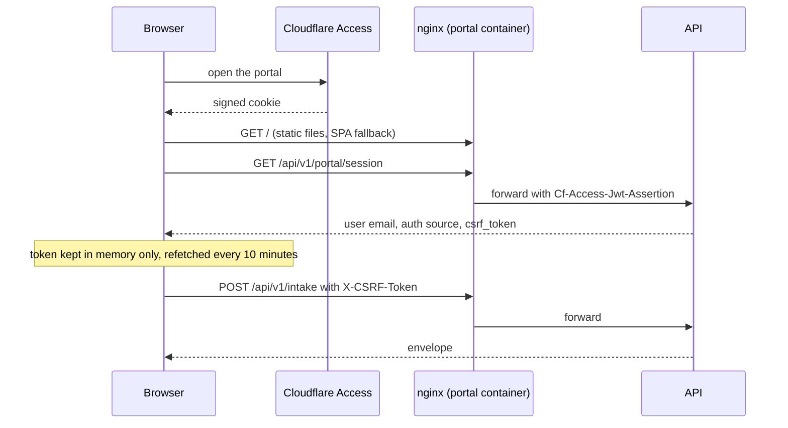

# Portal

[Operations](operations.md) · [Security](security.md) · [HTTP API](api.md) · [Setup](setup.md)

The portal is a single-page operator console for the same services the CLI and the HTTP API expose: submit documents, watch an ingest run, browse the library, and run queries. It is a React 19 app built with Vite, with TanStack Query for server state, zustand for the little client state it keeps, zod to validate every response, and Tailwind for styling. It lives in [`packages/portal`](../packages/portal) and has no server of its own: every byte of data comes from the API.

## Pages

The router in [`src/App.tsx`](../packages/portal/src/App.tsx) has ten pages under one shell (sidebar, header, and a health pill that polls `/health` every 15 seconds); `/` redirects to `/overview`.

| Route | What it shows | API calls |
| --- | --- | --- |
| `/overview` | Health, status, collection counts and a card for each pipeline, plus a grid of "facets" (areas of the system marked wired, partial or external) | `/health`, `/status`, `/api/v1/collections/stats`, `/api/v1/rag/status` |
| `/ingest` | Seven tabs that submit work (article URL, repository URL, research URL, idea, file, tool or library URL, and a page-capture URL), a live view of the run you just started, and recent submissions | `POST /api/v1/intake/upload-url`, `POST /api/v1/intake`, `GET /api/v1/intake/{id}/stream`, `GET /api/v1/envelopes` |
| `/library` | Knowledge artifacts, searchable and filterable | `GET /api/v1/artifacts` (cursor pagination) |
| `/library/:id` | One artifact: provenance, images, and for a book its pages and the summary, DSI, graph and RAPTOR layers | `GET /api/v1/artifacts/{id}`, `.../images`, `/api/v1/books/{source_id}`, `.../pages/{page}`, `.../summaries` |
| `/query` | A query box with collection picker, `top_k`, rerank toggle and key-value filters; results as cards | `POST /api/v1/query` |
| `/pipelines` | Running ingests, the envelope list and one envelope's detail (refreshed every 1.5 s) | `GET /api/v1/envelopes`, `.../{id}` |
| `/book-rag` | The book pipeline's status, collection counts and envelopes currently processing | `/api/v1/rag/status`, `/api/v1/collections/stats`, `/api/v1/envelopes?status=processing` |
| `/system` | Per-service health, GPU telemetry if the status body carries it, and links to external consoles | `/status` |
| `/ops` | Fleet roles and console links | none |
| `/settings` | Your account (email and how you authenticated), a logout link and the default query mode | `GET /api/v1/portal/session` |

Two things on these pages are static, not live. The fleet panel on `/ops` is a hard-coded example list of four generic roles (an API host, an inference host, RunPod serverless and a file share), and the external-console links (`localhost` addresses for three observability tools) are constants in [`ExternalLinks.tsx`](../packages/portal/src/components/system/ExternalLinks.tsx). Edit [`src/project/vorag.ts`](../packages/portal/src/project/vorag.ts) and that component to describe your own deployment.

## How it talks to the API

Every call goes through one hook, `useApi` in the `client.ts` module of the portal's [`src/api`](../packages/portal/src/api) directory. It sends a same-origin `fetch` with cookies (`credentials: "same-origin"`), adds the header `X-VO-RAG-Caller: portal`, throws an `ApiError` carrying the status and body on any non-2xx response, and parses the JSON with a zod schema ([`src/schemas/index.ts`](../packages/portal/src/schemas/index.ts)) so a response that drifts from the contract fails loudly in the browser instead of rendering wrong data. The portal holds no API key. Which paths it calls is in the table above; the contracts are in [HTTP API](api.md).

Authentication belongs to the surrounding deployment, not to the portal. In production the page is served behind Cloudflare Access, which sets a signed cookie and a `Cf-Access-Jwt-Assertion` header on each request; nginx forwards that header to the API, and the API's middleware verifies it ([security](security.md#cloudflare-access-and-csrf)).



The session call is how the browser learns who it is and gets its CSRF token. The API returns a token only for an Access identity and only when `portal.csrf_secret` is set; the portal puts it in the zustand store and attaches `X-CSRF-Token` to every request that is not a GET, HEAD or OPTIONS. The token expires after eight hours and the session query refetches every ten minutes. Only two preferences are persisted to `localStorage` (under the key `vorag-portal`): the default query mode and a "safe publication mode" flag. The token and the email are never persisted.

**The portal queries in `internal` mode only.** Its mode type is the single value `internal`, the query page shows it as fixed text and the settings page offers no other choice. It never sends `publication` or `partner`, so it reads raw, unfiltered evidence; treat it as an operator tool for people who may read the raw text, and not as a public search page ([rights and compliance](rights-and-compliance.md)).

## The ingest page

A file takes three requests, all visible in [`FileUpload.tsx`](../packages/portal/src/components/ingest/FileUpload.tsx): the browser asks for a presigned upload URL, hashes the file with SHA-256 and `PUT`s it straight to the object store, then registers a `file_drop` envelope that carries the hash. The `PUT` goes to the object store's address, not to the API, so the bucket must accept cross-origin `PUT` requests from the portal's origin. The server re-measures the stored bytes and replaces the client's hash with its own ([ingestion](ingestion.md#intake-surfaces)).

After submitting, the page opens the progress stream for the new envelope. That `GET` is not a passive view: it starts an ingest run inside the API process and streams each step as it finishes, and the dispatcher skips an envelope with a fresh stream heartbeat so the two never run the same book ([ingestion](ingestion.md#streaming-progress)). The page lists the steps as they arrive, shows the latest figure description and shows any quality warnings from the finished run. It also means the API host, not only the dispatcher host, needs the runtime dependencies for parsing and embedding if you ingest from the portal.

Only the **file** tab produces work that the book pipeline consumes. The URL, text and idea tabs store envelopes that no pipeline claims yet (the pipelines they hint at are planned in the roster), so they sit in `received` state; see [engineering](engineering.md#implemented-experimental-and-planned).

## Running it

```sh
corepack enable
pnpm install --frozen-lockfile
pnpm --filter @vo-rag/portal dev          # http://localhost:5173
pnpm --filter @vo-rag/portal typecheck
pnpm --filter @vo-rag/portal test         # about 80 tests in 16 test files
pnpm --filter @vo-rag/portal build        # type-check, then bundle to packages/portal/dist
```

The dev server proxies `/health`, `/status` and `/api` to `http://localhost:8000`. Set `VORAG_API_DEV_PROXY_TARGET` to point it elsewhere. Because the browser's `EventSource` cannot set headers, set `VORAG_PORTAL_DEV_API_KEY` and the dev server adds `X-API-Key` to every proxied request; that variable is read by the dev server only and never reaches the bundle. Without a running API most pages show errors. In dev the session call succeeds as an API-key identity, which gets no CSRF token because only Access identities are subject to CSRF.

In production the static build is served by the nginx container in [`packages/portal/Dockerfile`](../packages/portal/Dockerfile). Build it from the repository root, because the image copies the workspace files, and point it at the API with `VORAG_API_UPSTREAM`:

```sh
docker build -f packages/portal/Dockerfile -t vo-rag-portal .
docker run --rm -p 8080:80 -e VORAG_API_UPSTREAM=http://api.internal:8000 vo-rag-portal
```

The default upstream in the image is `http://127.0.0.1:8001`, which is not the API's default port, so always set it. The nginx template ([`nginx.conf.template`](../packages/portal/nginx.conf.template)) serves the static files with an SPA fallback, proxies `/health`, `/status` and `/api/` to the upstream with the Access header forwarded, and turns off buffering with a 30-minute read timeout on `/api/` so the progress stream and long queries are not cut off.

## Tests

The tests use Vitest and Testing Library in jsdom and mock the network, so they check components, the client, the stream hook and the nginx template, not a corpus-backed deployment. They are listed by area in [testing](testing.md#the-portal).
