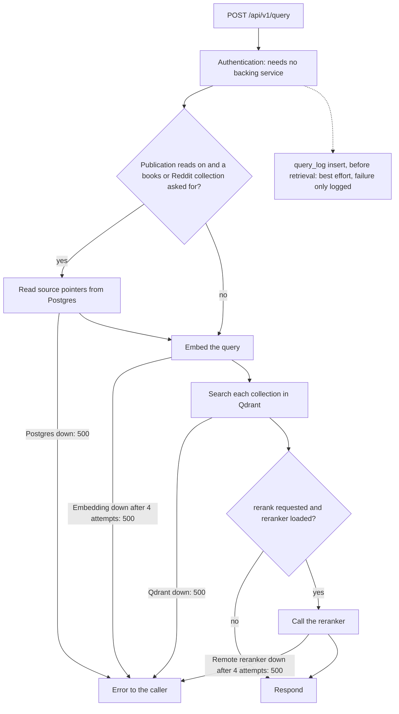

# Reliability

[README](../README.md) · [Ingestion](ingestion.md) · [Observability](observability.md) · [Security](security.md) · [Operations](operations.md)

What the system promises when something breaks halfway: which writes are safe to repeat, how a dead worker is noticed, how a half-finished publish is kept away from readers, what each client retries, and, for every dependency, what stops working and what keeps working. The state machines themselves (envelopes, generations, publication jobs) are drawn on the [ingestion](ingestion.md) page and not repeated here.

The short version: **writes are built to be repeated, reads are built to fail loudly.** Ingestion retries by running again from the start with identifiers that make the rerun land on the same rows. The query path has few retries and almost no fallbacks, so a dependency that is down is an error to the caller, not a quietly worse answer. The exceptions are listed in the [partial-failure table](#partial-failure-table).

## What is guaranteed, and what it costs

| Guarantee | Mechanism | Default |
| --- | --- | --- |
| A rerun never duplicates data | Content-derived IDs ([below](#idempotency-and-deterministic-ids)) | Always on |
| Two dispatchers never run one envelope | One-statement claim with `FOR UPDATE SKIP LOCKED` | Always on |
| A live book is not mistaken for a dead one | Heartbeat from a dedicated thread ([below](#heartbeat-thread)) | Always on |
| A dead worker's book is picked up again | Stale reclaim after 15 minutes without a heartbeat | Always on |
| A shutdown does not lose a book | 240 s grace, then the envelope returns to `received` | Always on |
| A crashed ingest is never visible to queries | Staging state and one atomic activation | **Off.** `VORAG_INGEST_GENERATIONS=1` |
| Readers see one consistent revision of a source | Revision pointer in Postgres | Reads on, writes **off** |
| A cloud launch cannot overspend by racing | Advisory-lock budget gate | Always on where used |
| A broken cache never breaks a request | The embedding cache disables itself | Always on |

With neither opt-in switch set, points go straight to `active`: a rerun overwrites them, but a crash in the middle of a book leaves the points written so far visible to queries. Read [ingestion](ingestion.md#what-the-loop-is-built-to-guarantee) before relying on a row marked off.

## Idempotency and deterministic IDs

Every retryable write uses an identifier derived from its content, so a retry computes the same identifier and overwrites instead of adding. The functions are `deterministic_uuid` and `deterministic_hex` in [`core/idempotency.py`](../src/vo_rag/core/idempotency.py): SHA-256 over the parts joined with `|`, truncated to a UUID or a hex string. They are stable across processes, Python versions and hosts.

| Identifier | Built from | A retry... |
| --- | --- | --- |
| Source ID | `vo-rag-corpus-sha256:` plus the SHA-256 of the file bytes | Finds the same book wherever it was uploaded |
| Qdrant point ID | Source ID, chunk index, stage (`raw`, `sterile`), optional version | Overwrites the same point |
| Generation ID | Envelope ID, source, collection, schema version, chunking version, sterilize flag | Resumes the same generation |
| Revision point ID | `source-publication-v1`, corpus, collection, source, revision, logical ID | Rewrites the same revision and never touches an older one |
| Publication job ID | The immutable inputs of the job | Resumes the same job |
| Cloud ledger row | The launch's job ID, with `ON CONFLICT DO NOTHING` | Does not double-count a launch |

Example, from `deterministic_point_id` for a book whose file hash is `9cd33ad5...`:

```text
chunk 0, raw      6f177f69-3478-f715-32b8-eb6e0a99ba7d   (computed twice: identical)
chunk 1, raw      bd0413c3-d5d8-e39f-90e7-3a42fe3f7157
chunk 0, sterile  e9911641-bbfe-0238-5857-b04a0b4d5156
```

The same property serves removal: a point carries its `source_id` in the payload, so deleting a source is a filter delete, which is how `vo-rag corpus purge` works (see [security](security.md#secrets-and-redaction)). A replay of a completed envelope finishes as a no-op.

What it does not do: identical IDs make a retry safe for Qdrant, but Qdrant and Postgres cannot commit together. The mechanisms below exist for the cases where a write is acknowledged on one side and unknown on the other.

## Heartbeat thread

A running ingest keeps its envelope claimed by touching the row every 60 seconds. If the touch came from an asyncio task, it would stop whenever a long synchronous step blocked the event loop, and a figure-heavy build once did that for hours. After 15 minutes another dispatcher would reclaim a book that was still running, and the lanes would converge on one book. So the heartbeat is a dedicated thread that opens a short-lived connection for each beat, since an asyncpg pool belongs to the loop that created it, and a thread keeps beating through CPU-bound Python because the interpreter releases the GIL between bytecode slices. Heartbeat failures are counted (`vo_rag_dispatcher_heartbeat_failures_total`) and the next beat tries again. The full account, with the stale-reclaim query and the heartbeat file the API reads, is in [ingestion](ingestion.md#heartbeat-and-stale-reclaim).

## Leases, generations and activation reconciliation

In generation mode a book is written as `staging` points under a lease: a random owner token and a 15 minute expiry that a task refreshes every 60 seconds. The token is a fence. Before and after every step the runner checks it still holds the lease, and every state change is conditional on it, so a runner that was replaced cannot write over its successor. A dispatcher that finds another runner owns the generation leaves the envelope alone, because that owner, or stale reclaim after a crash, is authoritative.

Activation is the dangerous moment: Qdrant point states and a Postgres row have to change together, and they cannot be one transaction. `_reconcile_activation_after_transaction_error` in [`workflow.py`](../src/vo_rag/pipelines/book_rag/workflow.py) handles the ambiguous outcome. When the activation transaction raises, the error might have arrived after Postgres committed (a lost reply, a cancellation). The runner re-takes the source lock, reads which generation Postgres says is active, and repairs Qdrant to match: if the new generation won, its points are re-marked active and the old ones superseded; if it lost, the new points are hidden again. The failure path performs the same check before marking a generation failed. **Postgres is the authority and Qdrant is repaired to agree**, so a late error can neither hide a committed activation nor publish a rolled-back one. The detail, including the rollback order, is in [ingestion](ingestion.md#generations-and-leases); the table is in [`core/db/queries/ingest_generations.py`](../src/vo_rag/core/db/queries/ingest_generations.py).

## Publication revisions and copy-on-write repair

Generations protect one ingest attempt. Revisions protect readers from every writer of a source: ingest, derived-layer builds and repairs. [`SourceRevisionWriter`](../src/vo_rag/core/storage/source_revision_writer.py) never edits a published source in place. It writes a complete new revision under new point IDs, verifies it, and publishes by moving one pointer, so the old revision stays intact until nobody holds it.

1. **Admit.** The coordinator ([`source_publication.py`](../src/vo_rag/core/ingest/source_publication.py)) records a durable job and allocates the next revision number under a per-source fence.
2. **Census.** The writer reads the active revision twice, with exact counts and full vectors, and refuses to continue if the two reads differ or, when a repair supplied an approved roster, do not match it. A repair therefore works from evidence it has just re-measured.
3. **Stage.** Points are upserted in batches of 8 with `wait=True`; each batch is recorded in the job's checkpoint before and after, and a non-`completed` acknowledgement raises.
4. **Verify.** The writer reads the revision back and compares every point against a receipt computed from what it meant to write.
5. **Publish.** A compare-and-swap moves `source_publications` from the expected revision to the new one. It is refused if the active pointer is not the revision the job started from, so a stale writer cannot overwrite a newer one.

Old points are retained at publication (the checkpoint records `old_point_disposition: retained_old_revision`), so a reader that captured the previous pointer still finds its points. If anything fails, the job moves to `partial_preserved` (or `preserved_no_write` when it proves nothing was written) and **only that source is blocked**: other sources keep ingesting. A rerun resumes the identical job and must produce identical writer output, otherwise it refuses with "resume producer output differs from its durable writer intent". The ambiguous-commit case is handled as for activation: after an exception the writer reads the authoritative pointer first and only marks a partial if the pointer did not move.

[`source_mutations.py`](../src/vo_rag/core/storage/source_mutations.py) applies the same copy-on-write rule to maintenance edits (a payload change, a vector update, a delete), turning each into a new revision, and [`source_quality_dependencies.py`](../src/vo_rag/core/storage/source_quality_dependencies.py) copies managed derived Books sources forward after a quality-only raw revision, rebinding them to the new raw revision. Without a rebind the read view hides a derived record whose raw source has moved on, so a summary or graph node is never served against text it was not built from. The state diagram for jobs is in [ingestion](ingestion.md#source-publication-revisions). Revision writes are off by default and cannot be combined with generations.

The guarantee is bounded and says so in the code: a query pins pointer decisions, not every legacy point or external store, and the writer records `source_snapshot_atomic: false` because its census is not one atomic read.

## Retries and backoff

Retry policy is per client and deliberately uneven. Retrying a read is cheap and safe; retrying a model call costs money; retrying a write needs the identifiers above.

| Client | Retries on | Attempts and waits | Gives up with |
| --- | --- | --- | --- |
| Embedding ([`core/embedding/client.py`](../src/vo_rag/core/embedding/client.py)) | Any HTTP error status except 413 and 429, and any transport error | 4 attempts, waiting 2 s, 4 s and 8 s | The last exception |
| Embedding, 429 | The worker's admission backpressure | Up to 48 attempts, each wait between half and the full of `min(2 s x 2^n, 15 s)`; about 5.5 to 11 minutes in total | The last exception |
| Embedding, 413 | A batch the service says is too large | Splits the batch in half and recurses | `single text exceeds embed service limit` for one text |
| Reranker ([`core/reranking/client.py`](../src/vo_rag/core/reranking/client.py)) | 429, 502, 503, 504 and transport errors | 4 attempts, waiting 2 s, 4 s and 8 s; other statuses raise at once | The last exception |
| LLM `complete` ([`core/llm/retry.py`](../src/vo_rag/core/llm/retry.py)) | Rate limit (429, 529) and server errors (5xx, connection) | 5 attempts, waiting 1 s, 2 s, 4 s and 8 s; each retry counted in `vo_rag_llm_retries_total` | The last exception; other 4xx fail fast |
| LLM `complete_json` | Schema validation failures only | 3 attempts, each re-prompted with the validation error | `StructuredOutputError` |
| Qdrant reads ([`core/storage/qdrant.py`](../src/vo_rag/core/storage/qdrant.py)) | Timeouts only, on exact point counts | 3 attempts, waiting 5 s then 10 s | The last exception |
| CLI HTTP client | 429, 500, 502, 503, 504 and transport errors | 3 attempts, waiting 0.5 s then 1 s | The last error |

Things the table makes easy to miss:

- **`complete_json` makes one provider call.** Every protected path (answer synthesis, sterilization, tagging) goes through it, so a provider 5xx or timeout there is not retried at the transport level; the five-attempt policy applies only to `LLMClient.complete`. The hosted Anthropic SDK underneath keeps its own default retries (2 in the installed version). A failed answer is a 500 you retry from the client.
- **The embedding client retries any error status**, including a 400 or 401, four times before raising. That costs about 14 seconds of waiting in a misconfigured deployment. 413 is exempt because splitting, not repeating, is the remedy.
- **429 is not an error.** The inference worker answers 429 when every model slot is busy. The embedding client treats it as backpressure with its own long, jittered budget so that a busy GPU slows an ingest instead of failing a book. Jitter stops parallel lanes retrying in lockstep, and the earlier budget of about two minutes was lost to a ten-lane wave.
- **A 30 MB request body is refused locally** (`ValueError`) before it is sent. The cloud load balancer in front of a serverless embedder answers 413 above that size, and chunking smaller is the remedy. Batches are also capped at 32 texts.
- **Trailing `/embed` and `/rerank` are stripped** from configured URLs, so the variable can include or omit them without breaking requests.
- **Qdrant writes and query-time reads are not retried.** A query that hits a Qdrant timeout is an error. The count reads that are retried guard the duplicate-ingest check and the validator, where an approximate or missing answer would re-embed a whole book or fail it needlessly.
- **Postgres has no retry layer.** The recovery path for a lost database connection mid-ingest is the envelope-level retry: the heartbeat stops, the stale reclaim fires, and the book runs again.

### Does the API use the embedding cache?

The module comment in the embedding client says the API builds a raw client and bypasses the cache wrapper, because a rolling model deploy could leave stale vectors cached. The code does not do that. `api/singletons.py` calls `build_embedding_client`, which returns the caching wrapper unless `VORAG_EMBEDDING_CACHE_ENABLED` is set to anything other than `1`. Code that constructs `EmbeddingClient` directly does bypass it: `brain_sync`, the local embedder in corpus repair, and the RAPTOR persistence code. The risk the comment describes is real but handled differently: the cache key includes `BGE_M3_MODEL_VERSION`, so **set that variable whenever you change the embedding model**, or the cache will serve vectors from the old one. To rule it out, disable the cache on the API.

## Caches

| Cache | Scope | Failure behavior |
| --- | --- | --- |
| Embedding vectors ([`core/embedding/cache.py`](../src/vo_rag/core/embedding/cache.py)) | On disk, keyed by model version and an xxh64 of the text, 20 GB by default | If the directory is unusable, the disk is too full for the limit plus a reserve, or SQLite raises on read, write or size, the cache switches itself off, logs the error type, and every request goes to the embedding service. Identical concurrent misses share one request. Vectors from the service are validated for count before they are stored |
| Cloudflare Access signing keys | In process, 1 hour | A fetch failure is an authentication failure (401), not an open door |
| Publication pointers | One query, in a context variable | Pins one consistent view across the several Qdrant calls of a query |
| OCR results | Object store, keyed by file hash | See [OCR](ocr.md#the-cache-contract) |

`vo_rag_cache_requests_total{cache="embedding"}` reports `hit`, `miss` and `skip`; a rising `skip` count means the cache disabled itself.

## Budgets

| Budget | Enforced by | Behavior |
| --- | --- | --- |
| Cloud spend | `CloudCostTracker.try_launch` ([`core/cloud/cost_tracker.py`](../src/vo_rag/core/cloud/cost_tracker.py)) | Refuses a launch whose estimate is not positive, exceeds the per-job cap, or would push the UTC month over the monthly budget. The check and the ledger insert run in one transaction under a single advisory lock, so concurrent launches serialize instead of each passing a stale read (F-018). The 50, 75 and 90 percent crossings are logged as warnings when a job completes; nothing else acts on them |
| OCR farm spend | The RunPod farm | Refuses a plan over the remaining budget and re-checks before creating a pod; see [OCR](ocr.md#cost-controls) |
| One LLM call | `LLMClient` budget hook | If a budget object with `charge_estimated` is supplied, the call is charged before the network call and refused if over the cap. No budget implementation ships, so this is a seam |
| One envelope's time | The operational sampler | Not enforced, only measured: elapsed time against `max(15 min, 6 s x pages)` ([observability](observability.md#ingest-metrics-flush)) |
| Request size | Retrieval and clients | A query is limited to 4000 characters; the candidate pool is capped at 400 before reranking; embed bodies at 30 MB; rerank bodies at 48,000 bytes |

The tracker is the gate that launch code is expected to call; the shipped agent helper refuses a serverless workload unless one is supplied. `can_launch` is a non-atomic read kept for callers that only want an answer, and `try_launch` is the one that reserves. The spend is visible as gauges from the [cost exporter](observability.md#the-cloud-cost-exporter), and the kill switch ([`core/cloud/kill_switch.py`](../src/vo_rag/core/cloud/kill_switch.py)) is the emergency teardown: it denies the cloud-worker Tailscale tag, deletes the tagged devices and terminates live RunPod pods. It is a tested building block that nothing in the codebase calls automatically.

## Partial-failure table

For each dependency, what happens to each surface when it is down. "500" means an unhandled exception: the API installs no exception handlers, so the caller gets a bare `Internal Server Error` and the `request` log line has `status=None`. "Readiness" means the response of the probe named, and `vo_rag_readiness` follows it.

| Dependency down | Queries | Answers | Ingest | Readiness |
| --- | --- | --- | --- | --- |
| **Postgres** | With publication reads on (the code default), a query that includes a books or Reddit collection first reads source pointers from Postgres and returns 500. Queries restricted to other collections work, and so does everything when `VORAG_SOURCE_PUBLICATION_ENABLED` is off. The `query_log` insert is skipped or fails silently. Authentication never touches Postgres | Same as queries; the `answer_log` and citation rows are skipped or fail silently | `POST /api/v1/intake` returns 503 `db_pool_unavailable`; a failed insert returns 503 `db_persist_unavailable` and the upload stays retryable. The dispatcher cannot claim: an error in the claim query ends its loop and it must be restarted, and its heartbeat file then says `stopping`. A book already running loses its heartbeats, is reclaimed after 15 minutes and reruns. A pool that failed at API start is not retried by the API's own routes, so restart the API | `/ready/query` and `/ready/intake` return 503 with `db_pool_unavailable`; `vo_rag_dependency_up{dependency="db_pool"}` is 0 |
| **Qdrant** | Every retrieval fails with 500 (no retry, 120 s client timeout, and one failing collection fails the whole query) | 500 before any model call | Intake is unaffected. A running book fails at its next Qdrant call and the envelope is set `failed` with the error; it is not retried automatically. In generation mode nothing was activated, so the previous version stays live; with publication writes on, the job ends `partial_preserved`. Count reads are retried on timeout, 3 attempts | `/ready/query` 503 with `qdrant_unavailable`; intake readiness is unaffected |
| **Garage / S3** | Unaffected | Unaffected | `POST /api/v1/intake/upload-url` still succeeds, because signing is local, and the client's upload then fails. A file-drop `POST /api/v1/intake` returns 503 `garage_verification_unavailable`, or `garage_unavailable` when no client was configured; URL and text intake are unaffected. A running book fails reading its file and the envelope is set `failed`. Cleanup of staged objects after commit is best effort | Neither probe requires it. The `/ready/query` body lists `garage` as configured or not and does not call it |
| **Embedding service** | The query embedding is retried (4 attempts, 2, 4 and 8 s waits, 60 s per attempt by default) and then the query returns 500. A cache hit on the exact query text avoids the call | 500, as for queries | The embed step retries as in the table above (429 for several minutes) and then raises; the envelope is set `failed` | `/ready/query` 503 with `embedding_server_unavailable` (probe `GET /health`, 1 s timeout); intake readiness is unaffected |
| **Reranker service** | If the reranker failed to load at start (a missing local model), requests with `rerank: true` skip reranking silently and return fused results. If a remote reranker goes down after start, a request with `rerank: true` returns 500 after 4 attempts on 429, 502, 503, 504 or a transport error (other statuses at once); `rerank: false` still works | Same as queries | Not used | `/ready/query` 503 with `reranker_unavailable` (remote probe `GET <url>/ready`, 1 s timeout) |
| **LLM provider** | Not used | A provider error or timeout gives 500 `answer_generation_failed` after one call (no transport retry); a profile that is disabled or lacks a key gives 503 `answer_generation_not_configured`. A refusal by the compliance gate happens first and costs nothing | Used only by optional steps. A sterilization output that breaks the verbatim budget, or is empty, fails the envelope. The self-retrieval smoke gate is advisory: with no endpoint, or when its model or retrieval call fails or exceeds 10 s, it records `skipped` (plus an `audit_unavailable` warning on error) and the book proceeds. A failure of the separate quality audit is also a warning, and in generation mode it blocks activation | Not probed |
| **Vision model (VLM)** | Not used | Not used | Only with `VLM_ENABLED`. If fewer than 90% of eligible figures get a description, the book fails; with the flag off, figures become composites from captions and nothing depends on the model. The inference worker answers 503 for the gateway and sets `vo_rag_vlm_gateway_up` to 0 | Not probed by the API |
| **OTel collector** | Unaffected | Unaffected | Unaffected (the dispatcher exports no spans) | Unaffected. Spans are batched in the background and dropped with an error log |
| **Dispatcher** | Unaffected | Unaffected | Intake still accepts and stores envelopes, which stay `received`, and the response says `dispatch_status: not_configured` instead of `queued`. When a dispatcher returns it claims the backlog, and reclaims `processing` envelopes untouched for 15 minutes | `/ready/intake` 503 with `dispatcher_unavailable: not_configured`, `stale_heartbeat` (older than 130 s), `invalid_heartbeat` or `unsafe_heartbeat_path` (the file is a symlink); `/ready/query` unaffected |

### Code behind each row

- **Postgres.** Pointer read: `publication_query` in [`publication_read_view.py`](../src/vo_rag/core/storage/publication_read_view.py), skipped when `source_visibility_enabled` is false in [`QdrantStore`](../src/vo_rag/core/storage/qdrant.py). Best-effort audit: `_try_insert_query_log` in [`routes/query.py`](../src/vo_rag/api/routes/query.py) and `_persist_answer` in [`routes/answer.py`](../src/vo_rag/api/routes/answer.py). Intake: `submit_intake` in [`routes/ingest.py`](../src/vo_rag/api/routes/ingest.py). Dispatcher loop and terminal-status handling: `run_dispatcher_loop` and `_run_claimed_envelope` in [`dispatcher.py`](../src/vo_rag/pipelines/book_rag/dispatcher.py). One-shot pool at start: `build_surface_services` in [`singletons.py`](../src/vo_rag/api/singletons.py). Probe: `_db_pool_health` in [`routes/system.py`](../src/vo_rag/api/routes/system.py).
- **Qdrant.** `cross_collection_search` gathers per-collection searches without `return_exceptions` ([`search.py`](../src/vo_rag/core/retrieval/search.py)); the client timeout is set in `QdrantStore.__init__`; count retry is `retry_read`; the probe is `_qdrant_health`.
- **Garage.** `upload_url`, `_verify_file_drop_for_intake` and `_delete_staged_after_envelope_commit` in `routes/ingest.py`; `_garage_health` in `routes/system.py`.
- **Embedding.** `prepare_query` in `search.py`; `_post_with_retries` in the embedding client; `_embedding_health` in `routes/system.py`.
- **Reranker.** `build_surface_services` records `reranker_unavailable_reason`; the route builds `rerank_fn` only when `services.reranker` is set; `RerankerClient._request_batch`; `_reranker_health`.
- **LLM.** `synthesize` and the `except` ladder in `routes/answer.py`; `complete_with_schema` in [`core/llm/structured.py`](../src/vo_rag/core/llm/structured.py); `_retrieval_smoke` in `workflow.py` catches every smoke-gate error and records `skipped`; the quality audit is described in [ingestion](ingestion.md#warnings-versus-failures).
- **VLM.** The yield check in [`visual_sidecar.py`](../src/vo_rag/pipelines/book_rag/visual_sidecar.py); gateway behavior in [`workers/inference/server.py`](../src/vo_rag/workers/inference/server.py).
- **OTel.** `setup_otel` and the batch exporter in [`core/observability/otel.py`](../src/vo_rag/core/observability/otel.py).
- **Dispatcher.** `dispatcher_health` in [`dispatcher_health.py`](../src/vo_rag/pipelines/book_rag/dispatcher_health.py) and `intake_ready` in `routes/system.py`.

The query path as a chain of hard and soft dependencies:



Why this shape: a query that silently dropped a collection, or returned an unreranked list while claiming a reranked one, would give a confident wrong answer. The code prefers a visible error, with two deliberate exceptions: an unavailable reranker at start skips reranking (readiness reports the gap), and audit writes never fail a request.

## Where each piece lives

| Concern | Module |
| --- | --- |
| Deterministic IDs | [`core/idempotency.py`](../src/vo_rag/core/idempotency.py) |
| Claim, heartbeat, reclaim, shutdown | [`pipelines/book_rag/dispatcher.py`](../src/vo_rag/pipelines/book_rag/dispatcher.py) |
| Generations, leases, reconciliation | [`pipelines/book_rag/workflow.py`](../src/vo_rag/pipelines/book_rag/workflow.py), [`core/db/queries/ingest_generations.py`](../src/vo_rag/core/db/queries/ingest_generations.py) |
| Publication jobs and pointers | [`core/ingest/source_publication.py`](../src/vo_rag/core/ingest/source_publication.py) |
| Revision writer and copy-on-write mutations | [`core/storage/source_revision_writer.py`](../src/vo_rag/core/storage/source_revision_writer.py), [`source_mutations.py`](../src/vo_rag/core/storage/source_mutations.py) |
| Retry policies | [`core/embedding/client.py`](../src/vo_rag/core/embedding/client.py), [`core/reranking/client.py`](../src/vo_rag/core/reranking/client.py), [`core/llm/retry.py`](../src/vo_rag/core/llm/retry.py) |
| Readiness probes | [`api/routes/system.py`](../src/vo_rag/api/routes/system.py), [`api/singletons.py`](../src/vo_rag/api/singletons.py) |
| Budget gate | [`core/cloud/cost_tracker.py`](../src/vo_rag/core/cloud/cost_tracker.py) |
