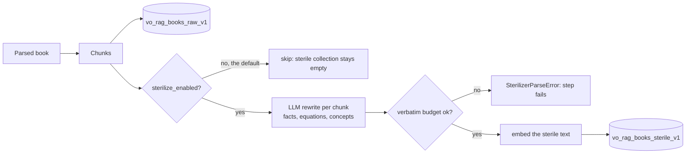
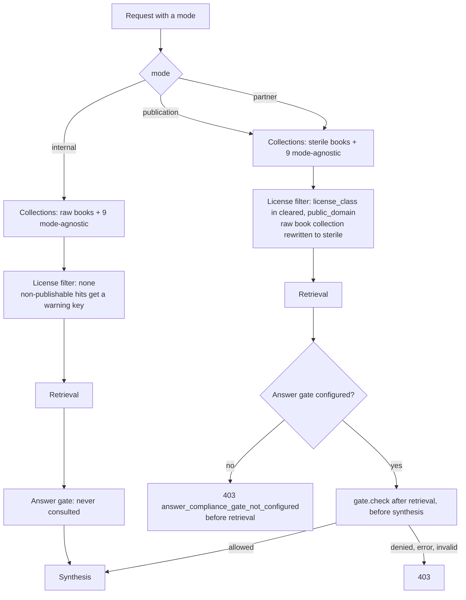

# Rights and compliance

[README](../README.md) · [Architecture](architecture.md) · [Data model](data-model.md) · [Retrieval and answers](retrieval-and-answers.md) · [Security](security.md)

A library of books is useful and legally delicate in the same breath. vo-rag keeps two views of each book: the **raw** text, which only an operator should read, and a **sterile** rewrite that keeps facts, equations and named concepts and drops the author's expression. Every query runs in one of three modes, and the mode decides which view it can read, which license classes it can see and whether an answer needs a compliance gate before it leaves the system.

These are policy mechanisms. They enforce the labels the system is given; they do not decide whether you have the right to use or publish a source. See the note in [Security](security.md#configuration-and-egress).

## License classes

Every source carries a license class, stored on each chunk's payload as `license_class` ([`LicenseClass`](../src/vo_rag/core/models/artifact.py)).

| Class | Meaning in the filter |
| --- | --- |
| `cleared` | Publishable |
| `public_domain` | Publishable |
| `pending` | Not publishable |
| `unlicensed` | Not publishable; the default when intake metadata names no class |
| `unknown` | Not publishable; what an unlabeled `sources` row defaults to |

`PUBLISHABLE` is `cleared` plus `public_domain` ([`license_filter.py`](../src/vo_rag/core/compliance/license_filter.py)). The class comes from the `sources` registry row for the book when one matches, and otherwise from `license_class` in the intake envelope's `metadata`. Nothing in `src/` writes `sources` rows, so the registry is something an operator maintains, and the envelope metadata is the path a submitter uses:

```sh
curl -sS http://127.0.0.1:8000/api/v1/intake \
  -H "Content-Type: application/json" -H "X-API-Key: $VORAG_API_KEY" \
  -d '{"source_type": "file_drop",
       "source_data": {"garage_key": "intake/01J9ZEXAMPLE/handbook.pdf"},
       "raw_content": {"garage_key": "intake/01J9ZEXAMPLE/handbook.pdf",
                       "filename": "handbook.pdf",
                       "content_type": "application/pdf", "size_bytes": 48213},
       "metadata": {"title": "Handbook", "license_class": "cleared"}}'
```

A book whose class is `unknown` fails the validator's `metadata_completeness` check unless the guard is set to warn, because an unlabeled book cannot be filtered ([ingestion](ingestion.md#the-eight-check-validator)).

## Sterilization and the sterile collection

Sterilization is an LLM rewrite of each chunk, done at ingest, that writes a second point into `vo_rag_books_sterile_v1`.



The prompt ([`sterilizer.py`](../src/vo_rag/core/compliance/sterilizer.py)) tells the model to keep factual assertions, equations (copied exactly, since a relationship is not expression), named concepts with their definitions and procedural steps re-expressed in neutral language, and to remove the author's prose style, metaphors, analogies, pedagogical framing, narrative voice and illustrative examples that reproduce creative expression. The model returns `sterile_content`, `facts`, `equations` and `concepts`. The sterile chunk keeps the raw chunk's page and section path, so a sterile hit can still be traced to a place in the book; `facts`, `equations` and `concepts` go into its metadata, and its chunk ID is derived from the source, the raw chunk ID and the word `sterile`, so re-running overwrites instead of duplicating.

Three controls bound the risk that the "rewrite" is a copy:

- **Verbatim budget.** The sterile text is compared with the original. The longest copied run must be at most 100 characters, and no more than 15% of the sterile characters may sit in copied runs of 15 or more characters. A chunk that breaks the budget raises `SterilizerParseError` and the sterilize step fails; an empty rewrite fails the same way.
- **Injection defense.** The raw chunk is untrusted input. The call goes through the same wrap, canary and validate path as answers ([retrieval and answers](retrieval-and-answers.md#the-injection-defense-trio)), at temperature 0, and the quarantine verdict is recorded on the sterile chunk as `_sterilization_quarantine`.
- **Figures.** A figure's neighbouring-text window is sterilized with the same budget, so the raw window never reaches the sterile side. A yield below 70% for figure chunks logs a warning.

**Sterilization is opt-in, and nothing in the shipped runner turns it on.** `BookRagConfig.sterilize_enabled` defaults to `False`, because it costs one LLM call per chunk and writes a rights-filtered collection nobody asked for. The production runner builds its config without it, and there is no environment variable or CLI flag for it. You enable it by constructing the pipeline yourself with `BookRagConfig(sterilize_enabled=True)`. Until you do, the sterile collection is empty, so **`publication` and `partner` retrieval returns no book evidence**, and the answer route has nothing to cite in those modes. In generation mode the flag is recorded on each ingest generation and compared on re-ingest, so flipping it re-runs a book.

## The three query modes

The mode is a field on every request (`mode` on `/api/v1/query` and `/api/v1/answer`, `--mode` on `vo-rag query` and `vo-rag answer`, `mode` on the MCP `vo_rag_query` tool). `QueryMode` is `internal`, `publication` or `partner`.



| | `internal` | `publication` | `partner` |
| --- | --- | --- | --- |
| Default book collection | `vo_rag_books_raw_v1` | `vo_rag_books_sterile_v1` | `vo_rag_books_sterile_v1` |
| Explicit request for the raw collection | Stays raw | Rewritten to sterile | Rewritten to sterile |
| License filter | None | `license_class` in `cleared`, `public_domain` | Same |
| Hits outside the publishable classes | Returned, with `_vo_rag_license_warning` set | Never returned | Never returned |
| `/api/v1/query` | Open to the key | Open to the key | Open to the key |
| `/api/v1/answer` gate | Never gated | Needs a gate | Needs a gate |

`publication` and `partner` behave identically in the code. The gate receives the mode, so a policy can treat them differently, and an API key can be restricted to one of them (`allowed_modes`) or to named collections, which the query and answer routes enforce before retrieval. Mode resolution is in [`query_mode.py`](../src/vo_rag/core/retrieval/query_mode.py) and the filter in [`license_filter.py`](../src/vo_rag/core/compliance/license_filter.py).

A few properties are worth knowing:

- **The filter is ANDed with the caller's filters.** `merge_with_user_filter` combines the mode filter and the request's `filters`, so a caller can narrow a public query but never widen it.
- **A point with no `license_class` never matches the public filter.** The derived-layer collections (summary tree, RAPTOR, DSI, graph) have no such field in their node schemas, so a public-mode query cannot read them even if it names them. They are built from raw text and are internal-mode material.
- **`context_scope` adds a second remap on answers.** `AnswerRequest.context_scope` defaults to `sterile`, which swaps the raw book collection for the sterile one in `internal` mode too. Only `internal` plus `context_scope: "raw"` hands raw text to synthesis, and if hosted answers are on while `answer.allow_raw_hosted_egress` is off, that combination is refused with 403 `raw_context_hosted_egress_forbidden`.
- **`/query` is not gated.** It returns evidence, and in public modes that evidence is the sterile, filtered view. The gate protects the step that composes new text from it.

## Publication read view

This is a separate idea from the `publication` mode and shares only a word. When a source is re-ingested or a derived layer is rebuilt, readers must not see half of the old version and half of the new one. Each Books or Reddit source has an active-revision pointer in `source_publications` ([source publication revisions](ingestion.md#source-publication-revisions)).

At the top of a query, `execute_retrieval` is wrapped by `publication_query` ([`publication_read_view.py`](../src/vo_rag/core/storage/publication_read_view.py)), which reads every pointer in one SQL statement and stores the map in a context variable. Every Qdrant read made during that query, including expansions that issue several calls, filters to the pinned revision through the `PublicationClient` wrapper ([`publication_client.py`](../src/vo_rag/core/storage/publication_client.py), [`publication_filter.py`](../src/vo_rag/core/storage/publication_filter.py)). A derived record whose raw source has moved on is hidden too, so a stale summary cannot outlive the text it summarized. A query that explicitly names only other collections skips the pointer read, and nested calls share one view while independent requests do not.

The guarantee is bounded and the code says so: the view pins pointer decisions, not every legacy point or every external store, and old immutable revisions stay retained while a query runs. Visibility enforcement is on by default (`VORAG_SOURCE_PUBLICATION_ENABLED`), and the revision writers that publish new versions are off by default.

## The answer compliance gate

An answer is new text composed from evidence, so in the two public modes the answer route will not run without an explicit policy. The gate contract is in [`core/compliance/answer_gate.py`](../src/vo_rag/core/compliance/answer_gate.py):

```python
@dataclass(frozen=True)
class AnswerGateDecision:
    allowed: bool
    reason: str

@runtime_checkable
class AnswerComplianceGate(Protocol):
    def check(self, *, mode: QueryMode, hits: Sequence[Any], caller: str) -> AnswerGateDecision: ...
```

`check` is a plain synchronous method. `hits` is a tuple of the `SearchResult` objects (`id`, `score`, `collection`, `payload`) that retrieval selected, and `caller` is the normalized caller label (one of `api`, `cli`, `mcp`, `portal`) from the `X-VO-RAG-Caller` header when one was sent, otherwise the caller bound to the key or Access identity (`api` if there is none); it is a label, not a verified identity.

| Situation | Result |
| --- | --- |
| `internal` mode | Never gated. `compliance.status` is `"not_configured"` |
| Public mode, no gate supplied | 403 `answer_compliance_gate_not_configured`, returned before retrieval so no work is done |
| Gate returns `allowed=True` | Synthesis proceeds; `compliance.status` is `"allowed"` |
| Gate returns `allowed=False` | 403 `answer_compliance_gate_denied`; no model call |
| Gate raises | 403 `answer_compliance_gate_error`; no model call |
| Gate or decision is malformed | 403 `answer_compliance_gate_invalid`; no model call |

The route is deliberately strict about "malformed". The gate must have a callable `check`; the call must be synchronous (an `async def check` returns a coroutine, which is closed and rejected); the result must be an `AnswerGateDecision`; `allowed` must be exactly the `bool` `True` (a truthy string or `1` is not an allow); and `reason` must be a `str`. Anything else is a 403, because a policy that cannot be read is not a policy that allowed the request.

The gate runs after retrieval and before synthesis. That order lets it judge the actual evidence, and it means a denial costs no model call. The client sees only the error code. The denial reason is logged with the mode (newlines collapsed, 200 characters at most), and an exception is logged by type only, so policy details and exception text never reach the caller. The route code is [`api/routes/answer.py`](../src/vo_rag/api/routes/answer.py).

### Supplying a gate

The route looks for the gate in two places, in this order: the `answer_compliance_gate` attribute of the `SurfaceServices` object, then `services.extra["answer_compliance_gate"]`. The stock `vo_rag.api.main:app` builds its services in its own lifespan and installs no gate, so a deployment that wants publication or partner answers adds one by wrapping that lifespan.

```python
from collections.abc import AsyncIterator, Sequence
from contextlib import asynccontextmanager
from typing import Any

from fastapi import FastAPI

from vo_rag.api.main import create_app
from vo_rag.core.compliance.answer_gate import AnswerGateDecision
from vo_rag.core.compliance.license_filter import PUBLISHABLE
from vo_rag.core.retrieval.query_mode import RAW_COLLECTIONS, QueryMode


class ClearedEvidenceGate:
    """Allow an answer only when no hit comes from a raw collection and every hit is cleared."""

    def __init__(self) -> None:
        self.publishable = {license_class.value for license_class in PUBLISHABLE}

    def check(self, *, mode: QueryMode, hits: Sequence[Any], caller: str) -> AnswerGateDecision:
        if not hits:
            return AnswerGateDecision(allowed=False, reason="no evidence to publish from")
        for hit in hits:
            if hit.collection in RAW_COLLECTIONS:
                return AnswerGateDecision(allowed=False, reason="raw evidence in result set")
            if hit.payload.get("license_class") not in self.publishable:
                return AnswerGateDecision(allowed=False, reason="hit is not cleared")
        return AnswerGateDecision(allowed=True, reason="no raw hits and every hit cleared")


app = create_app()
_service_lifespan = app.router.lifespan_context


@asynccontextmanager
async def lifespan_with_gate(app_: FastAPI) -> AsyncIterator[None]:
    async with _service_lifespan(app_):
        app_.state.surface_services.answer_compliance_gate = ClearedEvidenceGate()
        yield


app.router.lifespan_context = lifespan_with_gate
```

Serve it with `uvicorn module:app` in place of `vo_rag.api.main:app`. Tests and embedded use can instead build a `SurfaceServices`, set `services.extra["answer_compliance_gate"] = gate` and pass it to `create_app(settings=..., services=...)`; that path skips the lifespan, so it also skips the readiness sampler and shutdown handling.

With this gate, a publication-mode answer over cleared hits, none from a raw collection, gets 200 and `compliance.status` of `"allowed"`; any hit from a raw collection, any hit whose license class is not publishable, or an empty result set, gets 403 `answer_compliance_gate_denied`; and an `internal` request is unaffected. The gate decides on the evidence because that is what a rights policy is about. Do not use `caller` as an identity: `normalize_caller` maps any value outside `api`, `cli`, `mcp` and `portal` to `api`, and the `X-VO-RAG-Caller` header wins whenever it is sent. Only the legacy `VORAG_API_KEY` and Cloudflare Access users can send any label. Every entry in `VORAG_API_KEYS_JSON` is bound to a caller (its `caller` field, or its name when that is absent), and the query and answer routes reject a different header with 403 `caller_not_allowed_for_api_key`. Even a bound caller is one of four coarse labels, so treat it as a hint for logging or routing, not as an authorization decision. [Security](security.md#the-caller-label-is-not-authorization) has the full rules.

### Library callers must enforce their own gate

The answer route is the only place the gate is consulted. The LlamaIndex tier ([`integrations/llamaindex`](../src/vo_rag/integrations/llamaindex), see [integrations](integrations.md)) can also retrieve and synthesize answers: `VoRagRetriever` defaults to `QueryMode.PUBLICATION` and refuses `INTERNAL` unless `allow_internal=True`, and `VoRagSynthesizer` delegates to the same protected `AnswerSynthesizer`. But that tier does **not** call the answer gate. Outside the integration package itself, the only code in this repository that synthesizes answers through it is `scripts/run_answer_eval.py` (and tests); inside the package, the `book_search` agent tool builds a query engine the same way. Anyone who builds an answer path on the library, with LlamaIndex or by calling `execute_retrieval` and `AnswerSynthesizer` directly, gets mode-correct retrieval and injection defense but must apply their own compliance check before showing or publishing the result.

## Where each piece lives

| Concern | Code |
| --- | --- |
| Mode enum, collection resolution | [`core/retrieval/query_mode.py`](../src/vo_rag/core/retrieval/query_mode.py) |
| License filter and annotation | [`core/compliance/license_filter.py`](../src/vo_rag/core/compliance/license_filter.py) |
| Sterilizer, verbatim budget | [`core/compliance/sterilizer.py`](../src/vo_rag/core/compliance/sterilizer.py) |
| Sterilize workflow step | [`pipelines/book_rag/steps/sterilize.py`](../src/vo_rag/pipelines/book_rag/steps/sterilize.py) |
| Answer gate contract | [`core/compliance/answer_gate.py`](../src/vo_rag/core/compliance/answer_gate.py) |
| Gate enforcement, raw-egress guard | [`api/routes/answer.py`](../src/vo_rag/api/routes/answer.py) |
| Answer collection remap | [`core/answer/context.py`](../src/vo_rag/core/answer/context.py) |
| Per-key mode and collection scope | [`api/auth.py`](../src/vo_rag/api/auth.py) |
| Publication read view | [`core/storage/publication_read_view.py`](../src/vo_rag/core/storage/publication_read_view.py) |

The rights-related Postgres tables (`compliance_log`, `compliance_sub_chunks`, `sterile_samples`, `regurgitation_reports`) are listed in the [data model](data-model.md#rights-and-compliance).
