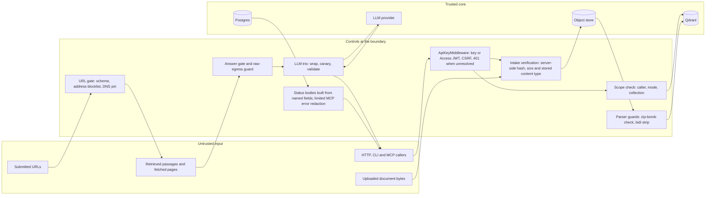

# Security and data handling

[README](../README.md) · [Data flows](data-and-api.md) · [Reliability](reliability.md) · [Observability](observability.md)

This page describes what the code defends, where each defense sits and what it deliberately leaves to the deployment. Every statement here was checked against the module it cites. The controls have unit and contract tests behind them; this is not a penetration-test result, and the system is single-tenant by design.

Four kinds of input are treated as hostile: HTTP requests, document bytes, URLs that callers submit, and text that reaches a model (retrieved passages, fetched pages and the model's own output). Do not bypass a control to make an example work; the examples below show the refusals.

## Trust boundaries



Reading the diagram: a caller never reaches a store without passing the middleware; document bytes are re-measured by the server before they are trusted and checked again by the parsers; a URL is validated before any network call is made on its behalf; on the answer path, text reaches a model wrapped as data and, in the public modes, only after the compliance gate has allowed the evidence, and what the model returns is checked before the response is built. The same wrapper covers sterilization, tagging and the fetch and search tools. The build-time paths (the summary tree, synthetic smoke queries and the advanced-layer builders) call the model without the untrusted-text wrapper.

## Threat table

Source comments tag some controls with `F-NNN` identifiers. The F-ID column below defines every one of them, and a dash means the control has no identifier. Rows are grouped by where the threat enters.

| Threat | Where it enters | Defense | Module | F-ID |
| --- | --- | --- | --- | --- |
| A request reaches a protected handler with no resolved identity and is treated as an administrator | Any route behind the middleware, including a route added later without its own check | `identity_from_request` raises 401 `identity unresolved`; no code path supplies a default identity. With no key and no Access configuration at all, every non-exempt route answers 401 | [`api/auth.py`](../src/vo_rag/api/auth.py) | F-001 |
| Missing, wrong or unconfigured credential | `X-API-Key` header, Access JWT header or cookie | 401 `invalid_auth`, or a specific `cloudflare_access_*` error; keys are compared in constant time | [`api/middleware.py`](../src/vo_rag/api/middleware.py), [`api/auth.py`](../src/vo_rag/api/auth.py) | - |
| Cross-site request forgery on a browser session | POST, PUT, PATCH and DELETE authenticated through Cloudflare Access (cookie or header JWT) | HMAC token in `X-CSRF-Token`, bound to the user's email, valid for 8 hours; 403 `invalid_csrf_token` | [`api/middleware.py`](../src/vo_rag/api/middleware.py), [`api/auth.py`](../src/vo_rag/api/auth.py) | - |
| A scoped key used outside its grant | `/api/v1/query`, `/api/v1/answer` | `enforce_query_scope` returns 403 for a caller, mode or collection the key was not issued for | [`api/auth.py`](../src/vo_rag/api/auth.py) | - |
| Server-side request forgery: a submitted URL points at an internal service, for example Qdrant on a private mesh | URL intake over the API, CLI and MCP, and the agent fetch tools | `validate_external_url` rejects loopback, private, link-local, shared (CGNAT), multicast and reserved addresses, literal or resolved, before any request; a name that resolves to even one blocked address is refused | [`web/url_safety.py`](../src/vo_rag/web/url_safety.py) | F-014 |
| A non-HTTP URL scheme, such as `ssh://`, reaches a tool that would connect out | Same entry points | Scheme allowlist of `http` and `https`; the tree contains no `git clone`, so the allowlist is the control for any consumer that adds one | [`web/url_safety.py`](../src/vo_rag/web/url_safety.py) | F-010 |
| DNS rebinding: a name resolves to a public address when checked and a private one when connected | Fetch tools that act on a validated URL | On the default path the connection dials the address that was validated, not a fresh lookup, while the URL keeps its hostname for TLS. A caller that injects its own `fetch` callable or `http_client` into the tools bypasses the pinned transport | [`web/pinned_http.py`](../src/vo_rag/web/pinned_http.py), [`agents/extraction.py`](../src/vo_rag/integrations/llamaindex/agents/extraction.py) | F-048 |
| A public URL redirects to a private address | Fetch tools | The shipped fetch tools never follow redirects; a 3xx response is raised as an error, so no second address is ever dialed | [`agents/extraction.py`](../src/vo_rag/integrations/llamaindex/agents/extraction.py), [`agents/tools/web_search.py`](../src/vo_rag/integrations/llamaindex/agents/tools/web_search.py) | F-049 |
| Prompt injection: instructions hidden in a book, page or OCR error | Model calls routed through the protected wrapper: answers, sterilization, tagging, and the fetch and search tools. Build-time calls (summary tree, synthetic smoke queries, advanced-layer builders) do not use it | Wrap the text as data, plant a per-call canary, validate the output; a high-confidence signal marks the result for quarantine | [`core/llm/protected.py`](../src/vo_rag/core/llm/protected.py), [`untrusted.py`](../src/vo_rag/core/llm/untrusted.py), [`output_validator.py`](../src/vo_rag/core/llm/output_validator.py) | F-012 |
| Data leaves through a link or an external citation in model output | `/api/v1/answer` | `allowed_domains=[]` is a literal at the synthesis call site, so any URL in a draft is a signal; drafts cite internal chunk IDs; `context_scope` defaults to `sterile`, so raw text is not sent unless asked for | [`core/answer/synthesizer.py`](../src/vo_rag/core/answer/synthesizer.py), [`api/schemas.py`](../src/vo_rag/api/schemas.py) | F-045 |
| The sterile rewrite reproduces the author's words | Sterilization output | Verbatim budget: the longest copied run is at most 100 characters and runs of 15 or more characters hold at most 15% of the text; a breach fails the step | [`core/compliance/sterilizer.py`](../src/vo_rag/core/compliance/sterilizer.py) | F-029 |
| Unvetted content is treated as trusted by default | Any new artifact or pipeline output | `trust_level` defaults to `quarantined`; a caller must opt in to `trusted` | [`core/models/artifact.py`](../src/vo_rag/core/models/artifact.py) | F-031 |
| Hidden text-direction controls make extracted text read differently from its bytes (Trojan-source style) | PDF and OCR text | Nine bidi embedding, override and isolate code points are stripped during normalization | [`core/parsing/text_normalization.py`](../src/vo_rag/core/parsing/text_normalization.py) | F-099 |
| A decompression bomb inside an EPUB | File upload, then parse | The central directory is checked before any member is read: more than 2 GiB declared in total, or a member over 100 MiB that expands more than 200 times, fails the book | [`core/parsing/parsers/epub.py`](../src/vo_rag/core/parsing/parsers/epub.py) | - |
| A client lies about the file it uploaded | `POST /api/v1/intake` | The server re-reads the stored object, computes the hash and checks the size and the stored content-type metadata (which the client chose when it requested the upload URL; bytes are not sniffed); client values are assertions only. See [ingestion](ingestion.md#intake-surfaces) | [`core/ingest/object_verification.py`](../src/vo_rag/core/ingest/object_verification.py) | - |
| A hostile filename traverses the object store | `POST /api/v1/intake/upload-url` | Path components and leading dots are stripped; the key is `intake/<ULID>/<name>` | [`api/utils.py`](../src/vo_rag/api/utils.py) | - |
| Credentials appear in a status page, an admin page or a tool error | `/status`, `/api/v1/admin/status`, MCP tool errors, `vo-rag config show` | `/status` and `/api/v1/admin/status` are safe because their bodies are built from named attributes, never from a dump of settings; nothing masks them afterwards. `mask_secrets` is used only by `vo-rag config show`. MCP errors pass through `redact_error_message`, which removes stack traces, `user:pass@` URLs, `key=value` secrets and paths ending in `.py`, and masks credentials only in the `sk-`, `*_live_`, `AKIA`, `xox*` and `ghp_` formats | [`api/routes/system.py`](../src/vo_rag/api/routes/system.py), [`api/utils.py`](../src/vo_rag/api/utils.py), [`mcp/errors.py`](../src/vo_rag/mcp/errors.py) | F-014 |
| Concurrent cloud launches each pass the budget check and together exceed it | Cloud workload launch | The check and the ledger insert run in one transaction under a single Postgres advisory lock | [`core/cloud/cost_tracker.py`](../src/vo_rag/core/cloud/cost_tracker.py) | F-018 |
| A retry duplicates points, or a source cannot be removed cleanly | Ingest retries, purge | Point IDs are SHA-256 of source, chunk index and stage, so a retry overwrites; the payload carries `source_id`, which `vo-rag corpus purge` filters on | [`core/idempotency.py`](../src/vo_rag/core/idempotency.py), [`core/storage/qdrant.py`](../src/vo_rag/core/storage/qdrant.py) | F-024 |
| A public-mode answer is composed without a rights decision | `/api/v1/answer` in `publication` or `partner` mode | Fail closed: 403 unless a gate is configured and returns an explicit allow. See [rights and compliance](rights-and-compliance.md#the-answer-compliance-gate) | [`api/routes/answer.py`](../src/vo_rag/api/routes/answer.py) | - |
| Personal data or keys become Prometheus label values | Metric-emitting code that labels with user input | `assert_safe_labels` raises on an email address, SSN, phone number or API-key pattern | [`core/observability/metrics.py`](../src/vo_rag/core/observability/metrics.py) | - |

## Authentication

Every route passes through `ApiKeyMiddleware` except the paths in `EXEMPT_PATHS` and `OPTIONS` requests. The middleware tries credentials in a fixed order and stops at the first that resolves an identity.

1. **API key.** The `X-API-Key` header is compared in constant time against `VORAG_API_KEY` first and then against each entry of `VORAG_API_KEYS_JSON`.
2. **Cloudflare Access.** If no key matched, the `Cf-Access-Jwt-Assertion` header, or failing that the `CF_Authorization` cookie, is verified. A bad key together with a valid Access token therefore authenticates through Access.
3. **Neither.** The response is 401 `{"error": "invalid_auth"}`.

| Identity | How it is created | `caller` | Admin | Scope |
| --- | --- | --- | --- | --- |
| Legacy admin key | `VORAG_API_KEY` matches; the identity is named `legacy` | none | yes | None: `enforce_query_scope` returns immediately for an admin |
| Scoped key | An entry of `VORAG_API_KEYS_JSON` matches | Always set: the entry's `caller`, or its name when `caller` is absent; a value outside `api`, `cli`, `mcp`, `portal` becomes `api` | no | Optional lists of modes and collections |
| Access user | A verified JWT whose email is in `portal.allowed_emails` | `portal` | yes | None |

An example of `VORAG_API_KEYS_JSON`. It is a JSON object keyed by name, or an array of objects; `key` is required, and `allowed_modes` and `allowed_collections` are accepted as `modes` and `collections` too. Values are trimmed and lower-cased. Leave a list out and that dimension is unrestricted.

```json
{
  "partner-site": {
    "key": "<random secret>",
    "caller": "api",
    "modes": ["publication"],
    "collections": ["vo_rag_books_sterile_v1"]
  },
  "ops-cli": { "key": "<random secret>", "caller": "cli" }
}
```

Two behaviors surprise people.

- **Scopes guard retrieval only.** `enforce_query_scope` runs in the query and answer routes. Every other authenticated route (intake, status, the admin status page, catalog and book routes, figures, the portal session) needs a valid identity of any kind and does not look at scopes or `is_admin`. A scoped key limits what a caller can retrieve, not what else it can call. Issue keys accordingly.
- **Collections are compared after the mode remap.** In `publication` and `partner` mode a request for the raw book collection is rewritten to the sterile one before the check, so a key restricted to publication access must list the sterile collection names.

If `VORAG_API_KEYS_JSON` is not valid JSON, authenticating any key other than the legacy key raises while parsing and the request fails with a server error. No request is admitted by the failure.

### The `caller` label is not authorization

`X-VO-RAG-Caller` is an optional header that the routes read for audit and for the compliance gate. The rule in `_identify_caller` is: when the header is present it wins and is normalized (any value outside `api`, `cli`, `mcp` and `portal` becomes `api`); when it is absent the identity's caller is used; with neither, the caller is `api`.

What stops a client from claiming any label depends on the identity, because `enforce_query_scope` compares the header with the identity's bound caller:

| Identity | Header `mcp` sent | Header absent |
| --- | --- | --- |
| Legacy admin key (caller none) | Accepted; the audit row says `mcp` | `api` |
| Access user (admin, caller `portal`) | Accepted; the audit row says `mcp` | `portal` |
| Scoped key bound to `cli` | 403 `caller_not_allowed_for_api_key` | `cli` |

Every entry in `VORAG_API_KEYS_JSON` is bound, because the code sets `caller` to the entry's `caller` or, failing that, its name. Only the legacy key and Access users are free to claim a label. Even a bound caller is one of four coarse values, so use it as a hint for logging and routing and never as an authorization decision.

### Cloudflare Access and CSRF

The portal sits behind Cloudflare Access. `authenticate_cloudflare_access` needs three settings (`portal.access_team_domain`, `portal.access_aud` and a non-empty `portal.allowed_emails`); if a token arrives and any is missing the answer is 401 `cloudflare_access_not_configured`. With them set, the token must be an RS256 JWT whose key ID appears in the team's published key set (`<team domain>/cdn-cgi/access/certs`, cached in process for one hour), whose audience matches and whose issuer equals the team domain. The email claim must be in the allowlist, otherwise 401 `cloudflare_access_email_not_allowed`. The team domain is set with its scheme, for example `https://team.cloudflareaccess.com`, because the issuer comparison is literal.

A browser session authenticated by cookie is exposed to cross-site requests, so the middleware demands a CSRF token on `POST`, `PUT`, `PATCH` and `DELETE` whenever the identity came from Access, whether the JWT arrived in the cookie or in the header. API-key requests carry no ambient credential and are not subject to it. The token is `<issued_at>.<base64url HMAC-SHA256>` over `<email>:<issued_at>` keyed with `portal.csrf_secret`. `GET /api/v1/portal/session` mints it, and only for an Access identity when the secret is set. A token expires after 8 hours and is rejected if dated more than 60 seconds ahead. An empty secret rejects every mutating Access request, which is the safe direction to fail.

### Fail-closed behavior (F-001)

The middleware sets `request.state.vo_rag_api_identity`, and routes read it through `identity_from_request`. If the attribute is missing the function raises 401 and does not construct an identity. That makes a forgotten dependency or a middleware bug an outage and not an open door. A deployment with no keys configured behaves the same way: every non-exempt route answers 401.

An example of the refusal, with no credential sent:

```sh
$ curl -sS -w '\n%{http_code}\n' http://127.0.0.1:8000/status
{"error":"invalid_auth"}
401
```

Auth runs outside the request-logging middleware, so a 401 does not produce a `request` log line and carries no `X-Request-Id`. Watch for rejected credentials at the proxy if you need to alert on them.

### Probes and exemptions

`EXEMPT_PATHS` is `/health`, `/ready`, `/ready/query`, `/ready/intake`, `/metrics`, `/docs` and `/openapi.json`, matched exactly. They are open so that orchestrators and scrapers need no secret. Consequences to plan for: the readiness bodies name which backing services are down and expose the service error text, `/metrics` lists operational series, and `/docs` documents the whole surface. Bind the API to loopback (pass `--host 127.0.0.1` to uvicorn, as every command in these docs does; the `api.host` setting is not read) or put these paths behind the proxy's access rules before exposing the API.

| Path | Auth | Contract |
| --- | --- | --- |
| `/health` | none | Always 200 with `{"status":"ok","service":"vo-rag"}`. It touches no dependency, so a deployment with nothing configured still answers. The body is a minimal liveness contract for monitors |
| `/ready`, `/ready/query` | none | 200 when the database pool, Qdrant, the embedding service and the reranker are all healthy, otherwise 503 with the reasons. `/ready` is an alias kept for compatibility |
| `/ready/intake` | none | 200 when the database pool and a fresh dispatcher heartbeat are healthy, otherwise 503 |
| `/status`, `/api/v1/rag/status`, `/api/v1/admin/status` | required | Richer bodies: envelope counts, per-collection point counts, spend, the pipeline roster |

The richer body moved off `/health` because an unauthenticated route should reveal as little as a liveness check needs. An example of a failing `/ready/intake` body from the test app, with the database pool healthy and no dispatcher heartbeat file:

```json
{
  "ok": false,
  "surface": "intake",
  "services": {
    "db_pool": {"ok": true},
    "dispatcher": {"ok": false, "error": "not_configured"}
  },
  "reasons": ["dispatcher_unavailable: not_configured"]
}
```

The middleware also leaves `/webhooks/github/star` out of `EXEMPT_PATHS` on purpose. No such route exists in this tree. The omission means that if a webhook receiver is ever added it must authenticate like everything else, not inherit a bypass.

## URL safety

`validate_external_url` ([`web/url_safety.py`](../src/vo_rag/web/url_safety.py)) is the single chokepoint for any URL a caller supplies. `POST /api/v1/intake` runs it before the database insert, the CLI runs it locally before any HTTP call, the MCP ingest tool runs it before an envelope exists, and the two agent fetch tools run it and then apply a domain allowlist of their own. The stages are:

1. The scheme must be `http` or `https`, and the host must be non-empty.
2. A literal IP address is checked against the blocklist at once, which is what stops an attacker who already knows an internal address from relying on DNS.
3. A hostname is resolved (off the event loop, with `getaddrinfo`) and every returned address is checked. One blocked address refuses the name, because the client could pick either at connect time.
4. The first address is returned as `ResolvedURL.ip` for pinning.

The blocklist covers `127.0.0.0/8`, `10.0.0.0/8`, `172.16.0.0/12`, `192.168.0.0/16`, `169.254.0.0/16`, `100.64.0.0/10` (carrier-grade NAT, which includes Tailscale), `0.0.0.0/8`, multicast `224.0.0.0/4`, reserved `240.0.0.0/4`, and for IPv6 `::1`, `fc00::/7`, `fe80::/10`, `ff00::/8` and the unspecified address. An IPv4-mapped IPv6 address is unwrapped and checked as IPv4. Ranges not listed, for example `192.0.0.0/24` and `198.18.0.0/15`, are not blocked.

The F-014 case is the reason the gate exists: a submitted `http://localhost:6333/collections` would otherwise reach a Qdrant instance that is reachable from the API host. Two real refusals from the intake route:

```sh
$ curl -sS http://127.0.0.1:8000/api/v1/intake -H "X-API-Key: $VORAG_API_KEY" \
    -H "Content-Type: application/json" \
    -d '{"source_type":"url","source_data":{},"raw_content":{"url":"http://127.0.0.1:6333/collections"}}'
{"detail":"ssrf_blocked:IPv4 in blocked network 127.0.0.0/8"}
$ curl -sS http://127.0.0.1:8000/api/v1/intake -H "X-API-Key: $VORAG_API_KEY" \
    -H "Content-Type: application/json" \
    -d '{"source_type":"url","source_data":{},"raw_content":{"url":"ssh://git@example.com/repo.git"}}'
{"detail":"ssrf_blocked:scheme 'ssh' not in ['http', 'https']"}
```

Checking an address is not enough on its own, because a check and a connection are two lookups apart. **DNS pinning (F-048)**: `PinnedAsyncHTTPTransport` replaces the TCP dial so that a connection to `(host, port)` goes to the validated IP, while the request URL, the `Host` header and TLS server-name checking keep the hostname. A rebinding server can answer the second lookup however it likes; nothing performs a second lookup. **Redirects (F-049)**: a redirect is the other way to move a validated request to a new address. The shipped fetch tools set `follow_redirects=False`, so a 3xx response raises and no further address is dialed. `validate_external_url_sync` exists for a caller that wants to follow redirects itself and re-validate every hop, but nothing in this tree calls it.

Intake stores a `url` envelope after the check and nothing in this tree fetches it. The fetching code paths are the two agent tools, which accept only domains from an explicit allowlist and refuse an empty one.

## Prompt injection: wrap, canary, validate (F-012)

Retrieved passages and fetched pages are attacker-controllable. The full mechanism, with the three layers and the signal kinds, is in [retrieval and answers](retrieval-and-answers.md#the-injection-defense-trio). This section records the security reasoning and the reach.

- **Why the canary changes per call.** A fixed canary could be learned by a red-team fixture or an attacker who has seen one prompt. A fresh random token for every call means its appearance in an output proves the system prompt was copied out, and the call refuses any input that already contains it.
- **Why a closing tag is a hard refusal.** Content containing a literal `</document>` is trying to escape its fence. The call raises `UntrustedContentRejected` before the model sees anything, and the caller must not retry.
- **Why URLs are a signal.** An injected instruction can ask a model to encode data into a link. The answer path passes an empty allowlist as a literal, so every URL it emits is a signal.
- **Reach.** The wrapper is the only sanctioned path for these callers: answer synthesis, sterilization, domain tagging, the fetch and search agent tools, the LlamaIndex synthesizer and the answer evaluator. The MCP query, status and submit tools make no model call.
- **What a signal does.** A result with a signal at confidence 0.8 or higher is flagged for quarantine, `vo_rag_injection_suspected_total` and `vo_rag_injection_quarantined_total` are incremented, and the answer route returns the answer with `warnings` and `compliance.should_quarantine` set and records `prompt_injection_suspected` in `answer_log`. It does not withhold the answer; that decision belongs to the caller.
- **One declared kind is never raised.** `tool_call_not_whitelisted` exists in the signal vocabulary but `validate_output` does not emit it.

`/api/v1/answer` adds an egress guard of its own. If hosted answers are enabled and `answer.allow_raw_hosted_egress` is not, any request that resolves to a raw collection is refused with 403 `raw_context_hosted_egress_forbidden`, so raw book text cannot go to a hosted model by accident.

## Trust levels and quarantine by default (F-031)

`TrustLevel` has three values: `trusted`, `untrusted` and `quarantined`. The default on a new `KnowledgeArtifact` is `quarantined`. The comment on the field gives the reason: a pipeline author who forgets to set trust gets a safe artifact, not a trusted one, so trust is something a caller earns by running the compliance gate and asking for it.

Where the value comes from today:

- Book ingest writes its raw chunk points with `trust_level` set to `trusted` explicitly, because the helper that builds them defaults to `quarantined`. The artifact row is `trusted` in the default mode and `quarantined` while a generation is staging.
- The agent output helper returns `trusted` only when the injection check raised no quarantine signal and the answer used corpus evidence only. In every other case it returns `quarantined`.
- Web-derived extraction records are always written `quarantined`.

The level is a label stored with the artifact or in the point payload. No retrieval path filters on it; what keeps an unfinished or rejected ingest out of query results is the `ingest_state` filter (see [ingestion](ingestion.md#generations-and-leases)), and what keeps rights-restricted text out of public answers is the mode filter and the compliance gate. Treat `trust_level` as input to those decisions and as an audit trail.

## Secrets and redaction

**Where secrets live.** Credentials come from environment variables only (`.env.example` lists the names with empty values), and nothing in the repository holds a real one. Hosted answers, the vision model, source-publication writes and telemetry are all off in the template. Enabling one needs both the service configuration and a decision about what data may cross that boundary.

**Keeping them out of output.**

- `/status` and `/api/v1/rag/status` are assembled from named fields. The code never dumps `settings`, so a new setting cannot leak by being added. No masking helper runs over these bodies; the construction is the protection.
- `/api/v1/admin/status` reports the caller's name, caller, admin flag, auth source and email, and no key material.
- `mask_secrets` is used only by the CLI. It replaces the value of any field whose name contains `api_key`, `secret_key`, `access_key`, `webhook_secret`, `csrf_secret`, `password` or `token`. `vo-rag config show` applies it to the config file and prints the key itself as `***` plus its last four characters.
- MCP tool errors pass through `redact_error_message`: stack traces, `user:pass@` URLs, `key=value` pairs whose key ends in a secret-like name, and file paths ending in `.py` are replaced before the message reaches a client. Its credential pattern covers only the `sk-`, `*_live_`, `AKIA`, `xox*` and `ghp_` formats, so a token in another format or a path to a non-Python file is not masked. The original exception stays in the process log.
- LLM trace spans record the exception type and never its message, because structured-output errors embed the raw model response.

**Redaction levels.** `VORAG_REDACTION_LEVEL` selects what the `Redactor` replaces. An unknown value falls back to `standard`.

| Level | Replaced with a placeholder |
| --- | --- |
| `off` | Nothing |
| `standard` (default) | Email addresses, phone numbers, credit-card numbers that pass a Luhn check, US SSNs, API keys of common provider formats |
| `strict` | Everything in `standard`, plus IPv4 addresses and person names |

Person-name redaction needs the optional Presidio package; without it `strict` silently falls back to the pattern set and names are not replaced. In `redact_mapping`, values under `api_key`, `secret`, `token`, `authorization` and `password` keys (matched by name suffix, so `max_tokens` stays visible) are always replaced with `<REDACTED>`. That list is installed by `get_default_redactor()`; a bare `Redactor()` has an empty always-scrub list and replaces only the level's entities.

The redactor is applied in the places that persist or export model-adjacent text: the LlamaIndex chat store redacts every message on write, and the LlamaIndex bridge, when an application installs it, redacts exported callback payloads and span attributes. It is not applied to `query_log.query_text`, which stores the query as sent, or to the evidence returned by `/api/v1/query`. If queries can contain personal data, restrict access to the `query_log` table and handle retention yourself.

**Removing data.** Deterministic IDs make a source removable by a filter on its `source_id`, and `vo-rag corpus purge SOURCE_ID` does that across Qdrant and Postgres, as a dry run unless told otherwise. Purge is by source. A `pii_subjects` table and its helper functions exist for a reverse lookup from a subject hash to envelopes and points, but nothing in this tree writes to them, so there is no purge-by-data-subject workflow yet.

## Hostile files

Document bytes are checked twice: by the server at intake, and by the parsers.

- **Declared sizes of an EPUB are checked before anything is decompressed.** Every reader of an untrusted EPUB (the container check, normalization, the HTML reader, pandoc) inflates members in full, so the cheapest place to refuse a bomb is before the first read. The guard reads only the central directory, and because the member reader never returns more than a member's declared size, those declared sizes bound what any later read can produce. It fails the book when the declared total exceeds 2 GiB, or when a member over 100 MiB expands more than 200 times. Members of 100 MiB or less are not ratio-checked. See [parsing and chunking](parsing-and-chunking.md#epub-and-mobi) for where it sits in the parse step.
- **Bidi controls are removed from extracted text (F-099).** U+202A to U+202E and U+2066 to U+2069 survive Unicode normalization and make text display one way while the stored bytes say another. They have no legitimate use in extracted PDF or OCR text, so they are deleted before chunking.
- **Filenames and keys.** Upload names are reduced to a safe character set and live under a ULID-scoped key.

## Configuration and egress

The API binds to whatever `--host` you give uvicorn; the commands in these docs use loopback, and the `api.host` setting is not read. Credentials come from environment variables. Hosted answers, visual processing and source-publication writes are off in the environment template, and enabling one needs both the service configuration and a review of the data allowed to cross that boundary.

Source classifications and license-filtered retrieval are policy mechanisms. They do not establish legal permission to publish a source document; determine rights independently before adding a corpus or exposing outputs.

What the API deliberately does not do, so the deployment must:

- **Control network exposure.** Keep the bind on loopback or behind a proxy that applies access rules to the exempt paths. The embedding and inference workers have no authentication on any route, so keep them on a private network. The cost exporter binds `0.0.0.0` on port 9109, also without authentication.
- **Rate-limit and set CORS.** Neither is wired in. A query-hit table and helper exist for rate accounting but nothing calls them, and `api.cors_origins` is not read by any middleware. Apply both at the proxy.
- **Supply a compliance gate.** Publication and partner answers return 403 until you provide one.
- **Isolate tenants.** Caller labels, scoped keys and collection allowlists separate uses of one corpus. They are not tenant isolation.

## Test credentials

The repository contains no corpus, deployment configuration or credentials. The credentials and redaction canaries in the tests are synthetic.

## Where each piece lives

| Concern | Module |
| --- | --- |
| Keys, Access JWT, CSRF, scope checks | [`api/auth.py`](../src/vo_rag/api/auth.py) |
| Middleware, exempt paths, request logging | [`api/middleware.py`](../src/vo_rag/api/middleware.py) |
| Probes and status bodies | [`api/routes/system.py`](../src/vo_rag/api/routes/system.py) |
| URL gate and pinned transport | [`web/url_safety.py`](../src/vo_rag/web/url_safety.py), [`web/pinned_http.py`](../src/vo_rag/web/pinned_http.py) |
| Injection trio | [`core/llm/protected.py`](../src/vo_rag/core/llm/protected.py), [`untrusted.py`](../src/vo_rag/core/llm/untrusted.py), [`output_validator.py`](../src/vo_rag/core/llm/output_validator.py) |
| Redaction | [`core/observability/redaction.py`](../src/vo_rag/core/observability/redaction.py) |
| Security tests | [`tests/security`](../tests/security) |
